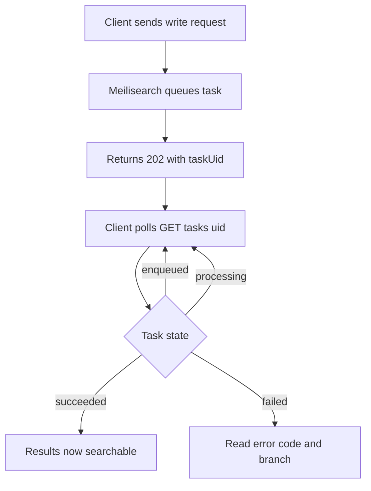

# The HTTP Contract: Status Codes, Error Payloads, and Idempotency

## English

Meilisearch's HTTP surface is deliberately small, and almost everything you do falls into one of two shapes: a synchronous read (search, get settings, get stats) that returns results directly, or an asynchronous write (add documents, change settings, delete an index) that returns a task object immediately. The write path is the one that trips people up. When you POST documents, you get back an HTTP 202 Accepted with a body containing a taskUid, not a 200 with your documents. That distinction is the API telling you the truth: the work has been queued, not done. The task then moves through states like enqueued, processing, succeeded, or failed, and you poll GET /tasks/:uid (or subscribe to webhooks) to find out what happened. A common beginner bug is treating a 202 as success and immediately searching for the new document; it isn't there yet, and that's not a bug, it's the contract.

The error model is equally worth internalising. Meilisearch returns structured JSON errors with a type, a code, a link, and a message. The type is the coarse category (invalid_request, internal, auth, system), the code is the stable machine-readable identifier you should branch on, and the message is for humans. You should never string-match on the message, because wording can change between versions; the code is the contract. A 400 with code invalid_search_filter means your filter expression is malformed; a 401 means your API key is missing or wrong; a 403 usually means the key exists but lacks an action or index scope; a 404 on a search endpoint usually means the index UID doesn't exist. Each of these deserves a different response in your client code.

Idempotency is a subtle area. Most write operations are naturally idempotent in effect because documents are keyed by primary key: re-adding the same document with the same primary key overwrites rather than duplicates, so retrying a failed batch is usually safe. But the task queue is not idempotent in the sense of deduplication: submitting the same batch twice creates two tasks, both of which run. This matters when your retry logic is naive. If a network timeout happens after the server received your POST, you don't know whether the task was created; retrying may create a duplicate task that overwrites your document with identical content (harmless) or, worse, a second task that races with a later update (not harmless). The pragmatic pattern is to make your documents carry a monotonic version field and let last-write-wins semantics do the work.

There's also a rate and payload dimension. The API has limits on document size and batch size, and exceeding them returns a 413 or a validation error rather than silently truncating. Reading the response headers and the error body together tells you whether you hit a hard limit or a soft one. In practice, a robust client wraps the HTTP layer in a small abstraction that classifies responses into (a) success with data, (b) accepted with task UID, (c) client error worth retrying with backoff, and (d) client error worth surfacing to the user. That four-way split covers almost every real failure you will encounter.

Finally, remember that the API is versioned by behaviour rather than by URL prefix in most deployments. That means upgrading the server can change subtle things like default values or which fields appear in responses. Pinning the server version and reading the changelog before upgrading is the boring but correct habit. The HTTP contract is stable and small, but it is not frozen, and treating it as a frozen thing is how you get surprised in production.

## 中文

Meilisearch 的 HTTP 介面刻意保持精簡，你幾乎所有操作都落入兩種形態之一：同步讀取（搜尋、取得設定、取得統計）直接回傳結果；非同步寫入（新增文件、更改設定、刪除索引）則立即回傳一個任務物件。真正容易令人出錯的是寫入路徑。當你 POST 文件時，收到的是 HTTP 202 Accepted 加一個內含 taskUid 的 body，而不是 200 加你的文件。這個區別正是 API 在告訴你真相：工作已被排入佇列，尚未完成。任務隨後會經歷 enqueued、processing、succeeded 或 failed 等狀態，你要輪詢 GET /tasks/:uid（或訂閱 webhook）才知道發生什麼事。新手常見的錯誤，是把 202 當成成功，然後立刻搜尋新文件；它還未出現，這不是 bug，而是契約。

錯誤模型同樣值得內化。Meilisearch 回傳結構化 JSON 錯誤，包含 type、code、link 與 message。type 是粗略分類（invalid_request、internal、auth、system），code 是穩定的機器可讀識別碼，你應該根據它分支處理；message 則給人看。你絕不應該對 message 做字串比對，因為措辭可能隨版本改變；code 才是契約。400 配 invalid_search_filter 表示你的過濾表達式格式有誤；401 表示 API key 缺失或錯誤；403 通常表示 key 存在但缺少某個 action 或索引範圍；搜尋端點上的 404 通常表示索引 UID 不存在。每個情況在你的客戶端程式碼中都應有不同的應對。

冪等性是個微妙地帶。大部分寫入操作在效果上天然冪等，因為文件以主鍵為鍵：用相同主鍵重新加入相同文件會覆寫而非重複，所以重試失敗的批次通常是安全的。但任務佇列在去重意義上並非冪等：同一批次提交兩次會建立兩個任務，兩者都會執行。當你的重試邏輯過於天真時，這就很要命。如果網路逾時發生在伺服器已收到你的 POST 之後，你不知道任務是否已建立；重試可能建立一個重複任務，用相同內容覆寫你的文件（無害），或者更糟，建立第二個任務與之後的更新競爭（有害）。務實的做法是讓文件攜帶單調遞增的版本欄位，讓後寫入勝出的語義替你完成工作。

還有速率與酬載的維度。API 對文件大小與批次大小設有限制，超過會回傳 413 或驗證錯誤，而不是默默截斷。同時閱讀回應標頭與錯誤 body，可告訴你撞到的是硬限制還是軟限制。實務上，穩健的客戶端會把 HTTP 層包進一個小抽象，將回應分類為：(a) 成功並帶資料、(b) 已接受並帶任務 UID、(c) 值得以退避重試的客戶端錯誤、(d) 值得向使用者呈現的客戶端錯誤。這個四分法幾乎涵蓋你遇到的所有真實故障。

最後，請記住 API 在多數部署中是靠行為而非 URL 前綴來版本化的。這意味著升級伺服器可能改變微妙之處，例如預設值或回應中出現哪些欄位。鎖定伺服器版本，並在升級前閱讀變更日誌，是沉悶但正確的習慣。HTTP 契約穩定且精簡，但並非凍結不變，把它當成凍結之物，就是你在生產環境被嚇到的原因。

## Key Takeaway

Treat a 202 with a taskUid as a promise, not a completion, and branch on error codes rather than error messages.

## Related Concepts
- Asynchronous task lifecycle
- HTTP error taxonomy

## Diagram

