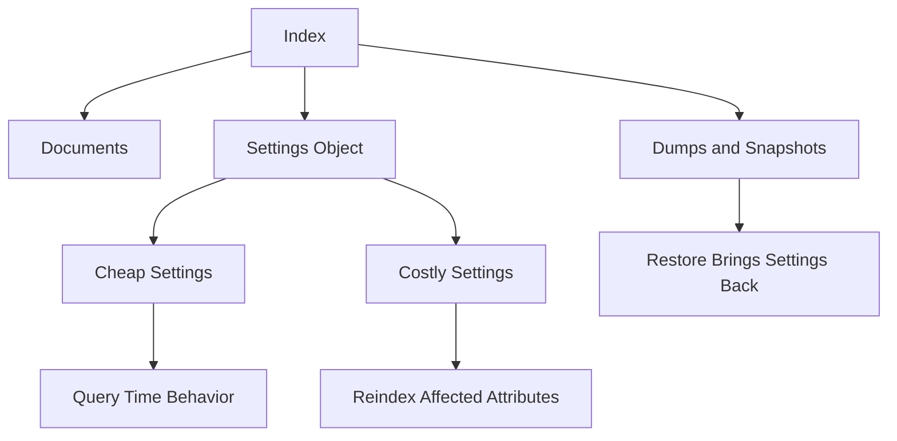

# Index Settings as a Versioned Configuration Object

## English

An index in Meilisearch is not just a bag of documents; it is a document store plus a settings object that governs how those documents are interpreted, ranked, and filtered. The settings object includes searchableAttributes, displayedAttributes, filterableAttributes, sortableAttributes, rankingRules, stopWords, synonyms, typoTolerance, and pagination limits, among others. The crucial mental model is that settings are part of the index's identity, not a per-query decoration. Two indexes with identical documents but different settings can return wildly different results for the same query, and neither is wrong; they are simply different search products built from the same corpus.

What makes settings interesting is that they have different costs. Changing displayedAttributes is cheap: it only affects which fields are returned in the response, and the engine can apply it at query time. Changing filterableAttributes or sortableAttributes is more expensive because the engine has to build or tear down auxiliary data structures on disk; this is why Meilisearch documents these as requiring a reindex of the affected attributes. Changing searchableAttributes can change tokenisation and ranking inputs, which is heavier still. Changing rankingRules, synonyms, or stopWords is comparatively cheap because it affects query-time behaviour rather than the stored representation. Knowing which bucket a setting falls into tells you whether you can flip it on a live index or should schedule it for a maintenance window.

Settings are also versioned in a practical sense: they are snapshotted with the index in dumps and snapshots, so a restore brings back the settings along with the documents. That is usually what you want, but it has a subtle consequence. If you restore a dump into a newer server version, the settings are interpreted under the new version's rules, which may have different defaults for fields the dump didn't explicitly set. The safe pattern is to treat your settings as code: keep them in a file in your repository, apply them with a script on deploy, and diff them before applying. The API even supports a reset-to-default operation per setting, which is useful when you want to undo an experiment without remembering what the default was.

A second subtlety is that settings changes are asynchronous, like document writes. You submit a settings update, get a task UID, and poll. During the transition, queries may see a partially applied configuration depending on which settings changed and how the engine sequences the work. For most settings this window is short, but for filterableAttributes on a large index it can be noticeable. If your application depends on a setting being live, gate the feature flag on the task succeeding rather than on the HTTP 202.

Finally, settings are the primary lever for evolving relevance without reindexing documents. You can add a synonym, adjust typo tolerance, or reorder ranking rules and see the effect on the next query. This makes settings a great place for A/B experiments, provided you keep a record of what you changed and why. A settings changelog in your repository, alongside the settings file itself, is the cheapest relevance documentation you will ever write.

## 中文

Meilisearch 中的索引不只是一堆文件；它是文件儲存加上一個設定物件，而該物件管轄這些文件如何被解讀、排名與過濾。設定物件包含 searchableAttributes、displayedAttributes、filterableAttributes、sortableAttributes、rankingRules、stopWords、synonyms、typoTolerance 以及分頁上限等。關鍵的心智模型是：設定是索引身分的一部分，而不是每次查詢的裝飾。兩個文件完全相同但設定不同的索引，對同一查詢可以回傳天差地遠的結果，而兩者都沒有錯；它們只是從同一語料庫建出的不同搜尋產品。

設定有趣之處在於成本各異。更改 displayedAttributes 很便宜：它只影響回應中回傳哪些欄位，引擎可在查詢時套用。更改 filterableAttributes 或 sortableAttributes 較貴，因為引擎必須在磁碟上建立或拆除輔助資料結構；這就是為何 Meilisearch 文件說明這些設定需要對受影響屬性重新索引。更改 searchableAttributes 可能改變分詞與排名輸入，負擔更重。更改 rankingRules、synonyms 或 stopWords 相對便宜，因為它影響查詢時行為而非儲存表示。知道某設定落入哪個桶，就能判斷你可以在線上索引直接切換，還是應安排維護窗口。

設定在實務意義上也是有版本的：它們會隨索引一起被快照進 dump 與 snapshot，所以還原時設定會連同文件一起回來。這通常是你要的，但有個微妙後果。若你把 dump 還原到較新的伺服器版本，設定會依新版本的規則解讀，而 dump 未明確設定的欄位可能有不同預設值。安全的模式是把設定當程式碼：存在儲存庫的檔案中，部署時用腳本套用，套用前先 diff。API 甚至支援逐項「重設為預設」操作，當你想撤銷實驗卻記不得預設值時很有用。

第二個微妙點是設定變更與文件寫入一樣是非同步的。你提交設定更新，取得任務 UID，然後輪詢。過渡期間，查詢可能看到部分套用的組態，取決於哪些設定變更以及引擎如何排序工作。對多數設定而言這個窗口很短，但對大型索引上的 filterableAttributes 可能明顯。若你的應用依賴某設定已生效，請以任務成功而非 HTTP 202 作為功能旗標的閘門。

最後，設定是無需重新索引文件即可演進相關性的主要槓桿。你可以新增同義詞、調整錯字容忍、或重排排名規則，並在下一次查詢看到效果。這使設定成為 A/B 實驗的好場所，前提是你記錄改了什麼與為什麼。在儲存庫中與設定檔並存的設定變更日誌，是你寫過最便宜的相關性文件。

## Key Takeaway

Settings are versioned configuration, not per-query options; know which ones are cheap to change live and keep them under version control.

## Related Concepts
- Index settings cost model
- Configuration as code

## Diagram

