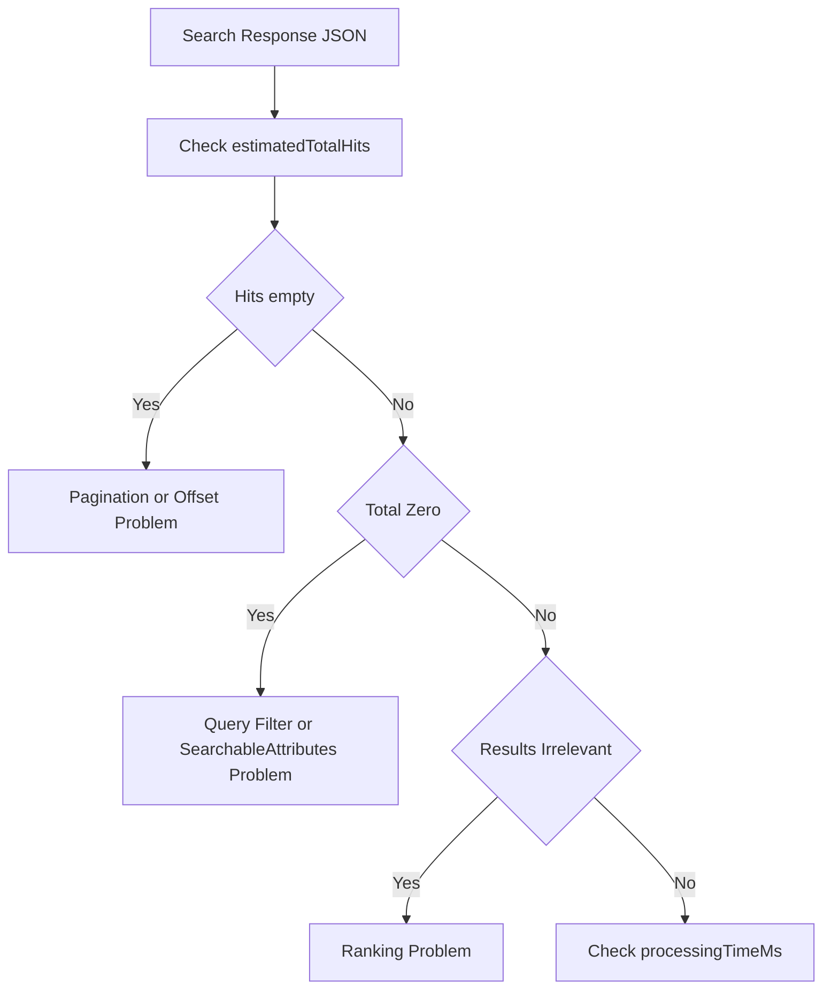

# The Search Response as a Debugging Instrument

## English

The JSON returned by a search request is richer than most people realise, and reading it carefully turns debugging from guesswork into diagnosis. Beyond the hits array, the response includes estimatedTotalHits (or totalHits depending on pagination mode), processingTimeMs, query, and per-hit metadata such as _formatted and _matchesPosition. Each of these is a signal about what the engine actually did, and each can answer a specific question you might have when results look wrong.

Start with estimatedTotalHits versus the length of hits. If estimatedTotalHits is large but hits is empty, you have a pagination or offset problem, not a relevance problem. If estimatedTotalHits is zero, the engine found nothing matching your query after tokenisation, filtering, and typo tolerance, which points you toward the query string, the filter expression, or the searchableAttributes configuration. If estimatedTotalHits is small but non-zero and the results look irrelevant, the problem is ranking, not recall, and you should look at rankingRules and searchableAttributes order. This three-way split (empty, truncated, misranked) covers most real-world complaints and tells you which subsystem to investigate.

processingTimeMs is a coarse but honest signal. A query that takes tens of milliseconds is normal; a query that takes hundreds suggests either a very large candidate set, an expensive filter, or a sort on an attribute that isn't optimised. Comparing processingTimeMs across query variations is a cheap way to find the expensive part of your query. If adding a filter triples the time, the filter is the suspect; if adding a sort does, the sortable attribute is. The engine won't tell you why, but it will tell you that something changed, and that's enough to bisect.

The _formatted field is the unsung hero of debugging. It shows each hit with the matched terms wrapped in highlight tags and the surrounding context cropped according to your crop settings. If a document appears in results but _formatted shows no highlighted terms, the match came from somewhere unexpected, possibly a field you forgot was searchable, or a synonym, or a prefix match that highlighted a different token than you assumed. Reading _formatted is often faster than reading your settings file. Similarly, _matchesPosition tells you exactly which character offsets in which attributes matched, which is invaluable when you suspect tokenisation is doing something surprising with punctuation or non-Latin scripts.

Finally, remember that the response reflects the query after all transformations: typo tolerance may have widened the match, synonyms may have expanded it, and stop words may have been dropped. A hit that seems inexplicable is usually explicable once you reconstruct those steps. The practical habit is to log the full response for a sample of queries, not just the hits, and to build a small internal tool that shows the response side by side with the query. Debugging search without the response is like debugging code without a stack trace: possible, but needlessly hard.

## 中文

搜尋請求回傳的 JSON 比多數人以為的更豐富，仔細閱讀它能把除錯從猜測變成診斷。除了 hits 陣列，回應還包含 estimatedTotalHits（或依分頁模式為 totalHits）、processingTimeMs、query，以及每筆結果的中繼資料如 _formatted 與 _matchesPosition。每一項都是引擎實際做了什麼的訊號，也能回答你結果看起來不對時的特定問題。

先從 estimatedTotalHits 與 hits 長度之間的關係入手。若 estimatedTotalHits 很大但 hits 為空，你面對的是分頁或 offset 問題，不是相關性問題。若 estimatedTotalHits 為零，引擎在分詞、過濾與錯字容忍之後什麼都沒找到，這指向查詢字串、過濾表達式或 searchableAttributes 組態。若 estimatedTotalHits 很小但非零且結果看似不相關，問題在排名而非召回，你應檢視 rankingRules 與 searchableAttributes 順序。這個三分法（空、被截斷、排名錯）涵蓋多數真實世界的抱怨，並告訴你該調查哪個子系統。

processingTimeMs 是粗略但誠實的訊號。數十毫秒的查詢很正常；數百毫秒則暗示候選集極大、過濾昂貴，或在未最佳化的屬性上排序。跨查詢變體比較 processingTimeMs 是找出查詢昂貴部分的便宜方法。若加一個過濾使時間變三倍，過濾就是嫌疑犯；若加排序才是，則 sortable 屬性有嫌疑。引擎不會告訴你原因，但會告訴你某事物改變了，這足以讓你二分搜尋。

_formatted 欄位是除錯的無名英雄。它顯示每筆結果，並依你的 crop 設定把匹配詞以高亮標籤包起、把周遭上下文裁切。若某文件出現在結果中但 _formatted 沒有高亮詞，匹配來自意料之外的地方，可能是你忘了設為可搜尋的欄位、同義詞，或前綴匹配高亮了與你想像不同的詞元。讀 _formatted 往往比讀設定檔快。同樣地，_matchesPosition 精確告訴你哪些屬性中的哪些字元位移匹配，當你懷疑分詞對標點或非拉丁文字做了意外之事時，這價值連城。

最後，請記住回應反映的是所有轉換之後的查詢：錯字容忍可能放寬了匹配，同義詞可能擴展了它，停用詞可能被丟棄。一筆看似無法解釋的結果，一旦你重建這些步驟通常就能解釋。務實的習慣是為樣本查詢記錄完整回應而非只有 hits，並建立一個小內部工具把回應與查詢並排顯示。沒有回應就除錯搜尋，就像沒有堆疊追蹤就除錯程式碼：可行，但沒必要地困難。

## Key Takeaway

Read estimatedTotalHits, processingTimeMs, _formatted, and _matchesPosition together to tell recall problems apart from ranking problems.

## Related Concepts
- Search response fields
- Relevance debugging workflow

## Diagram

