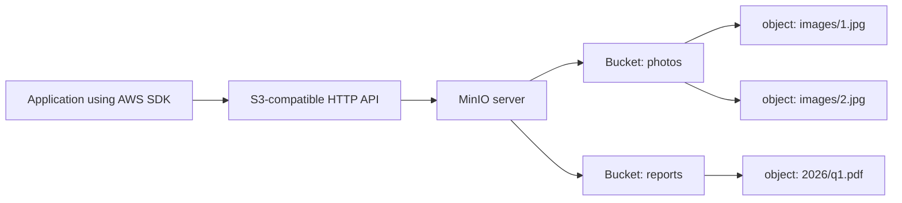

# Object Storage and the S3-Compatible API

### English

Object storage is a way of storing data as a collection of named blobs rather than as files inside folders. Each blob — an object — has a key (its full path-like name), some metadata, and a payload. There is no real directory tree: the "folders" you see are just prefixes that happen to contain a slash character. This design differs fundamentally from a traditional filesystem, where files live on a disk that is mounted and managed by the operating system.

A **bucket** is the top-level container for objects, and **object storage** became a standard service through Amazon S3. Because S3 became so widely adopted, most object storage systems now copy its API (application programming interface) exactly. **S3-compatible** means a system exposes the same HTTP endpoints, request formats, and authentication styles as Amazon S3. MinIO is an S3-compatible object store: you can point an AWS SDK, `aws s3` command line tool, or a backup utility at MinIO and change only the endpoint URL and the credentials.

This matters because S3 compatibility decouples your application from a single vendor. An application written against the S3 API keeps working if you move from a cloud provider's bucket to a MinIO server running on your own machines. The API is the contract; the storage underneath is interchangeable. In practice this is what makes MinIO useful for on-premises deployments, for AI and analytics workloads where data volumes are huge, and for keeping sensitive data inside a network boundary while using the same code that would otherwise call a public cloud.

### 中文

物件儲存（object storage）是一種把資料存成一堆「具名二進位 blob」的方式，而不是把檔案放進資料夾。每個 blob 是一個「物件」（object），擁有一個鍵（key，即完整的路徑式名稱）、一些中繼資料（metadata）同實際內容。當中並不存在真正的目錄樹：你看到的「資料夾」，其實只是鍵名裡剛好含有斜線的前綴而已。這種設計與傳統檔案系統根本不同 —— 後者的檔案放在作業系統掛載並管理的磁碟上。

一個 **bucket**（儲存桶）是物件的頂層容器，而物件儲存之所以成為標準服務，是因為 Amazon S3。由於 S3 被廣泛採用，現時大部分物件儲存系統都會完整複製它的 API（應用程式介面）。所謂 **S3-compatible**，即是指系統提供與 Amazon S3 相同的 HTTP 端點、請求格式與認證方式。MinIO 正是一個 S3 相容的物件儲存系統：你可以將 AWS SDK、`aws s3` 命令列工具或者備份程式指向 MinIO，只需改動端點網址同憑證。

S3 相容性的意義在於，它把應用程式與單一雲廠商脫鈎。以 S3 API 寫成的程式，即使你由雲端 bucket 搬遷到自建機房內的 MinIO 伺服器，依然可以正常運作。API 才是契約，底層的儲存則可隨時更換。這正是 MinIO 適合本地部署、適合數據量龐大的 AI 與分析工作負載，以及讓敏感數據留在網絡邊界內同時沿用同一套雲端程式碼的原因。

## Key Takeaway
MinIO speaks the S3 API, so any S3-aware application can swap a cloud endpoint for a self-hosted MinIO server without changing its code.

## Related Concepts
- Object Storage
- S3 API Compatibility
- Buckets and Keys

## Diagram

