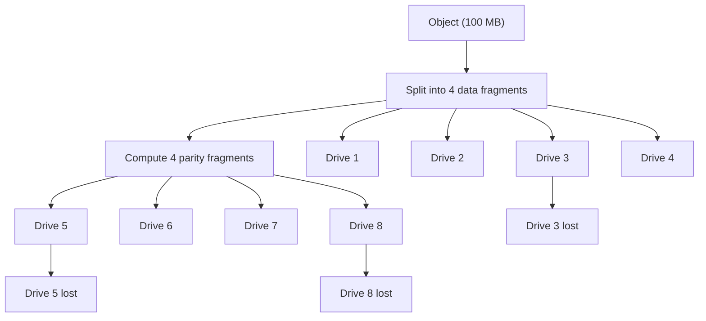

# Erasure Coding: Redundancy Without Triple Storage Cost

### English

**Erasure coding** is a way of adding redundancy to stored data by splitting it into fragments and storing those fragments across different drives, so that the data survives the loss of some drives. It is the storage equivalent of RAID but far more efficient. Traditional replication — making three full copies of every object — needs three times the raw disk space and three times the network traffic to write. Erasure coding might store an object across ten drives and only need eleven drives in total, while still being able to reconstruct the object if three of them fail.

The core idea is that the object is chopped into data fragments and then extra **parity** fragments are computed from them. The parity fragment is not a copy of the data; it is a mathematical summary that lets you rebuild missing pieces. In a common configuration, one object is split into four data fragments plus four parity fragments across eight drives. Any four drives can be lost and the object can still be fully reconstructed, because four fragments are always sufficient to recover the original.

MinIO is built around this model. Its storage layer groups drives into **drive sets**, and each object is placed using the erasure coding scheme across that set. The rule of thumb is that MinIO tolerates losing up to half the drives in a set before data becomes unavailable. When you deploy in "distributed" mode, several MinIO nodes together form a pool of drives that is treated as one logical storage system.

The practical trade-off is compute cost and rebuild time. Recalculating parity is CPU work, and repairing a degraded set means reading and rewriting many fragments — which takes time and adds I/O load. So operators generally keep spare capacity and monitor drive health closely. Erasure coding therefore sits between no redundancy at all and full replication, giving a much better balance of cost, durability, and read performance for the very large datasets typical of object storage.

### 中文

**糾刪碼**（erasure coding）是一種為儲存資料加入冗餘（redundancy）的方法：把資料切成碎片，分散儲存在不同硬碟上，即使部分硬碟損壞，資料仍然存在。它是儲存界的 RAID，但效率高得多。傳統複製（replication）—— 每個物件保留三份完整副本 —— 需要三倍原始空間，寫入時亦要三倍網絡流量。糾刪碼可以把一個物件分散存到十個硬碟，而總共只需十一個硬碟，卻能在其中三個損壞時還原資料。

原理是把物件切成數據碎片（data fragments），再由它們計算出額外的**校驗碎片**（parity fragments）。校驗碎片並非資料副本，而是一份數學摘要，可用來重建遺失的部分。常見配置是把一個物件分成四個數據碎片加四個校驗碎片，存放在八個硬碟上。任何四個硬碟損壞，物件仍可完整還原，因為四個碎片永遠足以重組原檔。

MinIO 正是建基於這個模型。它的儲存層把硬碟組成 **drive sets**，每個物件以糾刪碼方式橫跨該組放置。一般原則是：MinIO 可承受損失一個 drive set 內一半硬碟，資料仍然可用；當你以「分散式」模式部署時，多個 MinIO 節點共同組成一個硬碟池，被視為單一的邏輯儲存系統。

實際取捨在於運算成本與重建時間。重新計算校驗是 CPU 工作，修復降級中的 drive set 意味著讀寫大量碎片，耗時並增加 I/O 負擔。因此營運者通常預留多餘容量，並密切監察硬碟健康狀況。總結而言，糾刮碼在「完全冇冗餘」與「完整複製」之間取得平衡，為物件儲存常見的超大數據集提供更佳的成本、耐久度與讀取效能取捨。

## Key Takeaway
Erasure coding protects object data from drive failures at a fraction of the storage cost of full replication, at the price of CPU work and slower repair.

## Related Concepts
- Erasure Coding
- Parity Fragments
- Drive Sets and Distributed Mode

## Diagram

