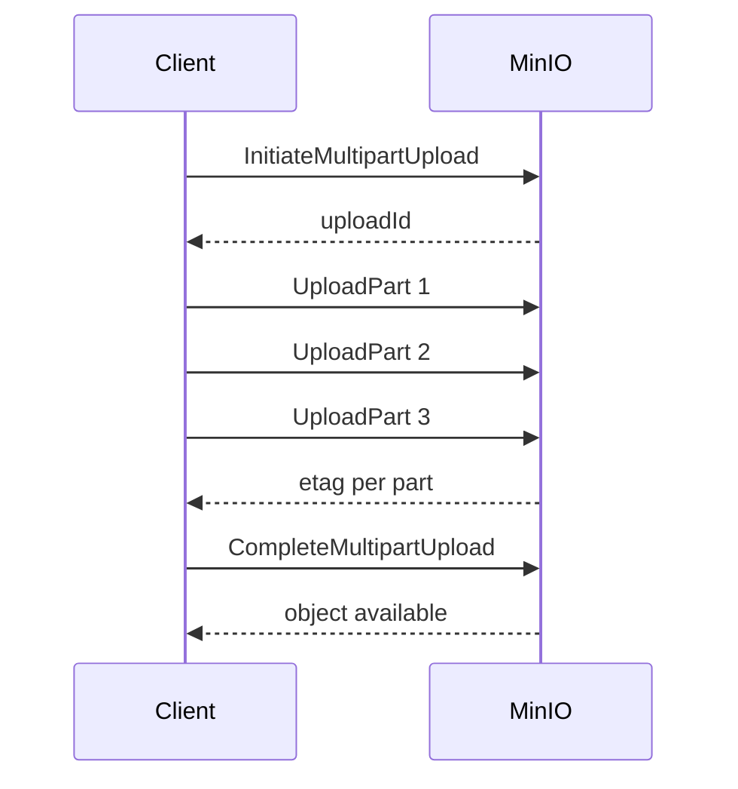

# Multipart Upload and Lifecycle Policies

### English

**Multipart upload** is the standard way to move a large object into object storage. Instead of sending one enormous request, the client splits the file into chunks — parts — and uploads each part separately, then calls "complete multipart upload" to stitch them together. S3-compatible systems, MinIO included, typically require parts to be at least 5 MB and no more than 5 GB, with up to 10,000 parts per object. Each part is uploaded in parallel, which saturates available network bandwidth far better than a single stream.

Multipart upload also makes uploads resumable. If your connection drops at part 40 of 100, the client only needs to re-send the missing parts, and it can query the server to find out which parts already landed. Uploads also have to be explicitly aborted; otherwise incomplete parts linger and consume space. Multipart is what you want for files that are too large to fit comfortably in memory, and for anything that must be uploaded over an unreliable network.

**Lifecycle policies** are rules that tell the storage system to manage objects automatically over time. A typical policy transitions objects to a cheaper storage class after a number of days, then expires and deletes them after a longer period. A practical rule: keep hot data in a fast tier for 30 days, move it to cold storage after that, and delete everything older than a year. MinIO also supports **object locking** (write-once-read-many retention, useful for compliance) and **replication** rules that copy objects to a remote MinIO or S3 bucket for disaster recovery.

Lifecycle management matters because object storage is cheap per gigabyte but grows without bound if nothing removes stale data — backups, logs, and intermediate build artefacts quietly consume a budget. Policies replace ad-hoc cron jobs with rules enforced by the storage layer itself.

### 中文

**分段上傳**（multipart upload）是將大型物件寫入物件儲存系統的標準做法。客戶端不會送出單一龐大請求，而是把檔案切成多段（parts）逐段上傳，最後呼叫「完成分段上傳」把它們合併。S3 相容系統（包括 MinIO）一般要求每段最少 5 MB、最多 5 GB，每個物件最多 10,000 段。各段可以並行上傳，比單一串流更有效率地用盡網絡頻寬。

分段上傳亦令上傳可以「續傳」。如果連線在第 40 段（共 100 段）時中斷，客戶端只需重傳缺失的段落，並可向伺服器查詢哪些分段已經寫入。此外，未完成的上傳必須被明確中止，否則殘留的段落會長期佔用空間。分段上傳適合體積大到無法舒適地放入記憶體的檔案，以及任何在不穩定網絡上進行的大檔傳輸。

**生命週期政策**（lifecycle policies）是讓儲存系統自動隨時間管理物件的規則。典型做法是：物件在若干日後轉移到較便宜的儲存類別（storage class），再過一段時間到期刪除。一條實用的規則是：熱資料在快速層保留 30 日，之後轉為冷儲存，超過一年的一律刪除。MinIO 亦支援**物件鎖定**（write-once-read-many 保留模式，適合合規審計）以及**複寫**規則，把物件複製到遠端的 MinIO 或 S3 bucket 作災難復原。

生命週期管理之所以重要，是因為物件儲存每 GB 雖然便宜，但若無人清理過期資料，容量會無上限增長 —— 備份、日誌、建置中間產物會悄悄吃掉預算。用政策取代即興的排程清理程式，等於把規則交回儲存層自己執行。

## Key Takeaway
Multipart upload makes large transfers fast and resumable, while lifecycle policies automatically move, expire, and replicate objects so storage does not grow without bound.

## Related Concepts
- Multipart Upload
- Lifecycle Policies
- Storage Classes
- Object Locking

## Diagram

