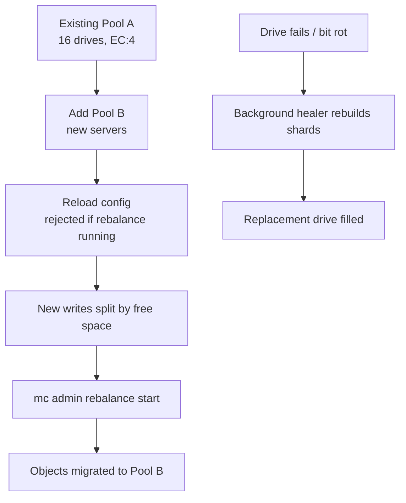

# Growing a Cluster: Server Pools, Erasure Sets, Rebalancing, and Healing

### English

A single MinIO server is easy but has no redundancy; a production cluster spreads data across many drives using **erasure coding**. The unit that matters is the **erasure set**: a fixed group of drives (typically 16 or 32) that together store one stripe of data plus parity. The cluster is then organised into one or more **server pools**, each pool containing its own erasure sets. A pool is the practical unit of capacity and failure domain: if one pool is lost entirely, the cluster stops serving I/O for *all* pools.

The consequence surprises people. You cannot simply bolt more disks onto an existing node. Expansion means adding a whole new pool of servers, and the new pool must match the erasure setting (`EC:M`) of the existing cluster — a cluster running `EC:4` requires the expansion pool to provide at least 4×2 drives per erasure set. The configuration is expressed as a version-2 YAML file with a `pools` list:

```yaml
version: v2
address: ":9000"
console-address: ":9001"
rootUser: "minioadmin"
rootPassword: "secret-CHANGE-ME"
pools:
- args:
  - "https://minio-{1...16}.example.net:9000/mnt/drive-{1...16}/minio"
- args:
  - "https://minio-{17...32}.example.net:9000/mnt/drive-{1...16}/minio"
```

After the reload, MinIO does **not** automatically shuffle existing objects across pools. Instead, new writes are distributed by free space: a pool receives a share of writes proportional to its free capacity relative to the whole cluster (3 TiB free out of 10 TiB total ⇒ roughly 30% of writes), and pools that would push a drive above 99% full or below a thousand free inodes are skipped entirely. That means the fastest way to use the new capacity is to trigger a rebalance yourself:

```bash
mc admin rebalance start myminio --dry-run   # preview the work
mc admin rebalance status myminio            # watch progress
mc admin rebalance stop myminio              # abort if needed
```

Rebalancing is I/O heavy and can run for hours on a large cluster, so plan it as a maintenance-window activity. It also refuses to start while another rebalance is running, and a configuration reload that adds a pool is *rejected* if a rebalance is in progress — a subtlety worth knowing because the reload command may still appear to succeed while the server logs the rejection.

Healing is a different mechanism and it is automatic. When a drive fails or silent **bit rot** (data corruption without a hardware error) is detected, MinIO reconstructs the missing shards from the surviving ones and writes them back to the replacement disk. Healing happens in the background, is triggered on every read and write of an affected object, and runs on a low-priority thread so it degrades gracefully under load. Within a single erasure set, only one drive is healed at a time, so a burst of failures takes longer but does not saturate the cluster. `mc admin heal` exists, but it is deprecated in favour of the automatic background healer — the right operational instinct is to monitor healing progress rather than to trigger it by hand.

The mental model to carry away: **pools are for growth, erasure sets are for redundancy, rebalance is for moving data, and healing is for repairing damage.** Conflating them is how operators end up with a cluster that is "expanded" but still 90% full on the original drives.

### 中文

單機 MinIO 容易架設，但完全沒有冗餘；生產環境要用**糾刪碼（erasure coding）**把資料分散到多隻磁碟。真正要理解的單位是**erasure set（糾刪集）**：一組固定數量的磁碟（通常 16 或 32 隻）一起存放一條資料帶加上同樣數目的校驗塊。叢集再組成一個或多個**server pool（伺服器池）**，每個 pool 內含自己的 erasure set。Pool 才是容量與故障域的實際單位：如果整個 pool 遺失，叢集會對**所有** pool 一齊停止 I/O。

這一點常令人意外。你不能單純在現有節點上再加磁碟。所謂擴充（expansion）意謂加入一整個新的 server pool，而新 pool 必須符合叢集既有的糾刪設定（`EC:M`）—— 叢集行 `EC:4`，新 pool 每個 erasure set 就要提供至少 4×2 隻磁碟。設定以 version 2 的 YAML 檔表達：

```yaml
version: v2
address: ":9000"
console-address: ":9001"
rootUser: "minioadmin"
rootPassword: "secret-CHANGE-ME"
pools:
- args:
  - "https://minio-{1...16}.example.net:9000/mnt/drive-{1...16}/minio"
- args:
  - "https://minio-{17...32}.example.net:9000/mnt/drive-{1...16}/minio"
```

重新載入之後，MinIO **不會**自動把既有物件搬遷到新 pool。相反，新寫入會按空閒空間比例分配：某 pool 的空閒容量佔全叢集的比例，就決定它分到多少寫入（10 TiB 總空閒中佔 3 TiB，即約 30%）；若某 pool 會令磁碟使用率超過 99%，或已知空閒 inode 少於一千個，該 pool 會被完全跳過。這代表要最快用盡新容量，就要自己觸發 rebalance：

```bash
mc admin rebalance start myminio --dry-run   # 預覽工作量
mc admin rebalance status myminio            # 觀察進度
mc admin rebalance stop myminio              # 需要時中止
```

Rebalance 極耗 I/O，在大型叢集上可以跑上數小時，應當作維護窗口的作業來規劃。另外，當另一個 rebalance 正在進行時，新增 pool 的設定重載會被**拒絕** —— 這個細節值得留意，因為重載指令在 shell 層面可能看似成功，真正被拒的訊息只出現在伺服器日誌裡。

Healing（修復）是另一套機制，而且全自動。當磁碟故障或偵測到無聲的 **bit rot**（沒有硬體錯誤訊號的資料損壞）時，MinIO 會由倖存的資料重建缺失的資料塊，寫回替換磁碟。修復在背景進行，受影響物件每次讀寫都會觸發，並且跑在低優先權的執行緒上，因此在負載高時會自動讓路。`mc admin heal` 指令雖然存在，但已被棄用，改由自動的背景修復器負責 —— 正確的運維反應是「監察修復進度」，而不是「手動叫它修」。

要帶走的核心模型是：**pool 負責擴容，erasure set 負責冗餘，rebalance 負責搬資料，healing 負責修損壞**。把四者混為一談，就會出現「已經擴容，但舊磁碟仍然用到九成」這種局面。

## Key Takeaway
Capacity grows by adding whole server pools that match the cluster's erasure setting, and data is moved onto the new capacity only by an explicit rebalance, while drive failures are repaired automatically by the background healer.

## Related Concepts
- Server Pools and Erasure Sets
- Expansion Constraints (EC:M parity matching)
- Rebalance and Write Distribution by Free Space
- Background Healing and Bit Rot

## Diagram

