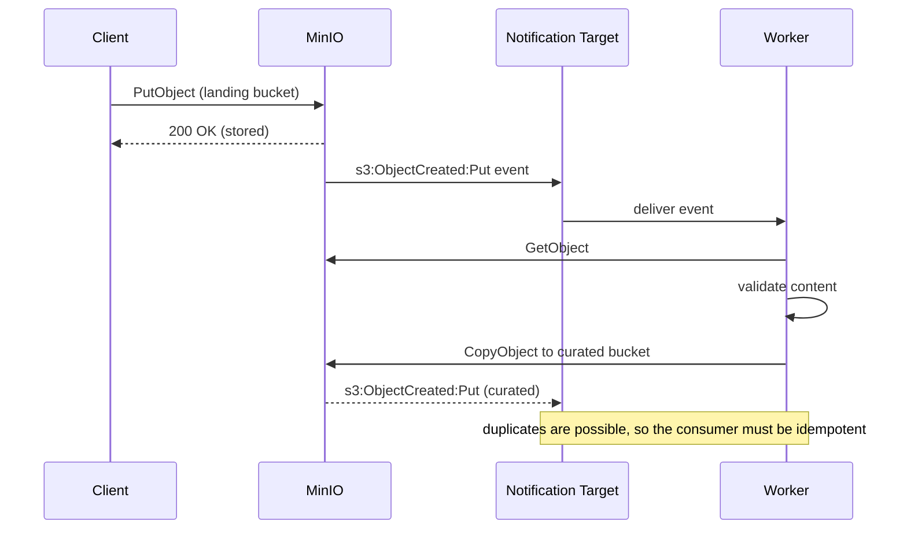

# Notifications, Webhooks, and Event-Driven Pipelines

### English

Storage systems rarely live alone. A file landing in a bucket usually needs to trigger something else: a data pipeline, a security scan, a CDN invalidation, a database row. MinIO exposes this through **bucket notifications**: a rule binds a set of event types to a *target*, and the server delivers a JSON event whenever a matching action occurs. Event types are prefixed by the S3 API family — `s3:ObjectCreated:*`, `s3:ObjectCreated:Put`, `s3:ObjectCreated:CompleteMultipartUpload`, `s3:ObjectRemoved:*`, `s3:ObjectAccessed:*` — and `s3:ObjectCreated:*` catches every creation flavour, including copies and multipart completions.

Targets come in three families. **Kinesis** and **Kafka** targets stream events into a durable log for high-volume pipelines. **AMQP / MQTT** targets deliver to message brokers for loose coupling. **Webhook** targets POST the event JSON to an HTTPS endpoint you control, which is the most flexible choice for a small team — you can point it at a Lambda, a CI webhook, or a small internal service. The older **ActiveMQ** and **Elasticsearch** targets still exist but are legacy.

```bash
# a webhook target
mc admin config set myminio notify_webhook:primary \
  endpoint="https://events.example.net/hooks/minio" \
  auth_token="${WEBHOOK_TOKEN}"

# a rule on a bucket
mc event add myminio/reports-prod arn:minio:sqs::primary:webhook \
  --event put,delete --prefix incoming/ --suffix .csv
```

Two design points are worth internalising. First, notifications are **asynchronous and best-effort by default**: the S3 operation returns success once the object is durably stored, and delivery to the target happens afterwards. If the target is down, events queue and are retried, but under sustained failure you will eventually see events dropped rather than the upload failing — which is the right trade-off for storage, but it means the *consumer* must be idempotent and must reconcile against the bucket rather than trust the event stream as the single source of truth. Second, the event payload contains only metadata (bucket, key, size, ETag, event name, timestamp) — it does not contain the object body, so the consumer fetches the object itself.

A common production pipeline therefore looks like: object lands in a *landing* bucket → notification fires → a consumer downloads and validates the object → on success it is copied to a *curated* bucket and a lifecycle rule eventually expires the landing copy. Note the ordering constraint: the consumer must verify the object before it is treated as authoritative, and because notifications can be duplicated, the copy step should be written to tolerate re-processing.

Notifications also work nicely with **replication**: replicate a bucket to a second site and attach notifications on both, so the consumer sees events from either side. For high-stakes pipelines, prefer Kafka or Kinesis over webhooks, because a message broker gives you consumer offsets and replay — if your consumer crashes halfway through, it can resume from the last committed offset instead of missing events entirely.

### 中文

儲存系統很少單獨存在。檔案落入 bucket 之後，通常要觸發其他事情：資料管線、安全掃描、CDN 快取失效、資料庫寫入。MinIO 透過 **bucket notification（桶通知）** 提供這個能力：一條規則把某幾種事件類型綁定到一個 *target*，當相符的操作發生時伺服器就送出一段 JSON 事件。事件類型以 S3 API 家族作前綴 —— `s3:ObjectCreated:*`、`s3:ObjectCreated:Put`、`s3:ObjectCreated:CompleteMultipartUpload`、`s3:ObjectRemoved:*`、`s3:ObjectAccessed:*` —— 而 `s3:ObjectCreated:*` 會涵蓋所有建立方式，包括複製與分段上傳完成。

Target 分三大類。**Kinesis** 與 **Kafka** 把事件串流到持久化訊息日誌，適合高流量管線；**AMQP / MQTT** 送到訊息代理，適合鬆耦合；**webhook** 則把事件 JSON POST 到你自控的 HTTPS 端點，對小型團隊最靈活 —— 可以指向 Lambda、CI webhook 或內部的小服務。較早的 **ActiveMQ** 與 **Elasticsearch** target 仍存在，但已屬舊式設計。

```bash
# 設定 webhook target
mc admin config set myminio notify_webhook:primary \
  endpoint="https://events.example.net/hooks/minio" \
  auth_token="${WEBHOOK_TOKEN}"

# 在 bucket 上加一條規則
mc event add myminio/reports-prod arn:minio:sqs::primary:webhook \
  --event put,delete --prefix incoming/ --suffix .csv
```

有兩個設計重點值得記住。第一，通知是**非同步而且預設為 best-effort**：S3 操作在物件持久化後就回傳成功，送往 target 的動作稍後才進行。若 target 當機，事件會排隊重試，但長時間故障下去，事件最終會被丟棄而不是令上傳失敗 —— 對儲存系統而言這是合理的取捨，但代表**消費端必須是冪等的（idempotent）**，並且要以 bucket 為準做對帳，而不能把事件流當成唯一事實來源。第二，事件內容只有中繼資料（bucket、key、大小、ETag、事件名稱、時間戳），並不含物件本身，所以消費端要自己再下載物件。

因此常見的生產管線是這樣：物件落入 *landing*（暫存）bucket → 通知觸發 → 消費端下載並驗證 → 驗證成功才複製到 *curated*（精選）bucket，並由生命週期規則最終過期暫存副本。這裡有個次序上的關鍵限制：消費端必須先驗證，該物件才可被視為可信；又因為通知可能重複投遞，複製步驟必須寫成可以容忍重複處理。

通知與**複寫（replication）**配合得好：在兩個站點的 bucket 都掛上通知，消費端無論從哪一邊都看得到事件。對關鍵管線，建議優先使用 Kafka 或 Kinesis 而非 webhook，因為訊息代理提供 consumer offset 與重播能力 —— 消費端中途崩潰時可以從最後提交的位置續做，而不是漏掉事件。

## Key Takeaway
MinIO bucket notifications turn object writes into an event stream, but because delivery is asynchronous and possibly duplicated, the consumer must be idempotent and verify objects before treating them as authoritative.

## Related Concepts
- Bucket Notifications and Event Types
- Webhook / Kafka / Kinesis Targets
- Idempotent Consumers and Event Replay
- Replication with Event-Driven Pipelines

## Diagram

