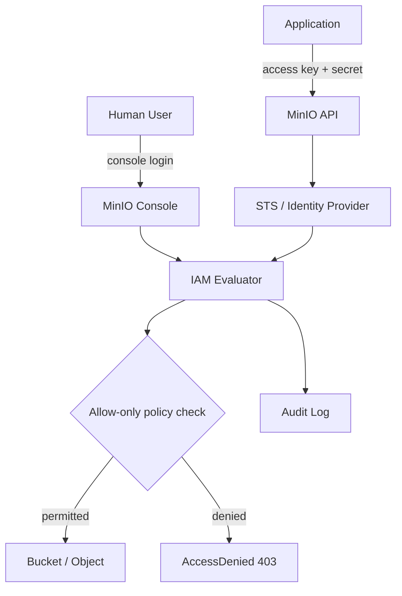

# Identity and Access Management: Users, Groups, Policies, and Service Accounts

### English

Object storage only becomes useful in production once *who* can do *what* is nailed down. MinIO therefore ships with its own IAM (Identity and Access Management) subsystem, modelled closely on AWS IAM: a **policy** is a JSON document listing allowed `Action`s on `Resource`s, optionally constrained by `Condition`s; a **user** or **group** is a principal that has policies attached; and requests are evaluated against the union of everything attached to the principal. The critical detail is that MinIO uses **Allow-only** semantics: nothing is permitted unless a policy explicitly grants it, so a fresh deployment is closed by default rather than open.

Policies are attached with the `mc` client. A typical minimum-privilege bucket policy looks like this:

```json
{
  "Version": "2012-10-17",
  "Statement": [
    {
      "Effect": "Allow",
      "Action": ["s3:GetObject", "s3:PutObject"],
      "Resource": ["arn:aws:s3:::reports-prod/reports/*"]
    }
  ]
}
```

Actions follow the familiar `s3:PutObject`, `s3:GetObject`, `s3:DeleteObject`, `s3:ListBucket` naming, but note that bucket-level actions (`s3:ListBucket`) and object-level actions (`s3:GetObject`) are *different resources* — a bucket ARN without a trailing `/*` covers the bucket itself, while `bucket/*` covers the objects inside it. Getting this wrong is one of the most common reasons a "working" policy still returns `AccessDenied`. Built-in policies such as `readonly`, `readwrite`, `consoleAdmin`, and `diagnostics` are starting points only; production deployments should write explicit statements.

Beyond human users, MinIO supports two more principal types that matter operationally. **Service accounts** are credentials created *under* a parent user or service account; they inherit the parent's policies unless explicitly restricted, and they can be given an inline policy or an expiry. They are the right way to let an application upload files without handing the application the parent account's own access key. **STS (Security Token Service)** issues temporary, short-lived credentials via `AssumeRole` or `AssumeRoleWithWebIdentity` (OIDC/JWT) or `AssumeRoleWithLDAPIdentity`, so that automated workloads never hold long-lived keys.

```bash
# create a user and attach a policy
mc admin user add myminio reports-svc
mc admin policy create myminio reports-rw reports-policy.json
mc admin policy attach myminio reports-rw --user reports-svc

# service account with a restricted inline policy
mc admin user svcacct add myminio reports-svc --policy reports-rw

# temporary credentials (LDAP identity)
mc admin user token myminio reports-svc
```

Two operational cautions. First, the root (owner) credentials are all-powerful and should only be used to bootstrap; rotate them with `mc admin user svcacct` or the console and store them in a secret manager. Second, MinIO's open-source community edition, licensed under AGPLv3, has been frozen and is no longer receiving new features or security patches — the commercially licensed AIStor line is the actively developed one. That matters for long-lived deployments because you are choosing where to place future security fixes, not merely where to place data today.

### 中文

要讓物件儲存真正投入生產環境，必須先講清楚「邊個可以做乜」。MinIO 內建自己的 IAM（Identity and Access Management，身分與存取管理）子系統，設計上與 AWS IAM 非常相近：**policy（策略）** 是一份 JSON 文件，列明允許哪些 `Action`（動作）、作用於哪些 `Resource`（資源），並可加上 `Condition`（條件）；**user** 或 **group**（群組）則是綁定了策略的主體。請求會與該主體身上所有已綁定的策略取聯集來判定。關鍵在於 MinIO 採用**只允許（Allow-only）**語意：沒有任何策略明確批准的操作一律禁止，所以全新部署預設是「鎖上」的，而不是敞開的。

策略用 `mc` 客戶端套用。一份最小權限的 bucket 策略通常長這樣：

```json
{
  "Version": "2012-10-17",
  "Statement": [
    {
      "Effect": "Allow",
      "Action": ["s3:GetObject", "s3:PutObject"],
      "Resource": ["arn:aws:s3:::reports-prod/reports/*"]
    }
  ]
}
```

動作名稱沿用大家熟悉的 `s3:PutObject`、`s3:GetObject`、`s3:DeleteObject`、`s3:ListBucket`。但要留意，bucket 層級的動作（`s3:ListBucket`）與物件層級的動作（`s3:GetObject`）對應的是**不同的資源** —— bucket ARN 尾端沒有 `/*` 代表桶本身，`bucket/*` 才代表桶內的物件。這一點搞錯，是很多「策略明明寫了」卻仍然收到 `AccessDenied` 的主因。內置策略如 `readonly`、`readwrite`、`consoleAdmin`、`diagnostics` 只適合用作起點；正式環境應該自己寫明確的 statement。

除了真人使用者，MinIO 還有兩種在運維上很關鍵的主體。**Service account（服務帳戶）**是在父使用者或服務帳戶之下建立的憑證，預設沿用父層的策略，亦可加上內聯策略或到期時間。讓應用程式上傳檔案時，正確做法是發一個 service account，而不是把使用者本身的 access key 交出來。**STS（Security Token Service）**則透過 `AssumeRole`、`AssumeRoleWithWebIdentity`（OIDC/JWT）或 `AssumeRoleWithLDAPIdentity` 發出短期憑證，令自動化工作負載完全不需要持有長期密鑰。

```bash
# 建立使用者並綁定策略
mc admin user add myminio reports-svc
mc admin policy create myminio reports-rw reports-policy.json
mc admin policy attach myminio reports-rw --user reports-svc

# 建立帶限制策略的服務帳戶
mc admin user svcacct add myminio reports-svc --policy reports-rw

# 取得臨時憑證（LDAP 身分）
mc admin user token myminio reports-svc
```

有兩點要小心。第一，root（owner）憑據無所不能，應該只用來做初始化，之後要輪換並存放於祕密管理工具。第二，MinIO 的開源社群版本（AGPLv3 授權）已經凍結，不再獲得新功能與安全修補 —— 仍在積極開發的是商業授權的 AIStor 系列。對長線部署而言，這個選擇決定的是「未來的安全修補放在哪裡」，而唔只是「今日資料放哪裡」。

## Key Takeaway
MinIO's allow-only IAM model, combined with scoped service accounts and short-lived STS credentials, turns "anyone can reach the bucket" into an auditable, least-privilege permission model.

## Related Concepts
- IAM Policies and ARN Formats
- Service Accounts and STS Temporary Credentials
- Root Credential Rotation
- MinIO OSS End-of-Life vs AIStor

## Diagram

