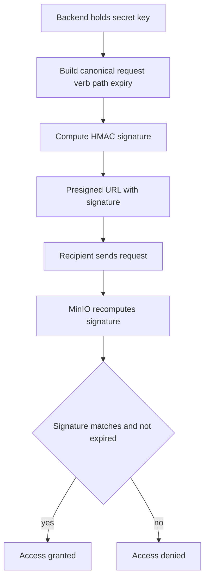

# Presigned URLs: Temporary, Signed Access Without Sharing Credentials

## English

A presigned URL is a URL that carries a cryptographic signature in its query string, letting anyone who holds the link perform one specific operation on one specific object for a limited time — without ever seeing your secret key. The server (or an SDK) takes the HTTP verb, the bucket and object path, an expiry timestamp, and your credentials, then computes an HMAC signature over that canonical request. Because the signature is derived from your secret key but does not reveal it, the link is safe to hand to a browser, a mobile app, or a third party. When the recipient makes the request, MinIO recomputes the signature from the same inputs plus its copy of the secret key; if they match and the clock has not passed the expiry, the request is allowed.

The most common use is the classic pattern: your backend holds the credentials, a user asks 'give me this file', and your backend responds with a presigned GET URL valid for, say, 15 minutes. The browser downloads directly from MinIO, so your application server never proxies gigabytes of traffic. The mirror pattern is presigned PUT (or POST) URLs for uploads: the client uploads straight to the bucket, and your server never touches the bytes. This is how many web apps handle large media without bloating their own bandwidth bill.

A few practical rules matter. Presigned URLs are bearer tokens — anyone with the link has the access, so treat them like passwords: short expiry, HTTPS only, and never log them in plaintext. Expiry is capped by MinIO's configured maximum (often 7 days by default for SigV4 presigning, though admins can lower it), and the URL is bound to the exact host, path, and headers used when signing — change the hostname from localhost to a public domain and the signature will no longer validate. If you use a reverse proxy in front of MinIO, make sure the public hostname is what was used to sign.

Presigned URLs also compose with policies: the signer's own permissions are what get delegated. A presigned URL signed by a user who can only read one bucket cannot be used to write elsewhere, and revoking that user's policy effectively kills new presigned URLs they would create (though already-issued ones remain valid until expiry). This makes presigned URLs a clean fit for 'share this file with a colleague for an hour' or 'let this CI job upload a build artifact' without minting new long-lived keys.

## 中文

預簽名 URL（presigned URL）係一條喺 query string 帶住密碼學簽名嘅網址，任何人攞住條 link，就可以喺限定時間內、對某一個特定物件做某一個特定操作 —— 而全程都唔會見到你嘅 secret key。伺服器（或者 SDK）會攞 HTTP 動詞、bucket 同 object 路徑、到期時間戳，再加你嘅憑證，計出一個覆蓋整條「標準化請求」嘅 HMAC 簽名。因為簽名係由 secret key 衍生出嚟、但唔會洩漏 secret key 本身，所以條 link 可以安全咁交畀瀏覽器、手機 app 或者第三方。對方發請求嗰陣，MinIO 會用同一組輸入加埋自己手上嗰份 secret key 重新計一次簽名；如果對得上、而且未過期，請求就放行。

最常見嘅用法就係經典模式：你嘅後端揸住憑證，使用者話「畀我攞呢個檔案」，後端就回一條有效 15 分鐘嘅預簽名 GET URL。瀏覽器直接由 MinIO 下載，你部應用伺服器完全唔使代理幾 GB 流量。反過嚟嘅模式就係用預簽名 PUT（或 POST）URL 做上載：客戶端直接上載去 bucket，你部伺服器一個 byte 都唔使掂。好多處理大型媒體嘅網站就係咁做，唔會搞到自己嘅頻寬爆錶。

有幾條實戰規矩要記住。預簽名 URL 本質上係 bearer token —— 邊個有條 link 就有嗰個許可權，所以要當佢係密碼咁對待：有效期要短、只行 HTTPS、千萬唔好將佢以明文寫入 log。有效期會受 MinIO 設定嘅上限限制（SigV4 預簽名通常預設最多 7 日，管理員可以調低），而且條 URL 係綁死喺簽名時用嘅 host、路徑同 header —— 你由 localhost 改成公開網域，簽名就唔會再透過驗證。如果你喺 MinIO 前面擺咗反向代理，就要確保簽名用嘅係公開嗰個 hostname。

預簽名 URL 亦會同策略（policy）疊加：被委派出去嘅，其實係簽名者自己嘅許可權。一個只可以讀某個 bucket 嘅使用者所簽嘅 URL，唔可以用嚟寫去第二度；而你撤銷咗嗰個使用者嘅策略，佢之後新簽嘅 URL 就即刻失效（不過已經發出咗嗰啲，喺到期前仍然有效）。所以預簽名 URL 好適合用嚟做「同同事分享呢個檔案一個鐘」或者「畀呢個 CI job 上載 build artifact」，唔使特登開多條長期金鑰。

## Key Takeaway

Presigned URLs delegate one scoped operation for a limited time via a signed link, so clients can read or write directly against MinIO without your server proxying bytes or exposing secret keys.

## Related Concepts
- HMAC request signing (SigV4)
- Bearer token security

## Diagram

