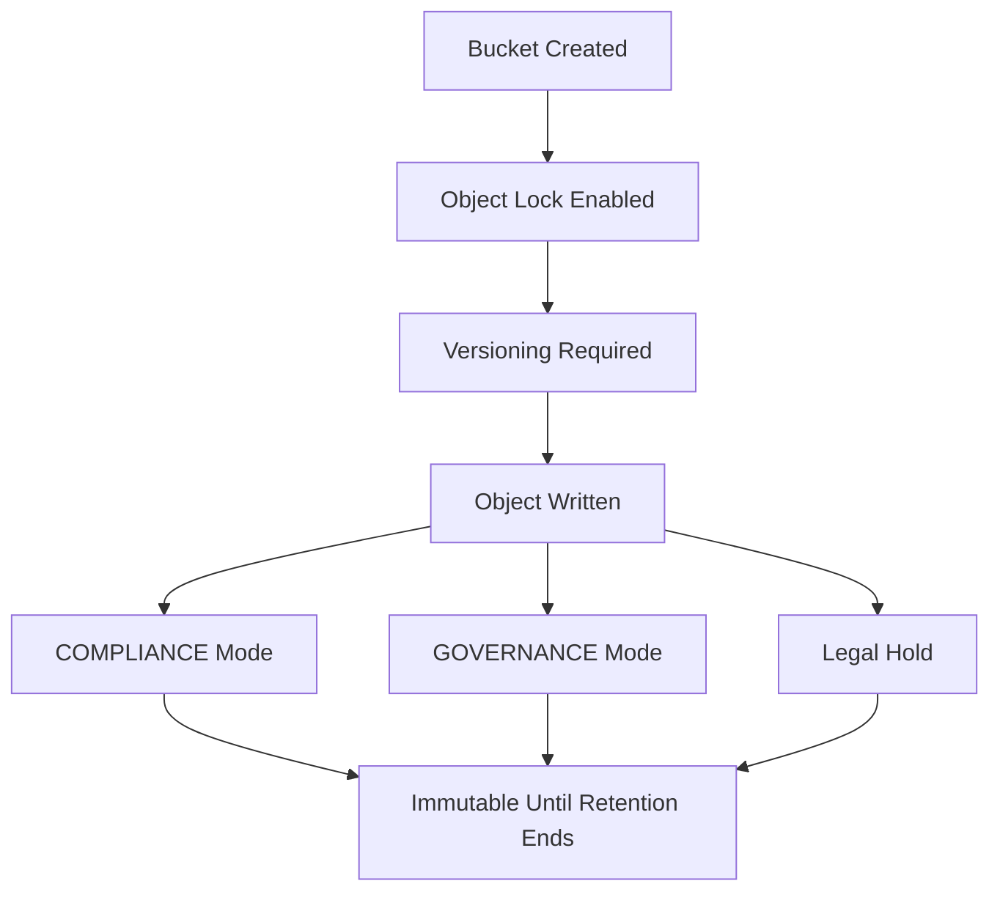

# Object Lock and Immutability: WORM Storage for Ransomware and Compliance

## English

Object Lock is a MinIO feature that makes objects immutable for a period of time or forever, implementing WORM (Write Once, Read Many) semantics. It is enabled per bucket at creation time — you cannot turn it on for an existing bucket — and it comes in two modes. In COMPLIANCE mode, nobody, not even the root account, can delete or overwrite an object before its retention date expires; this is the mode regulators typically want for financial or legal records. In GOVERNANCE mode, users with the special bypass permission can still delete or shorten retention, which is useful for operational flexibility but weaker against a determined insider.

Why does this matter? Ransomware operators increasingly target backups: if they can reach your object store with stolen credentials, they encrypt or delete the very copies you would restore from. Object Lock breaks that attack: even with valid credentials, an attacker cannot delete a locked object until the retention period lapses. Combined with versioning (which Object Lock requires), every overwrite creates a new version while the old one stays frozen, so you get a genuine 'undo' that no one can erase. A common design is a short retention on the live bucket and a longer, COMPLIANCE-locked retention on a replication target in a separate account or site.

There is also legal hold, a separate flag that pins an object indefinitely regardless of its retention date, until someone explicitly clears the hold. Legal hold is what you use during litigation or investigation: 'nobody touches these files until counsel says so.' Retention dates and legal holds are independent — an object with an expired retention date but an active legal hold still cannot be deleted. The two together give you both time-boxed and open-ended immutability.

Operationally, Object Lock forces you to think ahead. Because retention cannot be shortened in COMPLIANCE mode, a misconfigured lifecycle rule that sets a 10-year retention on a scratch bucket is effectively permanent — test on a throwaway bucket first. Also remember that Object Lock protects against deletion and overwrite, not against reads: if your policy lets an attacker read, they can still exfiltrate. Immutability is one layer; encryption at rest, least-privilege policies, and audit logging are the others. Used together, they turn an object store into a credible last line of defence for backups.

## 中文

Object Lock 係 MinIO 嘅一個功能，可以令物件喺一段時間內、甚至永久都唔可以改動，實現 WORM（Write Once, Read Many，寫一次、讀多次）語義。佢係喺建立 bucket 嗰陣逐個 bucket 開啟 —— 已經存在嘅 bucket 開唔返 —— 而且有兩種模式。COMPLIANCE 模式下，任何人都唔可以喺保留期屆滿前刪除或者覆蓋物件，連 root 帳戶都唔得；監管機構通常就係要呢種模式嚟保住財務或者法律紀錄。GOVERNANCE 模式下，擁有特殊 bypass 許可權嘅使用者仍然可以刪除或者縮短保留期，營運上比較有彈性，但對付心懷不軌嘅內部人就差啲。

點解呢樣嘢咁重要？勒索軟體集團越嚟越鍾意打備份嘅主意：如果佢哋用偷返嚟嘅憑證入到你嘅物件儲存，就會加密或者刪走你原本用嚟還原嘅嗰份副本。Object Lock 就係破解呢種攻擊：即使憑證有效，攻擊者喺保留期屆滿前都刪唔到鎖定咗嘅物件。配合版本控制（Object Lock 強制要求開啟版本控制），每次覆蓋都會產生新版本，舊版本就凍結喺度，等於有個冇人刪得走嘅「時光機」。常見設計係：線上 bucket 設短保留期，而喺另一個帳戶或者另一個站點嘅複製目標就設長啲、用 COMPLIANCE 鎖死嘅保留期。

另外仲有 legal hold（法律保留），係一個獨立嘅標記，唔理保留期幾時到期，都會無限期釘住個物件，直到有人明確解除為止。打官司或者調查期間就係用呢個：「律師未話 OK 之前，邊個都唔準掂呢啲檔案。」保留期同 legal hold 係互相獨立嘅 —— 一個物件保留期過咗、但 legal hold 仍然生效，一樣刪唔到。兩者加埋，就有咗有時限同無時限兩種不可變性。

營運上，Object Lock 逼你要諗遠一步。因為 COMPLIANCE 模式嘅保留期縮唔返，如果一條設錯咗嘅生命週期規則喺一個臨時 bucket 度設咗 10 年保留期，基本上就係永久 —— 所以一定要喺用完即棄嘅 bucket 度試清楚。仲要記住：Object Lock 防嘅係刪除同覆蓋，唔防讀取；如果你嘅策略容許攻擊者讀，佢哋一樣可以偷走資料。不可變性只係其中一層，靜態加密、最小許可權策略、審計日誌都係其他層。幾層加埋，先至可以令物件儲存成為備份嘅可靠最後防線。

## Key Takeaway

Object Lock provides WORM immutability in COMPLIANCE or GOVERNANCE mode plus legal hold, making backups undeletable even by attackers holding valid credentials — but it must be enabled at bucket creation and tested carefully.

## Related Concepts
- Ransomware-resistant backups
- Versioning and retention policies

## Diagram

