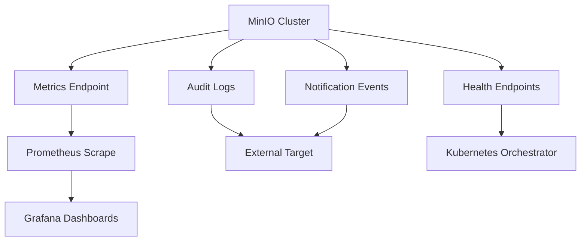

# Metrics, Audit Logs, and Health Endpoints: Operating MinIO Observably

## English

Running object storage without observability is like flying blind: you find out about problems when users complain. MinIO exposes a Prometheus-compatible metrics endpoint (commonly at /minio/v2/metrics/cluster on the server, plus per-node and per-bucket variants) that reports counters and gauges such as request rates, error rates by API, bytes transferred, disk usage per drive, and erasure-set health. You point Prometheus at it with a scrape config, and Grafana dashboards — MinIO publishes official ones — turn those numbers into latency percentiles and capacity forecasts. Because the metrics are standard Prometheus text format, they slot into whatever monitoring stack you already run.

Beyond metrics, MinIO can emit audit logs: a structured record of every API call, including who made it (access key, or the resolved identity), which bucket and object, the operation, the response status, and often the client IP. These logs are typically shipped to an external target (a webhook, a Kafka topic, or another bucket) rather than written locally, which keeps the storage nodes lean and lets you retain audit data separately from the data it describes. That separation matters: if an attacker compromises the cluster, audit records on a different system are far harder to tamper with. Pair audit logs with the built-in notification events (object created, removed, accessed) to build alerting such as 'more than N deletes in five minutes on the backup bucket'.

Health and readiness are their own concern. MinIO exposes unauthenticated probe endpoints: `/minio/health/live` for liveness and `/minio/health/ready` for per-node readiness, both of which orchestrators like Kubernetes use to decide whether to restart a pod or route traffic to it. Readiness in particular should reflect whether the node can actually serve requests — a node that is up but whose drives are failing should be pulled out of rotation, not kept in. The docs distinguish these per-node probes from the quorum-based `/minio/health/cluster` endpoints, which report whether enough peer nodes are available to satisfy cluster-wide read or write quorum. Separately, `mc admin info` gives a quick human-readable snapshot of cluster health, drive status, and capacity per pool, which is invaluable during an incident when you need a fast answer to 'is it the network or the disks?'.

A practical observability setup has three layers. First, alert on symptoms users feel: elevated 5xx rates, p99 latency, and capacity above a threshold. Second, watch leading indicators: drive errors, healing progress, replication lag, and the number of in-flight multipart uploads. Third, keep audit logs for forensics and compliance, with a retention period long enough to investigate an incident that is discovered weeks later. The goal is not to stare at dashboards but to make failures loud and early, so a degraded drive or a runaway client is caught before it becomes an outage.

## 中文

營運對象存儲而冇可觀測性，就好似矇住眼揸飛機：你要等到用戶投訴，先知道出事。MinIO 提供一個同 Prometheus 兼容嘅指標端點（伺服器上通常係 /minio/v2/metrics/cluster，另外仲有逐節點同逐 bucket 嘅版本），會報告請求速率、按 API 分類嘅錯誤率、傳輸位元組數、每隻磁碟嘅使用量、糾刪集健康狀況等計數器同儀錶。你用 scrape 設定叫 Prometheus 去抓，再用 Grafana 儀表板（MinIO 有官方提供）就可以將啲數字變成延遲百分位同容量預測。因為啲指標係標準 Prometheus 文字格式，可以直接融入你現有嘅監控堆疊。

除咗指標，MinIO 仲可以輸出審計日誌：即係每一次 API 呼叫嘅結構化紀錄，包括邊個做（access key，或者解析出嚟嘅身分）、邊個 bucket 同 object、咩操作、回應狀態，通常仲有客戶端 IP。呢啲日誌一般會送去外部目標（webhook、Kafka topic，或者另一個 bucket），而唔係寫喺本機，咁樣可以令存儲節點保持精簡，亦可以將審計資料同被審計嘅資料分開保存。呢個分隔好重要：如果攻擊者攻陷咗個叢集，放喺另一個系統嘅審計紀錄就難篡改好多。將審計日誌配合內建嘅通知事件（對象建立、刪除、被存取），就可以砌出例如「備份 bucket 五分鐘內刪除次數超過 N 次就報警」嘅告警。

健康同就緒係另一回事。MinIO 有唔使認證嘅探測端點：`/minio/health/live` 係 liveness，`/minio/health/ready` 係逐節點嘅 readiness，Kubernetes 之類嘅編排器就靠佢哋決定要唔要重啟個 pod、或者要唔要將流量導去度。特別係 readiness，應該要反映節點係咪真係服務到請求 —— 一個節點開住、但磁碟壞緊，就應該被抽離輪替，而唔係繼續擺喺度。官方文件亦區分咗呢啲逐節點探測同以仲裁（quorum）為基礎嘅 `/minio/health/cluster` 端點：後者回報嘅係有冇足夠嘅對等節點去滿足叢集層面嘅讀取或寫入仲裁。另外，`mc admin info` 會畀你一個快速、人睇得明嘅叢集健康、磁碟狀態同每個 pool 容量快照，喺事故期間你急住答「係網絡問題定係磁碟問題？」嗰陣，好有用。

一個實用嘅可觀測性設定有三層。第一，對用戶感受到嘅症狀報警：5xx 比率升高、p99 延遲、容量超過門檻。第二，睇領先指標：磁碟錯誤、修復進度、複製延遲、進行中嘅分段上載數量。第三，保留審計日誌用嚟做法證同合規，保留期要長到足以調查一個幾星期後才被發現嘅事故。目標唔係叫你盯住儀表板，而係令故障早啲、大聲啲咁浮現，等一隻退化嘅磁碟或者一個失控嘅客戶端喺變成故障之前就被捉到。

## Key Takeaway

MinIO's Prometheus metrics, external audit logs, and health endpoints turn object storage into something you can alert on and investigate, catching degraded drives and runaway clients before they become outages.

## Related Concepts
- Prometheus monitoring
- Audit logging and forensics

## Diagram

