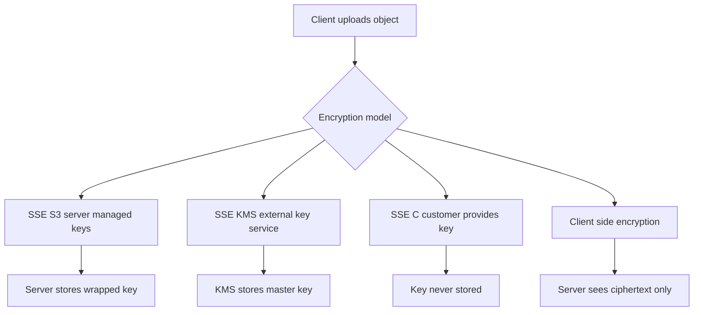

# Client-Side Encryption and SSE-KMS: Who Holds the Keys?

## English

Encryption in MinIO can happen in three different places, and knowing which one you are using is the difference between real confidentiality and a false sense of security. The simplest is SSE-S3 (Server-Side Encryption with keys managed by the server): MinIO generates and stores a unique data key per object, encrypts the object with it, and wraps that data key with a cluster-wide master key. You get encryption at rest with zero client changes, but the server holds everything needed to decrypt, so anyone with admin access to the cluster can read the data.

SSE-KMS goes a step further by delegating key management to an external Key Management Service — MinIO ships with a built-in KMS (KES) that fronts backends like HashiCorp Vault or a PKCS#11 device. When a client uploads an object, MinIO asks the KMS to generate a data key, encrypts the object with it, and stores only the wrapped key alongside the object. The cluster never persists the plaintext master key, so an attacker who steals the disks alone cannot decrypt anything. Revoking access at the KMS instantly makes old objects unreadable, which is a powerful incident-response lever.

SSE-C (Server-Side Encryption with Customer-provided keys) flips the model again: the client sends the encryption key on every request using HTTP headers, and MinIO uses it to encrypt or decrypt on the fly but never stores it. If you lose the key, the data is gone forever — there is no recovery path. This is useful for multi-tenant setups where the storage operator should never be able to read tenant data, but it puts a heavy operational burden on the client.

Finally, client-side encryption happens entirely in your application before the bytes ever reach MinIO; the server just sees opaque ciphertext. This is the strongest model because the server is mathematically incapable of reading the data, but you lose server-side features like range requests on plaintext, server-side search, and some lifecycle optimizations. A common pattern is to combine SSE-KMS for the bulk of data with client-side encryption for the most sensitive fields.

A practical rule of thumb: use SSE-S3 when you mostly want to satisfy a checkbox for 'encryption at rest' and trust your cluster admins; use SSE-KMS when compliance requires separation of duties between storage operators and key custodians; use SSE-C or client-side encryption when the storage provider is a different trust domain from the data owner. Whichever you pick, test key rotation and key loss scenarios in a lab before you rely on them in production.

## 中文

MinIO 的加密可以在三個不同位置發生，搞清楚你正在用哪一種，就是「真正保密」與「虛假安全感」之間的分界線。最簡單的是 SSE-S3（伺服器端加密，金鑰由伺服器管理）：MinIO 為每個對象生成並儲存一把唯一的資料金鑰，用這把金鑰加密對象，再用一把叢集層級的主金鑰把資料金鑰包起來。你在靜態資料上得到加密，客戶端零改動，但伺服器持有解密所需的一切，所以任何有叢集管理權限的人都能讀取資料。

SSE-KMS 更進一步，把金鑰管理交給外部金鑰管理服務——MinIO 內建 KMS（KES），可前置 HashiCorp Vault 或 PKCS#11 裝置等後端。客戶端上傳對象時，MinIO 請 KMS 生成資料金鑰，用該金鑰加密對象，只把「被包裹的金鑰」與對象一起儲存。叢集本身從不持久化明文主金鑰，所以只偷走磁碟的攻擊者無法解密任何東西。在 KMS 上撤銷權限會讓舊對象立即無法讀取，這是強大的事件應變槓桿。

SSE-C（伺服器端加密，金鑰由客戶提供）又把模型反轉：客戶端在每次請求中用 HTTP 標頭送出加密金鑰，MinIO 用它即時加解密但從不儲存。金鑰一旦遺失，資料就永遠消失——沒有任何復原路徑。這對多租戶場景很有用：儲存營運者永遠不該能讀取租戶資料，但對客戶端造成沉重的營運負擔。

最後，客戶端加密完全在你的應用程式內發生，位元組到達 MinIO 之前就已加密；伺服器只看到不透明密文。這是最強的模型，因為伺服器在數學上不可能讀取資料，但你會失去一些伺服器端功能，例如對明文做 range 請求、伺服器端搜尋，以及某些生命週期最佳化。常見做法是把大部分資料用 SSE-KMS，最敏感的欄位用客戶端加密。

實用經驗法則：若你只是想滿足「靜態加密」的勾選項並信任叢集管理員，用 SSE-S3；若合規要求儲存營運者與金鑰保管者職責分離，用 SSE-KMS；若儲存供應商與資料擁有者屬於不同信任域，用 SSE-C 或客戶端加密。無論選哪種，都要先在實驗室測試金鑰輪換與金鑰遺失情境，再在生產環境依賴它。

## Key Takeaway

MinIO's three encryption modes differ mainly in who holds the keys — the server, an external KMS, or the client — and that choice determines who can be forced or tricked into decrypting your data.

## Related Concepts
- Key Management Service (KMS)
- Encryption at rest

## Diagram

