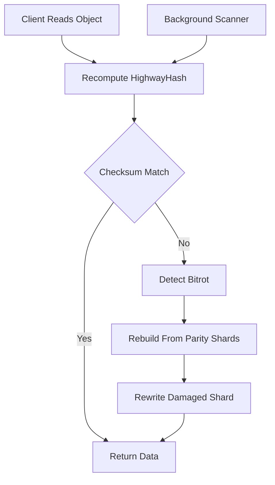

# Bitrot Detection and Healing: Trusting Data You Cannot See

## English

Object storage is often described as 'write once, read maybe', and the silent killer of that model is bitrot — the slow, random flipping of bits on disks, in RAM, or on the network path that leaves a file readable but wrong. A JPEG that opens with a gray stripe, a database backup that fails to restore, a PDF whose checksum no longer matches: these are the symptoms. MinIO takes an active stance against bitrot rather than waiting for a user to notice.

Every object that MinIO stores in erasure-coded form carries a per-part checksum computed with HighwayHash, a fast non-cryptographic hash designed for high throughput. When a client reads an object, MinIO recomputes the hash of the returned bytes and compares it with the stored value; a mismatch signals corruption. Because erasure coding keeps parity shards, MinIO can reconstruct the correct bytes from the surviving shards and, in the background, rewrite the damaged shard. From the client's point of view the read simply succeeds — the healing is invisible.

There is also a background scanner, often called the bitrot scanner, that walks the data directory on a schedule (configured per deployment) and re-verifies checksums even for objects nobody is reading. If it finds a bad shard, it triggers healing for that object. In distributed mode, healing reconstructs the missing shard from peers and writes it back, so a single degraded disk does not silently erode your durability over months. This is conceptually similar to ZFS scrubs or RAID patrol reads, but applied at the object layer.

Healing has two flavors worth distinguishing. 'Heal-on-read' is the inline repair just described: it fixes what a client happens to touch. 'Heal-on-demand' (triggered with `mc admin heal`) walks the namespace and repairs everything it finds, which is what you run after replacing a failed drive or adding a new server pool. Both depend on having enough healthy shards to reconstruct — if you lose more shards than your parity level allows, no amount of scanning will bring the data back, which is why monitoring erasure-set health matters as much as monitoring disk SMART status.

A practical implication: bitrot detection only works if checksums are actually verified, so do not disable the scanner to save CPU on a small cluster unless you fully understand the trade-off. And remember that checksums protect against accidental corruption, not against a malicious admin who rewrites both data and checksum — for that threat you need object lock, versioning, and replication to a second site.

## 中文

對象儲存常被形容為「寫一次、也許讀得到」，而這個模型的沉默殺手就是位元腐化（bitrot）——磁碟、記憶體或網路路徑上緩慢且隨機的位元翻轉，讓檔案仍可讀取但內容錯誤。開起來有灰條的 JPEG、還原失敗的資料庫備份、校驗碼對不上的 PDF，都是症狀。MinIO 採取主動立場對抗位元腐化，而不是等使用者發現。

MinIO 以糾刪碼形式儲存的每個對象都帶有以 HighwayHash 計算的分段校驗碼，這是一種為高吞吐量設計的快速非密碼學雜湊。客戶端讀取對象時，MinIO 會重新計算回傳位元組的雜湊並與儲存值比對；不符即表示損壞。因為糾刪碼保留同位元分片，MinIO 可以從存活分片重建正確位元組，並在背景重寫受損分片。從客戶端角度看，讀取就是成功——修復是隱形的。

還有一個背景掃描器（常稱為 bitrot scanner），會按排程（依部署設定）走訪資料目錄，即使沒人讀取也重新驗證校驗碼。若發現壞分片，就觸發該對象的修復。在分散式模式下，修復會從對等節點重建遺失分片並寫回，所以單一退化磁碟不會在幾個月內悄悄侵蝕你的耐用性。概念上類似 ZFS scrub 或 RAID patrol read，但套用在對象層。

修復有兩種值得區分。一種是「讀取時修復」（heal-on-read），即上述的內聯修復：修好客戶端剛好碰到的東西。另一種是「按需修復」（用 `mc admin heal` 觸發），會走訪命名空間並修復所有發現的問題，這是你更換故障磁碟或新增伺服器池之後要跑的。兩者都依賴有足夠的健康分片可重建——若遺失的分片超過同位元層級允許的數量，再怎麼掃描也救不回資料，所以監控糾刪集健康與監控磁碟 SMART 狀態同樣重要。

實務含義：位元腐化偵測只有在校驗碼真的被驗證時才有效，所以別為了在小叢集省 CPU 就關掉掃描器，除非你完全理解取捨。也要記住校驗碼防的是意外損壞，不是防惡意管理員同時改寫資料與校驗碼——面對那種威脅，你需要對象鎖、版本控制，以及複寫到第二個站點。

## Key Takeaway

MinIO fights bitrot with per-object HighwayHash checksums plus a background scanner, healing bad shards from parity or peers — but this only protects against accidental corruption, not a malicious admin.

## Related Concepts
- Erasure coding
- Data integrity checksums

## Diagram

