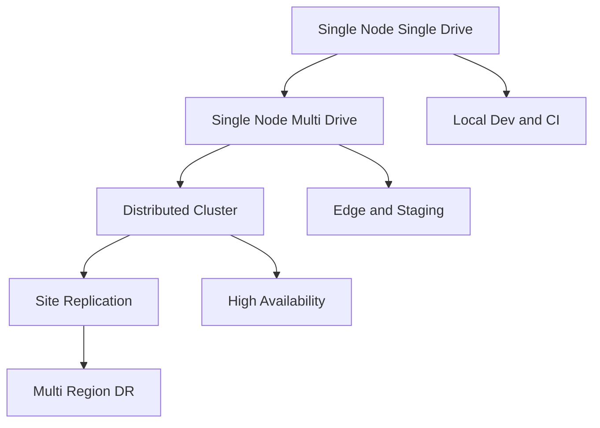

# Deployment Topologies: Single-Node, Distributed, and Site Replication

## English

MinIO can be run in configurations that range from a laptop to a multi-site global namespace, and picking the right one early saves painful migrations later. The smallest is single-node single-drive (often called 'fs mode' historically): one process, one filesystem, no erasure coding, no redundancy. It is fine for local development, CI pipelines, and demos, but it offers no durability beyond whatever the underlying disk provides and should never hold data you care about.

The next step is single-node multi-drive: one MinIO process manages several local drives as an erasure set, so you get parity and can survive a disk failure, but not a server failure. This is a good fit for edge appliances, small offices, or a staging environment where you want realistic S3 semantics without a cluster. Then comes distributed mode: multiple MinIO servers, each with its own drives, form a single namespace and a single erasure set (or several, if you use server pools). This is the topology that gives you high availability, because losing a whole server is just losing some shards rather than the whole dataset.

Above that sits site replication: two or more independent MinIO deployments in different locations, each with its own erasure sets, kept in sync through bucket replication rules. The key property is that each site is fully autonomous — if the WAN link drops, both sites keep serving reads and writes locally, and when connectivity returns, replication catches up. This is different from a stretched cluster, where a network partition can freeze writes because the cluster cannot reach quorum. For disaster recovery across regions, site replication is usually the right answer; for a single building with redundant power and networking, a single distributed cluster is simpler.

A subtle but important point is that you cannot freely mix topologies after the fact. Adding drives to an existing erasure set is not supported the way you might expect; the supported growth path in distributed mode is to add a new server pool, and MinIO then rebalances objects across pools in the background. Likewise, converting a single-node deployment into a distributed one usually means creating a new cluster and copying data with `mc mirror` or replication, not flipping a flag. Planning capacity and topology up front is therefore worth real effort.

A useful decision checklist: How much downtime can you tolerate? If the answer is 'minutes', distributed mode with enough parity is fine. If it is 'we must keep serving during a regional outage', you need site replication. If it is 'this is a dev box', single-node is fine. Then ask how much data growth you expect over three years, because that determines how many pools you will eventually add, and whether your initial layout leaves room for them.

## 中文

MinIO 可以從筆記型電腦一路部署到多站點全球名稱空間，及早選對拓撲能省下日後痛苦的遷移。最小的是單節點單磁碟（歷史上常稱「fs 模式」）：一個行程、一個檔案系統，沒有糾刪碼、沒有冗餘。這對本機開發、CI 管線與示範足夠，但除了底層磁碟本身提供的保障外毫無耐用性，絕不該存放你在乎的資料。

下一步是單節點多磁碟：一個 MinIO 行程把多顆本機磁碟管理成一個糾刪集，於是你有同位元、能撐過一顆磁碟故障，但撐不過整臺伺服器故障。這適合邊緣裝置、小型辦公室，或想要逼真 S3 語意卻不想架叢集的預備環境。再來是分散式模式：多臺 MinIO 伺服器各自帶磁碟，組成單一名稱空間與單一糾刪集（若使用伺服器池則可有多個）。這是提供高可用性的拓撲，因為失去一整臺伺服器只是失去部分分片，而非整個資料集。

再往上是站點複寫：兩個以上位於不同地點的獨立 MinIO 部署，各有自己的糾刪集，透過桶複寫規則保持同步。關鍵特性是每個站點完全自主——廣域網路斷線時，兩邊仍在本機提供讀寫，連線恢復後複寫再追上。這與延伸叢集不同：在延伸叢集中，網路分割槽可能因叢集無法達到 quorum 而凍結寫入。跨區域災難復原通常該用站點複寫；若只是同一棟樓但有冗餘電力與網路，單一分散式叢集更簡單。

一個微妙但重要的點：拓撲一旦定案就不能隨意混用。在既有糾刪集上加磁碟並不像你想的那樣受支援；分散式模式受支援的擴充路徑是新增伺服器池，MinIO 隨後在背景把物件重新平衡到各池。同樣地，把單節點部署轉成分散式，通常意味著建立新叢集並用 `mc mirror` 或複寫搬資料，而不是翻個開關。因此事前規劃容量與拓撲值得認真投入。

實用的決策清單：你能容忍多少停機？若答案是「幾分鐘」，有足夠同位元的分散式模式就夠。若是「區域性故障時仍須提供服務」，你需要站點複寫。若是「這只是開發機」，單節點就行。接著問你預期三年內資料成長多少，因為那決定你最終要加多少個池，以及初始佈局是否留了空間。

## Key Takeaway

MinIO's topologies trade simplicity for survivability — single-node for dev, distributed for server-level HA, and site replication for regional autonomy — and you should choose based on downtime tolerance and growth plans before deploying.

## Related Concepts
- High availability
- Disaster recovery

## Diagram

