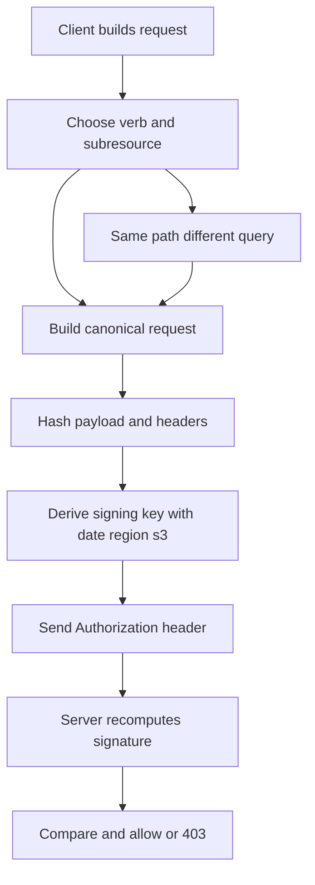

# The S3 API Is Not One API: Subresources, Query Parameters, and the Signature Dance

## English

People say MinIO 'speaks S3', but S3 is not a single endpoint — it is a family of HTTP verbs plus subresource query strings that all hit the same URL. A GET on /bucket/object returns the bytes; a GET on /bucket/object?acl returns the access control list; ?tagging returns the object's tags. Other subresources live on the bucket rather than the object: GET /bucket?versions lists object versions, GET /bucket?uploads lists in-progress multipart uploads, and GET /bucket?location reports the bucket's region. A multipart upload is started by POSTing to /bucket/object?uploads, not by a GET. The pattern is that a query string changes the meaning of the request, but which path you target still decides what the subresource applies to. This is why a client library that 'works with S3' can still fail on a specific feature: the library must know which subresource to append. When debugging, always look at the raw request line, not just the SDK method name.

Every request must also be authenticated, and S3 uses a scheme called Signature Version 4 (SigV4). The client does not send your secret key. Instead it builds a 'canonical request' — the HTTP method, the URI path, the sorted query parameters, selected headers, and a hash of the payload — then derives a signing key by repeatedly hashing your secret with the date, region, and service name ('s3'). The result is sent in the Authorization header as a signature. The server recomputes the same thing and compares. If a single byte differs — a header name capitalised differently, an extra space in the query string — the signature fails with a 403 and a message about the canonical request.

Two headers matter enormously in practice. The first is Host: because SigV4 signs the Host header, using path-style addressing (http://minio:9000/bucket/key) versus virtual-host style (http://bucket.minio:9000/key) produces different signatures. Older SDKs default to virtual-host style, which requires DNS wildcards; MinIO often needs path-style, which you enable with a client option or an environment variable. The second is the payload hash header, x-amz-content-sha256. Some tools send the literal string UNSIGNED-PAYLOAD to skip hashing large bodies; MinIO accepts this for many operations but not all, and mismatches produce confusing errors.

A concrete example: a curl command that works in a browser fails from the terminal because the browser added cookies and the terminal did not. Or an upload succeeds with a small file but fails above a threshold because the SDK switched to multipart, which uses different subresources (POST ?uploads, PUT ?partNumber=N&uploadId=..., POST ?uploadId=... to complete). Each of those three requests is signed separately, and if the clock on the client is more than about fifteen minutes off from the server, every one of them returns RequestTimeTooSkewed.

So the practical mental model is: an S3 request is a tuple of (method, path, subresource query, signed headers, payload hash), and every failure is one of those five elements disagreeing with the server. When something breaks, capture the raw HTTP exchange with a tool like curl -v or an SDK debug flag, and read the canonical request the server echoes back in the error body. Nine times out of ten the bug is a header, a query parameter, or a clock.

## 中文

大家常說 MinIO「識講 S3」，但 S3 其實唔係單一個 endpoint — 佢係一組 HTTP 動詞加子資源（subresource）查詢字串，全部打同一個 URL。對 /bucket/object 發 GET 係攞返位元組；對 /bucket/object?acl 發 GET 係攞存取控制清單；?tagging 攞標籤；?versions 列出物件版本；?uploads 開始一個分段上傳工作階段；?location 報告 bucket 嘅區域。路徑一樣，淨係查詢字串改變意思。所以一個「支援 S3」嘅客戶端庫，都可能喺某個特定功能上失敗：個庫要識得加邊個子資源先得。除錯時，永遠睇原始請求行，唔好淨係睇 SDK 方法名。

每個請求亦要驗證，S3 用嘅方案叫 Signature Version 4（SigV4）。客戶端唔會送你的密鑰。佢會砌一個「標準請求」（canonical request）— HTTP 方法、URI 路徑、排好序的查詢參數、揀選的標頭、載荷的雜湊 — 然後用你的密鑰同日期、區域、服務名（'s3'）反覆雜湊推導出簽署密鑰。結果放喺 Authorization 標頭做簽名。伺服器重算同一樣嘢再比較。只要有一個位元唔同 — 標頭名大小寫唔同、查詢字串多咗個空格 — 簽名就失敗，回 403 同埋關於標準請求嘅訊息。

實戰上有兩個標頭極重要。第一係 Host：因為 SigV4 會簽 Host 標頭，用路徑式定址（http://minio:9000/bucket/key）同虛擬主機式（http://bucket.minio:9000/key）會產生唔同簽名。舊版 SDK 預設用虛擬主機式，需要 DNS 萬用字元；MinIO 通常要路徑式，你要用客戶端選項或環境變數開啟。第二係載荷雜湊標頭 x-amz-content-sha256。有啲工具會送字面字串 UNSIGNED-PAYLOAD 去跳過雜湊大 body；MinIO 對好多操作都接受，但唔係全部，唔匹配就會出好混亂嘅錯。

具體例子：一條 curl 指令喺瀏覽器行得通，喺終端機就失敗，因為瀏覽器加咗 cookie 而終端機冇。又或者細檔上傳成功，過咗某個門檻就失敗，因為 SDK 轉咗用分段上傳，用唔同嘅子資源（POST ?uploads、PUT ?partNumber=N&uploadId=...、POST ?uploadId=... 去完成）。呢三個請求各自獨立簽名，如果客戶端時鐘同伺服器差超過大約十五分鐘，每一個都會回 RequestTimeTooSkewed。

所以實用嘅心智模型係：一個 S3 請求係一個五元組（方法、路徑、子資源查詢、已簽標頭、載荷雜湊），每個失敗都係呢五個元素之一同伺服器唔一致。出事嗰陣，用 curl -v 或 SDK 除錯旗標捉原始 HTTP 交換，再讀伺服器喺錯誤 body 回傳嘅標準請求。十次有九次，個 bug 係一個標頭、一個查詢參數，或者時鐘。

## Key Takeaway

An S3 request is a signed tuple of method, path, subresource query, headers, and payload hash — debug by reading the raw exchange, not the SDK method name.

## Related Concepts
- Signature Version 4
- S3 subresources

## Diagram

