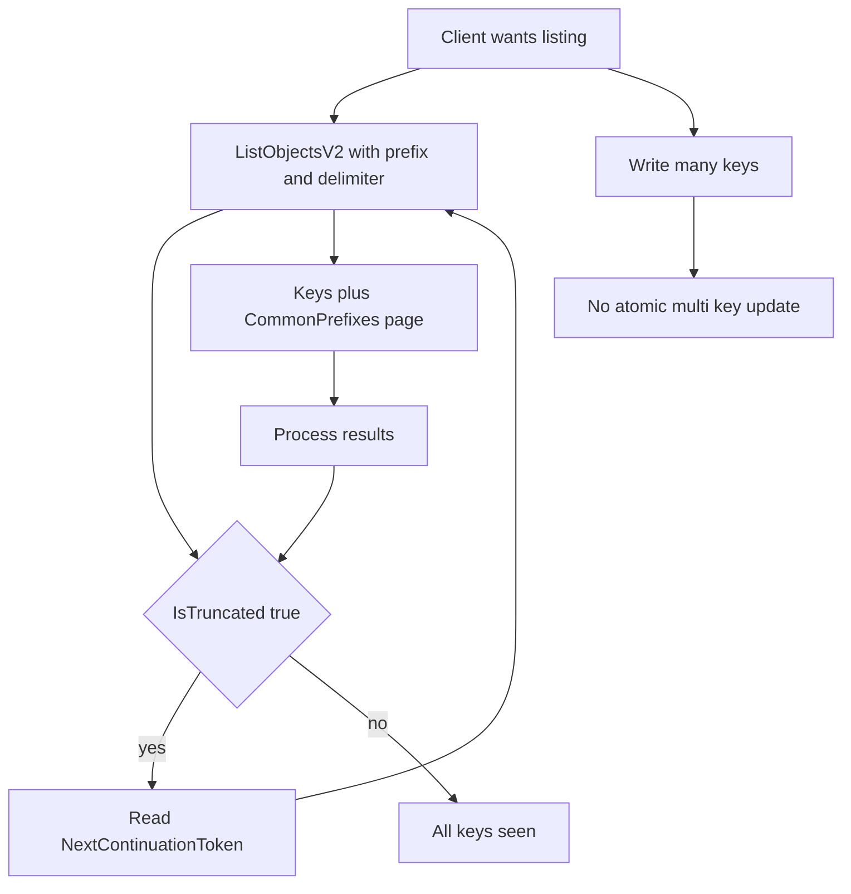

# Consistency, Listing, and Pagination: Why Object Stores Are Not File Systems

## English

A file system gives you a tree: directories, inodes, rename in place, and readdir that returns everything at once. An object store gives you a flat key space and a few verbs. There are no directories — a key like photos/2024/cat.jpg is just a string, and the slashes are convention. MinIO and S3 let you 'list with prefix and delimiter' to simulate folders: prefix=photos/2024/ and delimiter=/ returns the keys under that prefix, plus a rolled-up entry for each deeper 'folder' (CommonPrefixes). This is a listing operation, not a directory read, and it costs a round trip for every page.

That brings us to pagination. A listing returns at most a fixed number of keys per call — S3 caps it at 1000 — and includes a continuation token (or, in the older API, a marker) that you pass to get the next page. A common bug is code that lists a bucket once and assumes it saw everything; with a million keys it saw the first thousand. The correct pattern is a loop: call ListObjectsV2, process the results, check IsTruncated, and if true, send the NextContinuationToken. The same applies to ListObjectVersions and to listing incomplete multipart uploads, which is how you find orphaned parts wasting space.

Consistency is the other surprise. Modern S3 and MinIO provide strong read-after-write consistency for new PUTs and DELETEs: once an upload returns success, a subsequent GET or LIST sees it. But 'consistent' does not mean 'atomic across many keys'. If you write ten objects and the process dies after seven, the store has seven objects and no concept of a transaction to roll them back. There is no rename: 'moving' a key means copying the bytes to a new key and deleting the old one, which doubles the I/O and is not atomic. Applications that need atomic multi-object updates build that on top — with a manifest object, a version pointer, or a database — because the store will not do it for you.

There is also no locking of a key while you read it. If two writers PUT the same key, the last one wins; the earlier bytes are gone unless versioning is enabled, in which case both versions are retained and the newest becomes current. This last-writer-wins behaviour is fine for immutable artefacts (build outputs, backups, logs written once) and dangerous for mutable records (a counter, a user profile) unless you add versioning plus conditional writes, or put the mutable state in a database and keep only blobs here.

A practical analogy: an object store is a giant, reliable, cheap warehouse where you hand over a box with a label and get it back later by label. A file system is a workshop with shelves, labels, and a clipboard that tracks what is where. Warehouses scale better and never lose a box, but they will not let you rearrange a shelf atomically. Design your application around the warehouse's rules — immutable keys, manifest files, prefix listing, pagination loops — and it will behave predictably at any scale.

## 中文

檔案系統畀你一棵樹：目錄、inode、原地改名，同埋一次過回傳所有嘢嘅 readdir。物件儲存就畀你一個扁平嘅鍵空間同幾個動詞。冇目錄 — 好似 photos/2024/cat.jpg 呢個鍵只係一串字元，斜線係慣例。MinIO 同 S3 畀你「用字首同分隔符列出」去模擬資料夾：prefix=photos/2024/ 加 delimiter=/ 會回傳該字首下嘅鍵，再加每個更深「資料夾」嘅彙總專案（CommonPrefixes）。呢個係列出操作，唔係讀目錄，每一頁都要一次來回。

咁就帶到分頁。一次列出每次呼叫最多回傳固定數量嘅鍵 — S3 上限係 1000 — 並附一個續傳權杖（或者舊 API 嘅 marker），你要傳返去攞下一頁。常見 bug 係程式碼列一次 bucket 就當睇曬所有嘢；一百萬個鍵嘅話，佢只睇到頭一千個。正確模式係一個迴圈：呼叫 ListObjectsV2、處理結果、檢查 IsTruncated，如果係 true 就送 NextContinuationToken。ListObjectVersions 同列出未完成分段上傳都一樣，後者就係你搵浪費空間嘅孤兒分段嘅方法。

一致性係另一個驚喜。現代 S3 同 MinIO 對新 PUT 同 DELETE 提供強「寫後讀」一致性：上傳一返成功，之後嘅 GET 或 LIST 就見到。但「一致」唔等於「跨多個鍵原子」。如果你寫十個物件，程式寫到第七個死咗，儲存得七個物件，冇交易概念去回滾。亦冇改名：「移動」一個鍵即係複製位元組去新鍵再刪舊鍵，I/O 加倍而且唔原子。需要原子多物件更新嘅應用要自己喺上面砌 — 用 manifest 物件、版本指標，或者資料庫 — 因為儲存唔會幫你做。

亦冇喺你讀嗰陣鎖住個鍵。如果兩個寫入者 PUT 同一個鍵，最後一個贏；之前嘅位元組冇咗，除非開咗版本控制，咁兩個版本都會保留，最新嘅成為當前版本。呢種「後寫者勝」對不可變產物（建置輸出、備份、寫一次嘅日誌）冇問題，但對可變記錄（計數器、使用者資料）就危險，除非你加版本控制加條件寫入，或者將可變狀態放資料庫，呢度只留 blob。

實用類比：物件儲存係一個巨大、可靠、便宜嘅倉庫，你交一個貼咗標籤嘅箱，之後憑標籤攞返。檔案系統係一個有層架、標籤同記事板追蹤邊樣喺邊嘅工作坊。倉庫擴充套件得更好、永遠唔會唔見箱，但唔會畀你原子咁重排層架。圍繞倉庫嘅規則設計應用 — 不可變鍵、manifest 檔、字首列出、分頁迴圈 — 佢喺任何規模都會行為可預測。

## Key Takeaway

Object stores are flat key spaces with paginated listing and last-writer-wins semantics, so applications must supply their own atomicity and folder illusions.

## Related Concepts
- ListObjectsV2 pagination
- read-after-write consistency

## Diagram

