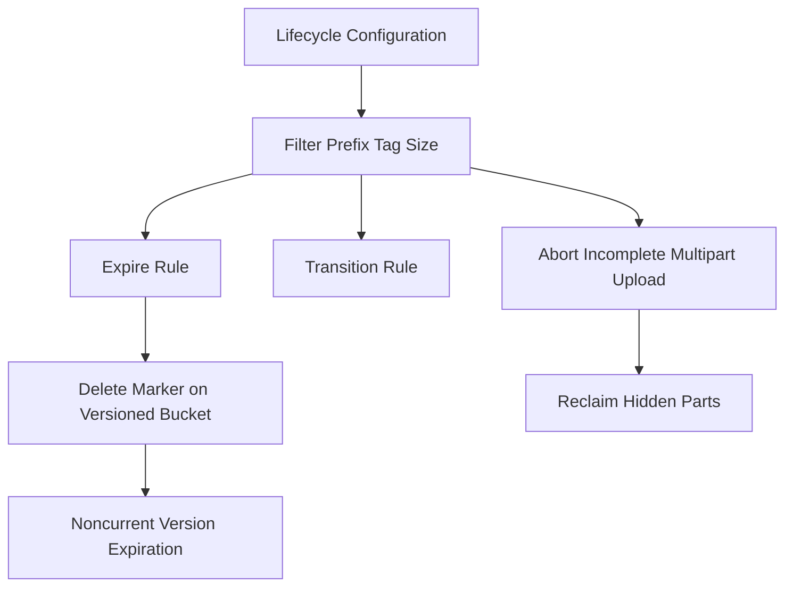

# Lifecycle Rules and Storage Classes: Making Objects Age Gracefully

## English

Objects accumulate. A bucket that starts as a clean upload target becomes a graveyard of old builds, expired logs, and abandoned multipart uploads. MinIO's answer is the lifecycle configuration: a set of rules, each with a filter (by prefix, tag, or size) and one or more actions with time-based conditions. The classic example is 'expire objects under tmp/ after seven days', which deletes matching keys automatically. Another is 'transition to a colder storage class after thirty days', which in S3 means moving to a cheaper tier; in MinIO it maps to whatever storage tiers you have configured, or is simply a no-op if none exist.

Rules are evaluated by the server on a schedule, not instantly. The practical consequence is that an object whose expiry date has passed may still be readable for hours or a day, depending on the scanner interval. Do not build security controls on lifecycle expiry — use bucket policies and object lock for that. Lifecycle is for cost and hygiene, not access control. Also note that expiration of a versioned bucket behaves differently: by default a delete marker is placed and old versions survive until a separate noncurrent-version expiration rule removes them. Without that second rule, a versioned bucket grows forever even though the UI shows 'deleted'.

Multipart uploads deserve their own rule. When a client starts a multipart upload and dies before completing it, the uploaded parts sit in the bucket consuming space but never appear in a normal listing. An AbortIncompleteMultipartUpload rule with a short window (say, one day) cleans these up. This single rule is one of the highest-value hygiene settings in any object store, because abandoned multipart parts are invisible and can silently consume a large fraction of capacity.

Storage classes are the other half of the story. In S3, objects carry a storage class attribute (STANDARD, STANDARD_IA, GLACIER, and so on) that determines durability, availability, and retrieval cost. In MinIO, the concept exists for compatibility — you can set a storage class on a PUT or via lifecycle transition — but the actual behaviour depends on whether you have configured remote tiers. If you have not, the attribute is recorded in metadata and otherwise ignored. This is a common source of confusion: code that sets a class expecting cheaper storage gets the same storage, just with a different label. Check your deployment's tier configuration before relying on transitions for cost savings.

A safe lifecycle policy has three parts: a short abort rule for incomplete multipart uploads, an expiry rule for genuinely temporary prefixes (tmp/, cache/, staging/), and a noncurrent-version expiry for versioned buckets. Add a transition rule only if you have tiers. Test the rules on a scratch bucket first, because a typo in a prefix can delete data you meant to keep — and remember that lifecycle deletion is permanent unless versioning is on. Read the rule back with a describe call and watch the server's scanner logs to confirm it is actually running.

## 中文

物件會累積。一個本來係乾淨上傳目標嘅 bucket，會變成舊建置、過期日誌同廢棄分段上傳嘅墳場。MinIO 嘅答案係生命週期設定：一組規則，每條有篩選條件（按前綴、標籤或大小）同一個或多個帶時間條件嘅動作。經典例子係「tmp/ 下嘅物件七日後過期」，會自動刪除匹配嘅鍵。另一個係「三十日後轉去較冷嘅儲存類別」，喺 S3 即係搬去更便宜嘅層；喺 MinIO 就對應你設定咗嘅儲存層，如果冇設定就等於冇作用。

規則由伺服器按排程評估，唔係即時。實際後果係：過咗到期日嘅物件可能仍然讀得到幾個鐘甚至一日，視乎掃描間隔。唔好將保安控制建立喺生命週期過期上面 — 嗰啲用 bucket 策略同物件鎖。生命週期係為成本同衛生，唔係存取控制。另外注意版本化 bucket 嘅過期行為唔同：預設會放一個刪除標記，舊版本會保留，直到另一條「非當前版本過期」規則移除佢哋。冇第二條規則，版本化 bucket 會永遠增長，即使介面顯示「已刪除」。

分段上傳值得自己一條規則。當客戶端開始分段上傳但完成前死咗，已上傳嘅分段會留喺 bucket 度佔空間，但永遠唔會喺正常列出出現。一條 AbortIncompleteMultipartUpload 規則加短窗口（例如一日）就會清理。呢條規則係任何物件儲存最高價值嘅衛生設定之一，因為廢棄分段係隱形嘅，可以靜靜食掉好大比例容量。

儲存類別係故事另一半。喺 S3，物件帶一個儲存類別屬性（STANDARD、STANDARD_IA、GLACIER 等等），決定耐用性、可用性同取回成本。喺 MinIO，呢個概念存在係為咗兼容 — 你可以喺 PUT 或經生命週期轉換設定儲存類別 — 但實際行為視乎你有冇設定遠端層。如果冇，個屬性會記錄喺元數據，其餘忽略。呢個係常見混淆來源：設定咗類別期望更便宜儲存嘅程式碼，得到同樣儲存，只係標籤唔同。依賴轉換慳成本之前，檢查部署嘅層設定。

安全嘅生命週期策略有三部分：一條短嘅中止未完成分段上傳規則、一條對真正臨時前綴（tmp/、cache/、staging/）嘅過期規則，同埋版本化 bucket 嘅非當前版本過期。只有你有層先加轉換規則。先喺臨時 bucket 測試規則，因為前綴打錯字可以刪走你想保留嘅資料 — 記住生命週期刪除係永久嘅，除非開咗版本控制。用 describe 呼叫讀返條規則，再睇伺服器掃描日誌確認佢真係行緊。

## Key Takeaway

Lifecycle rules are the hygiene layer of an object store: abort orphaned multipart uploads, expire temporary prefixes, and expire noncurrent versions — but never treat them as access control.

## Related Concepts
- AbortIncompleteMultipartUpload
- storage class transitions

## Diagram

