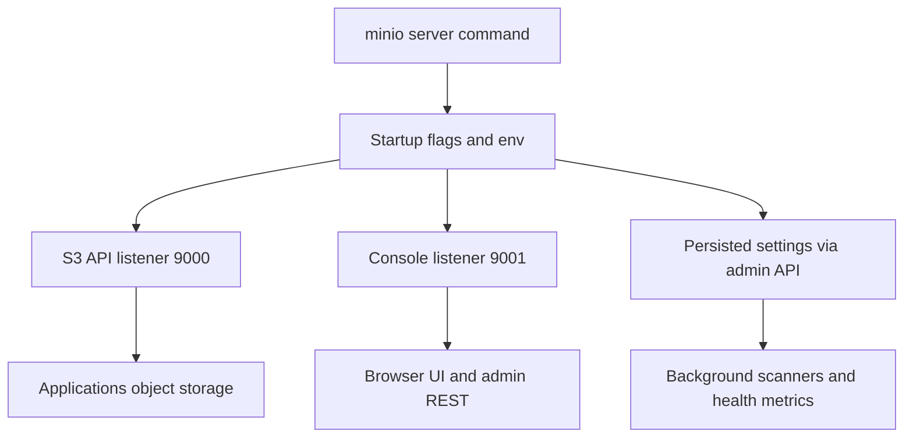

# The MinIO Server Process: Ports, Configuration, and the Admin API

## English

A MinIO server is a single Go binary that you start with a command like `minio server /data` (for a single directory) or `minio server http://host{1...4}/data` (for a distributed cluster). When it starts, it binds two logical services: the S3 API port (default 9000, changed with `--address`) and the web console port. In modern MinIO versions the console is assigned a random port by default unless you ask for a specific one with `--console-address` (commonly `:9001`). The S3 port speaks the object storage protocol your applications already understand; the console port serves a browser UI, while the admin REST endpoints live on the S3 API port. These are separate listeners, which is why a common deployment mistake is exposing only 9000 and then wondering why the browser console does not load.

Configuration is not stored in a config file you hand-edit. MinIO reads environment variables and CLI flags at startup, and many settings (for example the root credentials `MINIO_ROOT_USER` and `MINIO_ROOT_PASSWORD`, or TLS certificate paths) are supplied this way. There is no hand-written YAML config file — historically MinIO used a `config.json` inside the data directory, and newer releases moved toward environment-driven configuration and the `mc admin config` command, which writes settings through the admin API and stores them in the backend. The takeaway for a student: treat the server as stateless-ish software whose behaviour is defined by its startup flags plus a small set of persisted settings, not by a large mutable config tree you edit by hand.

Under the hood the process is doing more than answering GET and PUT. It runs background scanners that check object integrity, it coordinates with peers in distributed mode over an internal RPC mesh, and it exposes health and metrics endpoints (for example `/minio/health/live` and `/minio/health/ready`, plus a Prometheus-style metrics endpoint). Orchestrators like Kubernetes use those health endpoints as liveness and readiness probes: if `/minio/health/live` fails, the container is restarted; if readiness fails, traffic is withheld. Knowing these paths helps you debug why a pod keeps restarting.

A practical example: you run `MINIO_ROOT_USER=admin MINIO_ROOT_PASSWORD=supersecret minio server /mnt/data --console-address :9001`. Your Python script then talks to `http://localhost:9000` with the AWS SDK, while you open `http://localhost:9001` in a browser to see buckets. If a colleague cannot reach the console, check whether they are hitting 9000 by mistake, or whether a firewall only opened the API port. These are mundane but extremely common operational issues.

One more nuance: the root credentials are powerful and should not be used by applications. Best practice is to create a dedicated user or service account with a narrow policy (covered elsewhere) and keep root only for bootstrap and emergencies. The server process itself does not care who calls it as long as the request is signed correctly and the policy allows the action, so credential hygiene is entirely your responsibility.

## 中文

MinIO 伺服器是一個以 Go 編寫的單一二進位檔，你可以用類似 `minio server /data`（單一目錄）或 `minio server http://host{1...4}/data`（分散式叢集）的指令啟動它。啟動時它會綁定兩個邏輯服務：S3 API 連接埠（預設 9000，可用 `--address` 更改）以及網頁主控台連接埠。在較新的 MinIO 版本中，主控台預設會被指派一個隨機連接埠，除非你用 `--console-address` 指定（常見寫法是 `:9001`）。S3 連接埠講的是你的應用程式早已理解的物件儲存協定；主控台連接埠提供瀏覽器介面，而管理用 REST 端點則在 S3 API 連接埠上。兩者是分開的監聽器，這正是為何常見的部署錯誤是只開放 9000，然後納悶為何瀏覽器主控台打不開。

設定並不是放在你手動編輯的設定檔裡。MinIO 在啟動時讀取環境變數與命令列旗標，許多設定（例如根憑證 `MINIO_ROOT_USER` 與 `MINIO_ROOT_PASSWORD`，或 TLS 憑證路徑）就是這樣提供的。它並沒有可供手動編輯的 YAML 設定檔——歷史上 MinIO 曾在資料目錄內使用 `config.json`；較新的版本則走向環境變數驅動的設定，以及 `mc admin config` 指令，後者透過管理 API 寫入設定並儲存在後端。給學生的結論是：把伺服器視為一種「半無狀態」的軟體，其行為由啟動旗標加上少量持久化設定所決定，而不是一棵你手動編輯、龐大且可變的設定樹。

在表面之下，這個行程做的事遠不止回應 GET 與 PUT。它執行背景掃描器檢查物件完整性，在分散式模式下透過內部 RPC 網狀結構與同伴協調，並暴露健康與指標端點（例如 `/minio/health/live` 與 `/minio/health/ready`，以及 Prometheus 風格的指標端點）。Kubernetes 之類的編排器會把這些健康端點當作存活與就緒探針：若 `/minio/health/live` 失敗，容器會被重啟；若就緒探針失敗，流量就不會送進來。認識這些路徑有助於你除錯為何某個 pod 不斷重啟。

一個實例：你執行 `MINIO_ROOT_USER=admin MINIO_ROOT_PASSWORD=supersecret minio server /mnt/data --console-address :9001`。你的 Python 腳本接著用 AWS SDK 與 `http://localhost:9000` 溝通，而你用瀏覽器開啟 `http://localhost:9001` 來檢視 bucket。如果同事連不上主控台，先檢查他是否誤打了 9000，或防火牆是否只開放了 API 連接埠。這些問題很平凡，卻是極常見的維運狀況。

還有一個細節：根憑證權限極大，不應供應用程式使用。最佳實務是建立專用的使用者或服務帳戶，並綁定範圍狹窄的策略（另處已述），根憑證只保留給初始啟動與緊急情況。伺服器行程本身不在乎誰來呼叫，只要請求簽章正確且策略允許該動作即可，因此憑證衛生完全是你的責任。

## Key Takeaway

A MinIO server is one binary exposing separate API and console ports, configured mainly through startup flags and environment variables, with health endpoints that orchestrators rely on.

## Related Concepts
- Health and readiness probes
- Root credentials versus service accounts

## Diagram

