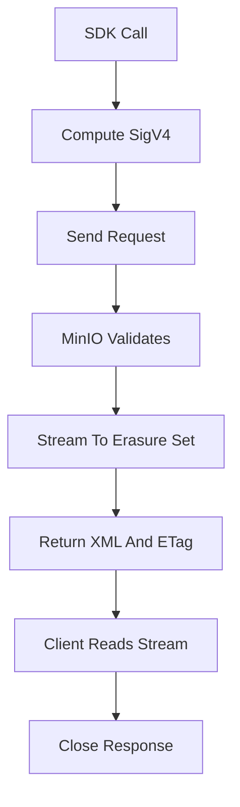

# Reading and Writing Objects with an S3 SDK: The Request Lifecycle

## English

Most people never touch the raw HTTP of S3; they use a client library such as boto3 for Python, the AWS SDK for Java or Go, or the MinIO SDKs. But understanding what the library does on your behalf makes debugging far easier. When you call something like `client.put_object(Bucket='photos', Key='2024/cat.jpg', Body=data)`, the SDK first computes a SigV4 signature: it hashes the request body, builds a canonical request string from the method, path, query, headers, and payload hash, then signs it with a key derived from your secret access key, the date, and the region. MinIO validates that signature server-side. If the clock on your machine is badly skewed, the signature's date will be outside the allowed window and you get an error that looks mysterious but is really about time.

The request then travels to the server, which maps the bucket and key to a location, streams the body into an erasure set, and returns an XML response with an ETag header. That ETag is often the MD5 of the object for simple single-part uploads, which is why people use it for integrity checks, but for multipart uploads it is a composite value and is not a plain MD5 of the whole object. Confusing these two cases is a classic source of bugs in deduplication or checksum scripts.

Reads follow a similar path. `get_object` returns a streaming body plus metadata headers such as `Content-Length`, `Content-Type`, and any user metadata you stored (custom headers prefixed with `x-amz-meta-`). If you never read the stream fully or close it, connections can leak, so always use a context manager or explicitly close the response. Range requests (`Range: bytes=0-1023`) let you fetch part of an object without downloading it all, which is how video players seek and how large-file tools resume downloads.

Listing is another place where the abstraction leaks. `list_objects_v2` returns up to 1000 keys per call and a continuation token; you must loop until the token is absent. A directory-looking prefix like `logs/2024/` is not a real folder, just a shared string prefix, so there is no atomic rename and no cheap way to count objects except by listing. Deleting a 'folder' means deleting every key under that prefix, one batch at a time.

Finally, error handling matters. S3 errors arrive as XML with a code like `NoSuchKey`, `AccessDenied`, or `SlowDown`, and SDKs surface them as typed exceptions. Retrying with exponential backoff is expected behaviour for throttling and transient 5xx errors, and most SDKs do it automatically. Knowing which errors are retryable and which are your bug (a wrong key, a policy denial) is the difference between a resilient pipeline and one that hammers a server pointlessly.

## 中文

大多數人從不直接碰 S3 的原始 HTTP，而是使用客戶端函式庫，例如 Python 的 boto3、Java 或 Go 的 AWS SDK，或 MinIO 自家的 SDK。但理解函式庫替你做了什麼，會讓除錯容易得多。當你呼叫類似 `client.put_object(Bucket='photos', Key='2024/cat.jpg', Body=data)` 時，SDK 會先計算 SigV4 簽章：它對請求主體做雜湊，用方法、路徑、查詢、標頭與酬載雜湊組出正規化請求字串，再用一把由你的秘密存取金鑰、日期與區域衍生的金鑰來簽署。MinIO 會在伺服器端驗證該簽章。若你機器的時鐘偏差太大，簽章中的日期會落在允許視窗之外，你會得到一個看起來神祕、實際上只是時間問題的錯誤。

請求接著送到伺服器，伺服器把 bucket 與 key 對應到某個位置，將主體串流寫入一個糾刪集，並回傳帶有 ETag 標頭的 XML 回應。對簡單的單段上傳而言，那個 ETag 往往是物件的 MD5，這正是人們拿它做完整性檢查的原因；但對分段上傳而言，它是複合值，並非整個物件的單純 MD5。混淆這兩種情況，是去重或校驗腳本中典型的 bug 來源。

讀取走類似的路徑。`get_object` 回傳串流主體加上元數據標頭，例如 `Content-Length`、`Content-Type`，以及你儲存的任何使用者元數據（以 `x-amz-meta-` 為前綴的自訂標頭）。若你沒有完整讀完串流或關閉它，連線可能會外洩，所以務必使用上下文管理器或明確關閉回應。範圍請求（`Range: bytes=0-1023`）讓你只取物件的一部分而不必全部下載，影片播放器的跳轉與大檔工具的下載續傳就是這樣做的。

列舉則是抽象外洩的另一個地方。`list_objects_v2` 每次呼叫最多回傳 1000 個 key 以及一個續傳權杖；你必須迴圈直到權杖不存在為止。看起來像目錄的前綴如 `logs/2024/` 並不是真正的資料夾，只是共用的字串前綴，因此沒有原子重命名，也沒有便宜的方式計算物件數量，只能靠列舉。刪除一個「資料夾」意味著刪除該前綴下的每一個 key，一次一批。

最後，錯誤處理很重要。S3 錯誤以 XML 抵達，帶有像 `NoSuchKey`、`AccessDenied` 或 `SlowDown` 的錯誤碼，SDK 會把它們呈現為具型別的例外。對節流與暫時性 5xx 錯誤以指數退避重試是預期行為，多數 SDK 會自動處理。知道哪些錯誤可重試、哪些是你自己的 bug（key 打錯、策略拒絕），正是韌性管線與只會無意義猛打伺服器的管線之間的差別。

## Key Takeaway

S3 SDK calls are signed HTTP requests whose ETag, listing, streaming, and error semantics have subtle rules that you must respect to build reliable code.

## Related Concepts
- SigV4 request signing
- ETag and multipart checksums

## Diagram

