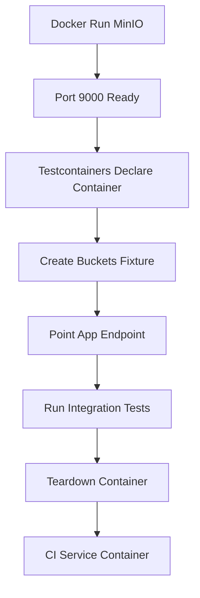

# Running MinIO Locally: Docker, Testcontainers, and CI Fixtures

## English

One of MinIO's most practical uses is as a disposable S3 for development and testing. You can start a server in a container with a command like `docker run -p 9000:9000 -p 9001:9001 -e MINIO_ROOT_USER=minioadmin -e MINIO_ROOT_PASSWORD=minioadmin minio/minio server /data`. Within seconds you have a working S3 endpoint at `http://localhost:9000`. Because it is a single binary with no external database, it starts fast and shuts down cleanly, which makes it ideal for integration tests that need real object storage semantics rather than a mock.

Mocks are tempting but risky. A fake S3 client in unit tests will happily accept any key, ignore prefixes, and never reproduce quirks like ETag composition or pagination tokens. When your code later runs against real S3 or MinIO, those untested paths break. Using a real MinIO container in tests gives you the actual behaviour: policy enforcement if you configure it, real multipart uploads, real listing order, real error codes. The trade-off is startup time and resource use, but a few seconds per test suite is usually acceptable.

Testcontainers libraries for Java, Python, Go, and others make this ergonomic: you declare a MinIO container in code, the library pulls the image, waits for the port to be ready, and tears it down afterwards. A typical pattern is to create buckets in a fixture before tests, point your application's S3 endpoint configuration at the container's mapped port, and use unique bucket names per test to avoid interference. Because MinIO is S3-compatible, the same test code can later run against AWS S3 by swapping the endpoint and credentials.

In continuous integration, a common approach is a service container declared in the CI config (for example a GitHub Actions `services:` block) that starts MinIO alongside the job. Your pipeline then runs the same integration tests locally and in CI, reducing the classic 'works on my machine' gap. You should also seed test data deterministically so assertions about listing and pagination are stable, and clean up or use fresh buckets between runs to avoid state leaking.

A caution: do not treat a local MinIO as a faithful simulation of every cloud behaviour. Defaults differ (for example, some AWS-specific features or IAM semantics may not match exactly), latency and failure modes are different, and a single-node local instance has none of the distributed complexity. Still, for the vast majority of application logic, a local MinIO is a far better test double than a hand-written mock, and it doubles as a convenient scratchpad for learning the S3 API interactively.

## 中文

MinIO 最實用的用途之一，是作為開發與測試用的可拋棄式 S3。你可以用類似 `docker run -p 9000:9000 -p 9001:9001 -e MINIO_ROOT_USER=minioadmin -e MINIO_ROOT_PASSWORD=minioadmin minio/minio server /data` 的指令在容器中啟動伺服器。幾秒內你就有一個可用的 S3 端點位於 `http://localhost:9000`。由於它是單一二進位檔且不需外部資料庫，啟動快、關閉乾淨，非常適合需要真實物件儲存語意（而非模擬）的整合測試。

模擬很誘人卻有風險。單元測試中的假 S3 客戶端會來者不拒地接受任何 key、忽略前綴，也永遠不會重現 ETag 組合或分頁權杖這類怪癖。當你的程式之後對真實 S3 或 MinIO 執行時，那些未受測試的路徑就會壞掉。在測試中使用真實的 MinIO 容器，能給你真實行為：若你設定策略就有真實的策略強制、真實的分段上傳、真實的列舉順序、真實的錯誤碼。代價是啟動時間與資源使用，但每個測試套件多花幾秒通常可以接受。

Java、Python、Go 等語言的 Testcontainers 函式庫讓這件事很順手：你在程式碼中宣告一個 MinIO 容器，函式庫會拉取映像、等待連接埠就緒，並在之後拆除。典型模式是在 fixture 中於測試前建立 bucket，把應用程式的 S3 端點設定指向容器的映射連接埠，並為每個測試使用唯一的 bucket 名稱以免互相干擾。由於 MinIO 與 S3 相容，同一套測試程式碼之後只要換掉端點與憑證，就能對 AWS S3 執行。

在持續整合中，常見做法是在 CI 設定裡宣告服務容器（例如 GitHub Actions 的 `services:` 區塊），讓 MinIO 與工作一起啟動。你的管線接著在本機與 CI 執行同一套整合測試，減少經典的「在我機器上可以」落差。你也應該以確定性的方式植入測試資料，讓關於列舉與分頁的斷言穩定，並在每次執行之間清理或使用全新的 bucket，以免狀態外洩。

一個告誡：不要把本機 MinIO 當成對每一種雲端行為的忠實模擬。預設值有差異（例如某些 AWS 專屬功能或 IAM 語意未必完全一致），延遲與失敗模式不同，單節點本機實例也沒有分散式的複雜性。儘管如此，對絕大多數應用邏輯而言，本機 MinIO 是遠比手寫模擬更好的測試替身，它同時也是互動式學習 S3 API 的便利草稿紙。

## Key Takeaway

A local MinIO container is a fast, faithful test double for S3 that beats hand-written mocks and integrates cleanly with Testcontainers and CI service containers.

## Related Concepts
- Testcontainers
- Integration testing against real S3 semantics

## Diagram

