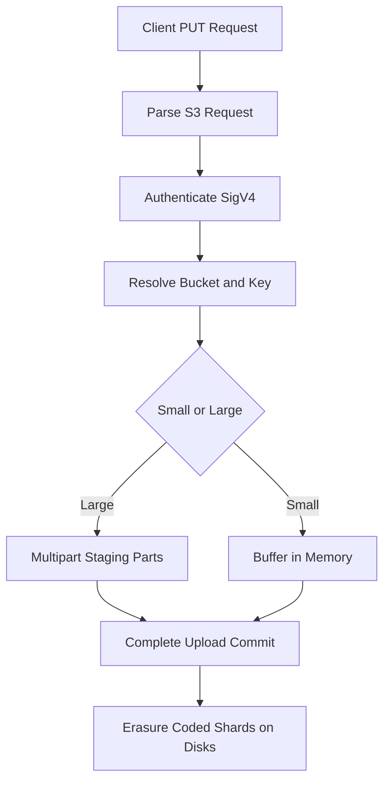

# The Data Path: How a PUT Request Becomes Bytes on Disk

## English

When a client issues a PUT to MinIO, the request is not simply streamed to a file. The server first parses the S3 request, authenticates it with the AWS Signature Version 4 scheme, and resolves the bucket and object name into a directory layout on the backend filesystem. MinIO stores each object as a directory whose name is the object key, containing the encoded data parts plus metadata files. In erasure-coded setups, the incoming stream is split into data and parity shards, and each shard is written to a different drive so that no single disk holds enough to reconstruct the object alone. This is why the on-disk layout looks nothing like the logical key you typed — the mapping between the two is MinIO's internal concern, and you should never manipulate those directories by hand.

A key detail is that MinIO supports streaming writes: for small objects it can buffer in memory, but for large ones the client is expected to use multipart upload so that the server receives bounded parts rather than one unbounded stream. Each part is written, hashed, and only committed to the object's final namespace when the multipart upload is completed. Until then the parts sit in a temporary staging area. If the client disappears mid-upload, an incomplete upload lingers until it is aborted or garbage-collected by a lifecycle rule, which is why abandoned multipart uploads are a common source of unexpected storage consumption.

On the read path the reverse happens. A GET is authenticated, the object's metadata is read to learn which shards exist and their checksums, and the server reads enough shards to reconstruct the data. Because erasure coding tolerates missing shards, a read can succeed even when several drives are offline — the server simply reads from the surviving shards and recomputes the missing ones on the fly. This is also where bitrot detection kicks in: each shard carries a checksum, and a mismatch triggers a heal rather than silently returning corrupt bytes.

A useful mental model is a librarian who never hands you the original manuscript. Instead the manuscript is photocopied into overlapping fragments stored in different cabinets, and the librarian reassembles a clean copy on demand, cross-checking fragments against a catalogue of checksums. You ask for a book by title; you never see the cabinets. That abstraction boundary is exactly what the S3 API gives you, and it is why object storage behaves so differently from a POSIX filesystem where you can open, seek, and rewrite bytes in place.

Practically, understanding this path explains several operational behaviours: latency scales with object size and shard count, small-object workloads stress metadata rather than throughput, and partial failures surface as slow reads rather than hard errors because reconstruction is happening behind the scenes. It also explains why deleting an object is a metadata operation plus asynchronous cleanup, not an immediate physical erase.

## 中文

當客戶端向 MinIO 發出 PUT 請求，資料並不是簡單地串流寫入一個檔案。伺服器首先解析 S3 請求，用 AWS Signature Version 4 方案驗證身分，然後把 bucket 與 object 名稱解析成後端檔案系統上的目錄佈局。MinIO 把每個 object 存成一個以 object key 命名的目錄，內含編碼後的資料分片以及元數據檔案。在啟用糾刪碼的部署中，傳入的串流會被切成資料分片與校驗分片，每個分片寫到不同的磁碟，令任何單一磁碟都不足以獨自重建整個 object。這就是為何磁碟上的佈局與你輸入的邏輯 key 看起來完全兩回事 —— 兩者之間的對應是 MinIO 的內部事務，你絕不應該手動去改那些目錄。

一個關鍵細節是 MinIO 支援串流寫入：對於小 object 它可以在記憶體中緩衝，但對於大 object，客戶端應該使用分段上傳（multipart upload），讓伺服器接收到有界的分段而不是一條無界串流。每個分段都會被寫入、計算雜湊，只有在分段上傳完成時才提交到 object 的最終命名空間。在此之前，分段停留在臨時暫存區。如果客戶端在上傳中途消失，未完成的上傳會一直殘留，直到被中止或被生命週期規則回收 —— 這就是為何被遺棄的分段上傳是意外儲存消耗的常見來源。

讀取路徑則是反過來。GET 請求經過驗證後，伺服器讀取 object 的元數據，得知哪些分片存在及其校驗和，然後讀取足夠的分片來重建資料。由於糾刪碼能容忍分片缺失，即使有幾塊磁碟離線，讀取仍可成功 —— 伺服器只需從存活的分片讀取，並即時重算缺失的部分。這也是位元腐蝕偵測發揮作用的地方：每個分片都帶有校驗和，一旦不匹配便觸發修復，而不是悄悄回傳損壞的位元組。

一個有用的心智模型是一位永不把原稿交給你的圖書館員。原稿被複印成互相重疊的碎片，存放在不同的櫃子裡，圖書館員按需重新組裝出一份乾淨的副本，並對照校驗和目錄逐一核對碎片。你按書名借書，永遠看不到那些櫃子。這個抽象邊界正是 S3 API 給你的東西，也是為何對象儲存的行為與 POSIX 檔案系統如此不同 —— 在檔案系統裡你可以開啟、隨機定位、就地改寫位元組。

在實務上，理解這條路徑能解釋幾個運維現象：延遲隨 object 大小與分片數量而變，小 object 工作負載壓力落在元數據而非吞吐量，而部分故障會表現為緩慢的讀取而非硬性錯誤，因為重建正在背後進行。它亦解釋了為何刪除 object 是元數據操作加上非同步清理，而不是即時物理抹除。

## Key Takeaway

A PUT is authenticated, split into erasure-coded shards across drives, and committed only on completion, while a GET reconstructs the object from surviving shards and checksums on demand.

## Related Concepts
- Erasure coding
- Multipart upload

## Diagram

