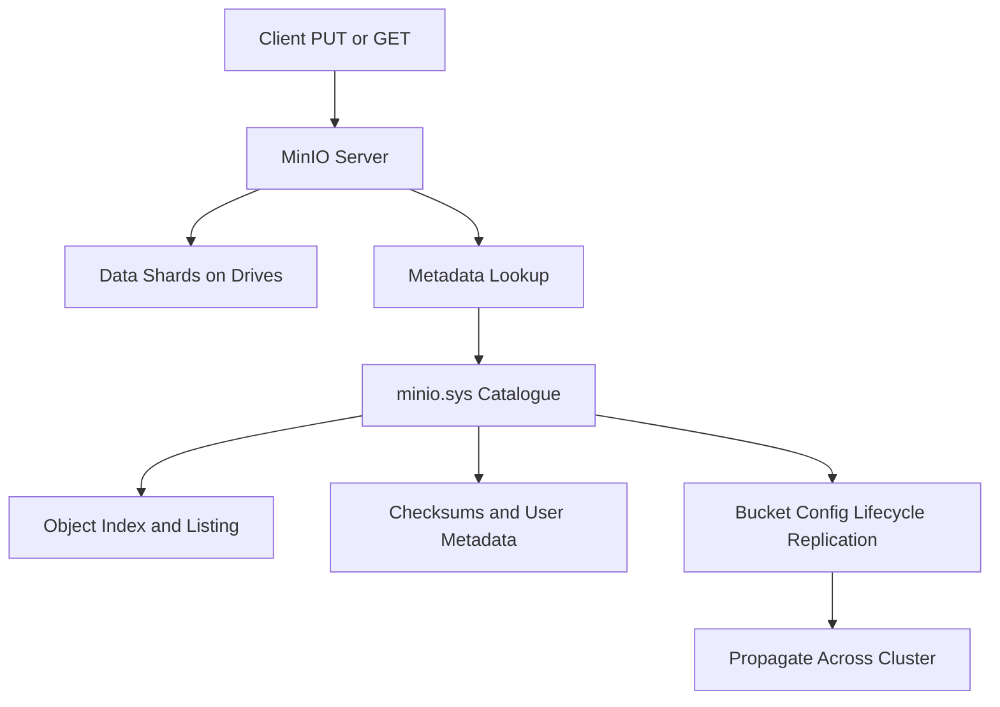

# The .minio.sys Metadata Layer and Why Object Stores Need a Catalogue

## English

Object storage looks stateless from the client's perspective: you PUT a key, you GET a key. But underneath, MinIO must remember an enormous amount of bookkeeping — which shards belong to which object, what the checksums are, what user metadata (content type, custom headers) was attached, and which objects exist in a bucket so that listing works. MinIO keeps this catalogue in a hidden internal namespace, conventionally under a directory named .minio.sys at the root of each drive. That directory holds system metadata, bucket configuration, and internal state that the server consults on every request.

Why does this matter? Because in a distributed object store, listing a bucket cannot mean walking every drive and reconstructing every object's directory name — that would be catastrophically slow at millions of objects. Instead the metadata layer provides an index the server can consult. The trade-off is that metadata operations and data operations have very different performance characteristics: a workload of many tiny objects stresses the catalogue far more than a workload of a few large objects moving the same total bytes. This is the root of the well-known advice that object stores prefer fewer, larger objects, and that batching or packing small files pays off.

The .minio.sys area is also where bucket-level configuration lives — things like lifecycle rules, notification targets, replication settings, and object-lock configuration. When you change a bucket policy or add a lifecycle rule, that change is persisted into this internal namespace and replicated across the cluster so every node agrees. This is why configuration changes in a distributed deployment are not instantaneous global switches but state that must propagate and converge.

A practical consequence: you should treat .minio.sys as off-limits. It is not a user bucket, it will not behave like one, and poking at it can corrupt the server's view of the world. When backing up or migrating, use the supported tools and APIs rather than copying raw drive contents, because a raw copy of data shards without their matching metadata is not a usable object. The metadata and the data are two halves of the same thing.

Think of a warehouse with a manifest at the front desk. The manifest tells you exactly which aisle and shelf holds each crate; the crates themselves are just boxes. Lose the manifest and you have a warehouse full of unlabelled boxes — the bytes are all there, but nothing tells you which box is which. That is why the internal metadata layer, dull as it sounds, is the part of MinIO you most want to keep healthy and least want to touch.

## 中文

從客戶端角度看，對象儲存好像是無狀態的：你 PUT 一個 key，你 GET 一個 key。但在底層，MinIO 必須記住大量簿記資料 —— 哪些分片屬於哪個 object、校驗和是甚麼、附加了甚麼使用者元數據（內容類型、自訂標頭），以及 bucket 內有哪些 object 以便列表操作能運作。MinIO 把這份目錄存放在一個隱藏的內部命名空間，慣例上是在每塊磁碟根目錄下一個名為 .minio.sys 的目錄。該目錄存放系統元數據、bucket 設定，以及伺服器在每個請求時查閱的內部狀態。

為何這很重要？因為在分散式對象儲存中，列出 bucket 不可能意味著走遍每塊磁碟並重建每個 object 的目錄名稱 —— 在數百萬個 object 的規模下那會慢得災難性。反之，元數據層提供了一個伺服器可查閱的索引。代價是元數據操作與資料操作的效能特徵截然不同：大量細小 object 的工作負載對目錄的壓力，遠大於少量大 object 搬運相同總位元組數的工作負載。這就是「對象儲存偏好較少而較大的 object」這條眾所周知的建議之根源，也是把小檔案批次打包會划算的原因。

.minio.sys 區域亦是 bucket 層級設定的所在 —— 例如生命週期規則、通知目標、複製設定、物件鎖定設定。當你更改 bucket 策略或加入生命週期規則，該變更會持久化到這個內部命名空間，並複製到整個叢集，令每個節點達成一致。這就是為何分散式部署中的設定變更不是即時的全局開關，而是必須傳播並收斂的狀態。

一個實際後果：你應該把 .minio.sys 視為禁區。它不是使用者 bucket，行為也不會像一個使用者 bucket，亂動它可能損壞伺服器對世界的認知。備份或遷移時，應使用受支援的工具與 API，而不是複製原始磁碟內容，因為只有資料分片而沒有對應元數據的原始副本，並不是一個可用的 object。元數據與資料是同一件事的兩半。

想像一座倉庫，前台有一份清單。清單告訴你每個木箱放在哪條走道哪個貨架；木箱本身只是箱子。失去清單，你就有一座裝滿無標籤箱子的倉庫 —— 位元組全都還在，但沒有東西告訴你哪個箱子是哪個。這就是為何這個沉悶的內部元數據層，是 MinIO 中最需要保持健康、也最不該去碰的部分。

## Key Takeaway

MinIO keeps its object catalogue and bucket configuration in a hidden .minio.sys namespace, which is why metadata-heavy small-object workloads are slow and why raw drive copies are not usable backups.

## Related Concepts
- Bucket configuration
- Object metadata

## Diagram

