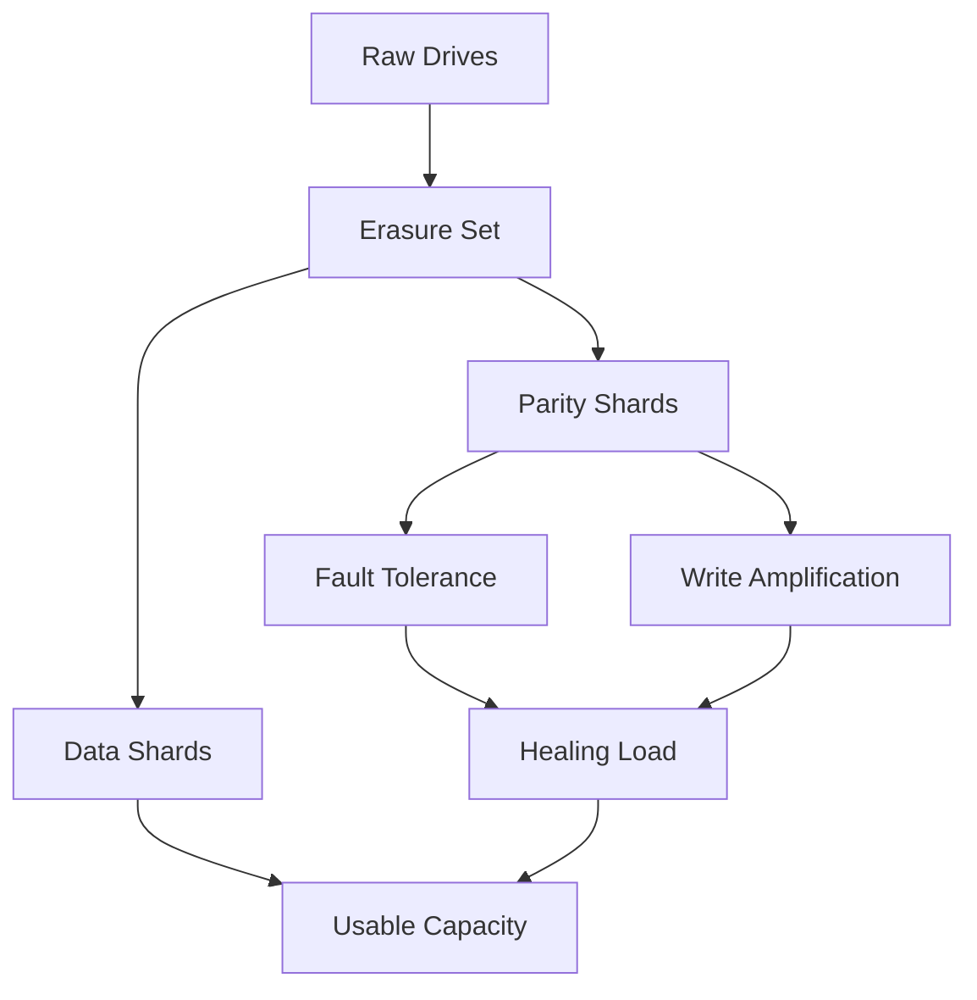

# Capacity Planning and the Cost of Durability: Choosing Parity and Drive Counts

## English

Erasure coding lets MinIO survive drive failures, but durability is not free — it is paid for in raw capacity. When you configure a deployment, you choose how many data shards and how many parity shards each object is split into. The usable capacity of the cluster is roughly the data-shard fraction of the raw capacity, so a configuration with more parity gives more fault tolerance at the cost of less usable space. This is the central capacity-planning trade-off, and it is worth understanding before you buy disks, because you cannot change the shard layout of an existing erasure set without rebuilding it.

The number of drives in a set constrains the allowed shard combinations. MinIO's erasure sets are built from a fixed number of drives, and the parity count must leave enough data shards to be sensible. As a rule of thumb, higher parity means you can lose more drives simultaneously and still read and write, which matters for large clusters where the probability of multiple concurrent failures rises with drive count. A small home lab can tolerate modest parity; a production cluster holding irreplaceable data should plan for more.

There is a second, subtler cost: write amplification and repair traffic. Every write produces both data and parity shards, so more parity means more bytes hit the network and disks per unit of user data. When a drive fails and healing begins, the cluster must read surviving shards and recompute the lost ones, consuming bandwidth and CPU that would otherwise serve clients. Over-provisioning parity is therefore not automatically safer — it can slow healing and reduce headroom. The goal is a parity level matched to your failure-domain size and your tolerance for degraded performance during repair.

Capacity planning also has to account for the fact that object storage does not shrink when you delete. Deletion is logical; space is reclaimed asynchronously, and versioning or object lock can retain old versions that still occupy space. Incomplete multipart uploads, as noted elsewhere, quietly consume capacity too. A realistic plan therefore includes monitoring actual usage growth, setting lifecycle rules to expire what you do not need, and leaving headroom for healing so that a repair does not fill the cluster and cause a write outage.

A good analogy is a lifeboat: the number of seats you reserve for redundancy determines how many passengers you can actually carry. Reserve too few and a single hole sinks you; reserve too many and you are sailing a ferry that carries a rowboat's worth of people. The right answer depends on how rough the water is — your failure domains, your drive reliability, and how much degraded performance you can tolerate while repairs run. Measure, do not guess, and revisit the numbers as the cluster grows.

## 中文

糾刪碼讓 MinIO 能承受磁碟故障，但耐用性不是免費的 —— 代價是原始容量。當你配置部署時，你要選擇每個 object 被切成多少個資料分片與多少個校驗分片。叢集的可用容量大致是原始容量中資料分片所佔的比例，所以校驗分片越多，容錯能力越強，但可用空間越少。這是容量規劃的核心取捨，值得在買磁碟之前就想清楚，因為你無法在不重建的情況下改變現有糾刪集的分配佈局。

一個糾刪集內的磁碟數量限制了允許的分片組合。MinIO 的糾刪集由固定數量的磁碟組成，校驗分片數量必須留下足夠的資料分片才算合理。經驗法則是：校驗分片越多，你能同時失去越多磁碟而仍可讀寫，這對大型叢集尤其重要，因為磁碟數量越多，多塊磁碟同時故障的機率就越高。小型家用實驗室可以容忍較低的校驗比例；存放不可替代資料的生產叢集則應規劃得更高。

還有第二個更微妙的成本：寫入放大與修復流量。每次寫入都會同時產生資料分片與校驗分片，所以校驗越多，每單位使用者資料所打的網路與磁碟位元組就越多。當磁碟故障並開始修復時，叢集必須讀取存活分片並重算遺失的分片，消耗本來可服務客戶端的頻寬與 CPU。因此過度提高校驗比例並不自動等於更安全 —— 它可能拖慢修復並減少餘裕。目標是讓校驗水平匹配你的故障域大小，以及你對修復期間效能降級的容忍度。

容量規劃還必須考慮一個事實：對象儲存在你刪除時不會立即縮小。刪除是邏輯性的；空間是非同步回收的，而版本控制或物件鎖定可能保留仍佔空間的舊版本。未完成的分段上傳，如前所述，也會悄悄消耗容量。因此現實的規劃包括監測實際使用增長、設定生命週期規則讓不需要的資料過期，以及為修復預留餘裕，免得一次修復就填滿叢集並造成寫入中斷。

一個好比喻是救生艇：你為冗餘預留多少座位，決定你實際能載多少乘客。預留太少，一個破洞就沉船；預留太多，你就在駕駛一艘只載得下一艘小艇人數的渡輪。正確答案取決於水有多洶湧 —— 你的故障域、磁碟可靠性，以及修復進行時你能容忍多少效能降級。要量度，不要猜，並隨叢集成長重新檢視這些數字。

## Key Takeaway

More parity shards buy fault tolerance with usable capacity and healing bandwidth, so parity should be matched to failure-domain size and repair headroom rather than maximised blindly.

## Related Concepts
- Erasure set
- Healing

## Diagram

