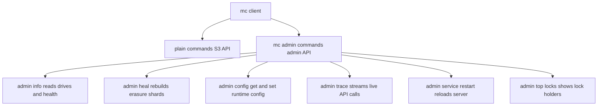

# The mc admin Toolchain: Reading Cluster State Without Guessing

## English

The `mc` client has two faces. The plain commands (`mc cp`, `mc ls`, `mc mb`) talk to the S3 API and work against any S3-compatible server. The `mc admin` subcommands are different: they talk to MinIO's own admin API, which is not part of the S3 specification at all, and they expose things the S3 protocol deliberately hides. Learning to read that state is what separates an operator from someone who just copies files around.

Start with `mc admin info <alias>`. It prints the server version, uptime, the number of drives online versus offline, and per-drive capacity and health. If a drive has been taken offline — a pulled cable, a failed disk, a node rebooting — you will see it here before any user complains. `mc admin heal` is the companion: it scans for objects whose erasure shards have drifted out of sync and rebuilds the missing pieces. Healing can run in a background mode so it does not saturate the cluster, and you can scope it to a bucket or a prefix.

The config surface is also administered from here. `mc admin config get` and `mc admin config set` read and write the server's runtime configuration — things like the notification targets, the audit log destination, or the scanner speed — and most changes take effect without a restart. `mc admin service restart` is the blunt instrument when they do not. `mc admin trace` is the most underrated command: it streams a live log of every API call the server handles, showing the request, the response code, and the latency. When someone says 'uploads feel slow', trace tells you whether the time is spent in authentication, in the data path, or waiting on a lock.

There is also `mc admin top locks`, which shows which objects currently hold locks and who is waiting on them. In a cluster doing heavy concurrent writes to the same key, this is how you diagnose a stall that looks like a network problem but is really lock contention. `mc admin scanner info` reports on the background scanner that walks the namespace looking for inconsistencies and expired lifecycle entries.

The mental model: the S3 API is the public face for applications, and the admin API is the control panel for humans. They are separate protocols with separate authentication (admin credentials or a policy that grants admin actions). Treating them as one thing leads to confusion — a user with full bucket permissions still cannot run `mc admin info`, and an admin credential is not something you hand to an application.

## 中文

`mc` 客戶端有兩副面孔。普通命令（`mc cp`、`mc ls`、`mc mb`）走的是 S3 API，對任何 S3 相容伺服器都有效。`mc admin` 子命令則完全不同：它們走的是 MinIO 自家的 admin API，這根本不是 S3 規範的一部分，它們揭露的正是 S3 協議刻意隱藏的東西。學會讀懂這些狀態，就是「維運者」與「只會複製檔案的人」之間的分界線。

先由 `mc admin info <alias>` 開始。它會印出伺服器版本、運行時間、線上與離線磁碟的數量，以及每塊磁碟的容量與健康狀況。如果有磁碟被離線——拔了線、壞了盤、節點正在重啟——你會在用戶抱怨之前就在這裡看到。`mc admin heal` 是它的搭檔：它會掃描那些糾刪分片已經不同步的對象，並重建缺失的部分。修復可以背景模式運行，以免把整個叢集塞滿，你也可以把它限定在某個 bucket 或某個前綴。

設定面也是在這裡管理的。`mc admin config get` 與 `mc admin config set` 讀寫伺服器的執行期設定——例如通知目標、審計日誌目的地、掃描器速度——大部分變更即時生效，無需重啟。當它們不生效時，`mc admin service restart` 就是那根大棒。`mc admin trace` 是最被低估的命令：它即時串流伺服器處理的每一個 API 呼叫，顯示請求、回應碼與延遲。當有人說「上傳好像很慢」，trace 會告訴你時間花在認證、資料路徑，還是等鎖。

還有 `mc admin top locks`，顯示哪些對象目前持有鎖、誰在等。在一個對同一個 key 做大量並發寫入的叢集裡，這就是你診斷「看起來像網路問題、其實是鎖競爭」的卡頓的方法。`mc admin scanner info` 則報告背景掃描器的狀況——它會走訪命名空間，尋找不一致與過期的生命週期項目。

心智模型是這樣：S3 API 是給應用程式用的公開門面，admin API 是給人用的控制面板。它們是兩套獨立協議，各有獨立的認證（admin 憑證，或授予 admin 動作的策略）。把兩者混為一談只會造成混亂——一個擁有完整 bucket 權限的使用者仍然不能執行 `mc admin info`，而 admin 憑證也絕不是交給應用程式的東西。

## Key Takeaway

mc admin commands speak a separate admin protocol that reveals cluster health, healing state, live request traces, and lock contention — information the S3 API never exposes.

## Related Concepts
- The MinIO Server Process: Ports, Configuration, and the Admin API
- Metrics, Audit Logs, and Health Endpoints: Operating MinIO Observably

## Diagram

