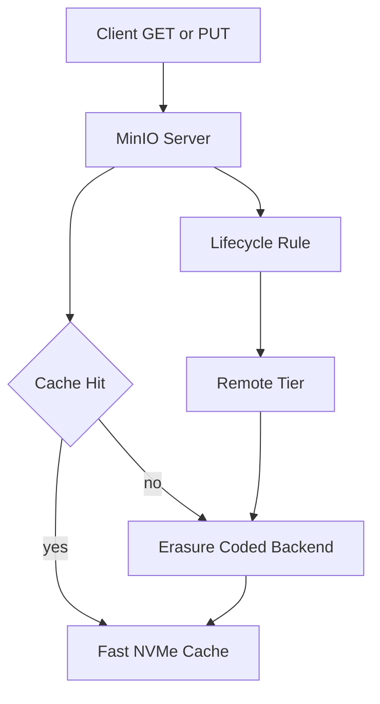

# Caching and Tiering: Putting a Fast Layer in Front of Cold Data

## English

Object storage is optimised for durability and scale, not for latency. A PUT that must write erasure shards across several drives and wait for quorum is not going to feel like a local SSD. MinIO addresses this in two complementary ways: a read/write cache in front of the cluster, and tiering that moves cold objects to a cheaper backend.

MinIO's own answer to latency used to include a read/write cache in front of the cluster, configured with `mc admin config set <alias> cache` and pointed at a local directory on fast NVMe. That subsystem existed through the 2024 releases but has since been removed from current MinIO, so treat any tutorial that still shows `cache` keys like `max_use` or `drives` as describing historical behaviour. What replaced it is not a single in-process cache but a set of deliberate choices: put your hot data on the smallest possible erasure set, keep a warm tier of recently used objects close by, and lean on tiering for everything genuinely cold.

Tiering is the other half, and it is current. You register a remote tier — another S3-compatible endpoint, whether that is cloud object storage or a second MinIO cluster — with `mc ilm tier add`, then attach a lifecycle rule that transitions objects older than N days to that tier. (The older spelling `mc admin tier add` still works in some builds but has been deprecated since 2022 in favour of the `mc ilm tier` family, which groups tiering with the other lifecycle commands.) The object's metadata stays in the hot cluster; only the bytes move. When a client later GETs the object, MinIO transparently fetches it back from the tier. From the application's point of view nothing changed: same bucket, same key, same API. This is the object-storage equivalent of a library that keeps recent books on open shelves and older ones in a basement archive, fetching on request.

A subtlety worth knowing: transitioned objects are read-through, not migrated back. Repeated access to a cold object will repeatedly hit the remote tier unless you transition it back or copy it. So tiering suits genuinely cold data — backups, compliance archives, logs past their retention window — not data that is occasionally hot. Getting this wrong turns a cost optimisation into a latency problem.

Together, caching and tiering let one namespace span a spectrum from 'hot and fast' to 'cold and cheap' without the application knowing. That is a powerful property, and also a trap: it is easy to configure a cache that is too small to help, or a tier that silently becomes the read path for a workload that was supposed to be hot.

## 中文

對象存儲優化的是耐用性與規模，不是延遲。一個 PUT 要把糾刪分片寫到多塊磁碟並等待 quorum，感覺絕對不像本機 SSD。MinIO 用兩種互補的方式應對：叢集前面的讀寫快取，以及把冷對象搬到更便宜後端的分層。

MinIO 自己的延遲對策從前包含叢集前面的讀寫快取，用 `mc admin config set <alias> cache` 設定，指向本機目錄（最好在快的 NVMe 上）。該子系統在 2024 年各個版本仍存在，但已從現行的 MinIO 中移除，所以任何仍然展示 `max_use`、`drives` 之類 `cache` 鍵值的教學，講的都是歷史行為。取代它的不是單一進程內快取，而是一連串有意識的取捨：把熱資料放在最小的糾刪集上、讓近期用過的物件留在較近的暖層、真正冷的資料就交給分層處理。

分層是另一半，而且這是現行的做法。你用 `mc ilm tier add` 註冊一個遠端層——另一個 S3 相容端點，可以是雲端對象存儲或第二個 MinIO 叢集——然後掛上一條生命週期規則，把超過 N 天的對象轉移到該層。（舊的寫法 `mc admin tier add` 在某些版本仍然可用，但自 2022 年起已被棄用，改用 `mc ilm tier` 系列，把分層與其他生命週期命令歸在一起。）對象的元數據留在熱叢集，只有位元組搬走。客戶端之後 GET 該對象時，MinIO 會透明地從分層取回。從應用程式角度什麼都沒變：同一個 bucket、同一個 key、同一個 API。這就像一座圖書館，新書放在開放書架，舊書放在地下檔案庫，需要時才去取。

有個微妙之處值得知道：已轉移的對象是讀穿（read-through），不會自動搬回來。反覆存取一個冷對象會反覆打到遠端層，除非你把它轉移回來或複製一份。所以分層適合真正冷的資料——備份、合規檔案、超過保留期的日誌——不適合偶爾會熱的資料。搞錯這一點，就會把成本優化變成延遲問題。

合起來，快取與分層讓同一個命名空間橫跨「熱而快」到「冷而便宜」的光譜，而應用程式毫不知情。這是強大的特性，也是陷阱：很容易設出一個小到沒用的快取，或一條悄悄變成某個本該是熱的工作負載之讀取路徑的分層。

## Key Takeaway

Caching absorbs latency and bursts in front of the erasure-coded backend, while tiering moves genuinely cold objects to cheaper storage — but transitioned objects read through, so tiering only pays off for data that stays cold.

## Related Concepts
- Lifecycle Rules and Storage Classes: Making Objects Age Gracefully
- Capacity Planning and the Cost of Durability: Choosing Parity and Drive Counts

## Diagram

