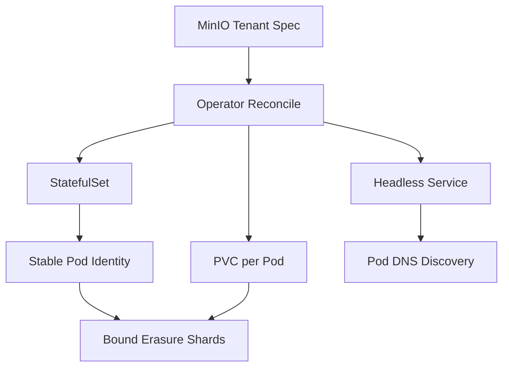

# Running MinIO in Kubernetes: StatefulSets, PVCs, and the Operator

## English

Kubernetes is built around stateless pods that can be killed and rescheduled at any moment. MinIO in distributed mode is the opposite: each node owns specific drives, and those drives hold specific erasure shards. If a pod comes back with different storage, the cluster sees a missing drive. Reconciling these two worldviews is the core challenge of running MinIO on Kubernetes.

The first answer is the StatefulSet. Unlike a Deployment, a StatefulSet gives each pod a stable identity (`minio-0`, `minio-1`, …) and, via volumeClaimTemplates, its own PersistentVolumeClaim that follows the pod across reschedules. Each pod's drive is therefore bound to that pod's ordinal, which is exactly what MinIO's erasure sets assume. You typically run one MinIO server per pod, with a local or block-backed volume, and use a headless Service so the pods can resolve each other by DNS name for the internal cluster traffic.

There is a well-known caveat about local volumes: a pod rescheduled to a different node will not find its local PersistentVolume there. This is why many deployments use node affinity to pin MinIO pods to specific nodes, or use network-attached block storage that can reattach elsewhere. The trade-off is real — local NVMe is faster but less flexible; network block storage is more portable but adds a hop. Neither is wrong; the choice follows from whether you value throughput or scheduling freedom.

The MinIO Operator automates much of this. It introduces a custom resource, the Tenant, which describes the desired state — number of server pools, drives per node, CPU and memory, TLS, and the storage class. The operator creates the StatefulSets, Services, and PVCs, and reconciles them when you change the spec. It also manages the console, and handles upgrades by rolling pods one at a time so the cluster stays available. The operator is optional; you can hand-write the YAML. But at any real scale, the reconciliation logic saves a lot of careful YAML editing.

Finally, remember that Kubernetes health checks and MinIO health are not the same thing. A liveness probe that restarts a pod because a drive is slow can make things worse by forcing a rejoin. Prefer readiness probes that take the pod out of rotation without killing it, and let MinIO's own healing handle drive-level recovery. The cluster is designed to tolerate a missing drive; it is not designed to tolerate being restarted every thirty seconds.

## 中文

Kubernetes 圍繞著無狀態 pod 設計，pod 隨時可以被殺掉並重新排程。分散式模式的 MinIO 恰恰相反：每個節點擁有特定的磁碟，而那些磁碟存著特定的糾刪分片。如果 pod 回來時帶著不同的儲存，叢集就會看到一塊消失的磁碟。調和這兩種世界觀，就是在 Kubernetes 上跑 MinIO 的核心挑戰。

第一個答案是 StatefulSet。與 Deployment 不同，StatefulSet 給每個 pod 穩定的身分（`minio-0`、`minio-1`……），並透過 volumeClaimTemplates 給它自己的 PersistentVolumeClaim，讓它在重新排程後仍跟著同一個 pod。因此每個 pod 的磁碟綁定到它的序號，這正是 MinIO 糾刪集所假設的。你通常每個 pod 跑一個 MinIO 伺服器，配上本機或區塊儲存卷，並用 headless Service 讓 pod 之間能透過 DNS 名稱互相解析，進行叢集內部通訊。

關於本機卷有個眾所周知的注意點：pod 被排到另一個節點時，在那裡找不到它的本機 PersistentVolume。這就是為什麼許多部署用 node affinity 把 MinIO pod 釘在特定節點，或改用可重新掛載到別處的網路區塊儲存。這個取捨很真實——本機 NVMe 更快但較不靈活；網路區塊儲存更可攜但多了一跳。兩者都沒有錯；選擇取決於你重視吞吐量還是排程自由度。

MinIO Operator 把大部分這些自動化。它引入一個自訂資源 Tenant，描述期望狀態——伺服器池數量、每節點磁碟數、CPU 與記憶體、TLS、儲存類別。Operator 建立 StatefulSet、Service 與 PVC，並在你改 spec 時進行調和。它也管理主控台，並以一次滾動一個 pod 的方式處理升級，讓叢集保持可用。Operator 是選用的；你可以手寫 YAML。但在任何真實規模下，調和邏輯能省下大量小心翼翼的 YAML 編輯。

最後，記住 Kubernetes 的健康檢查與 MinIO 的健康不是同一回事。一個因為磁碟變慢就重啟 pod 的 liveness probe，可能因為強迫重新加入而讓情況更糟。優先使用 readiness probe，把 pod 移出輪替而不殺掉它，並讓 MinIO 自己的修復機制處理磁碟層級的復原。叢集被設計成能容忍一塊消失的磁碟；它可沒被設計成能容忍每三十秒被重啟一次。

## Key Takeaway

StatefulSets with per-pod PVCs preserve the drive-to-node binding MinIO's erasure sets depend on, and the Operator automates that reconciliation — but health probes must respect that a missing drive is a recoverable state, not a reason to restart.

## Related Concepts
- Distributed Mode: How MinIO Scales Horizontally
- Deployment Topologies: Single-Node, Distributed, and Site Replication

## Diagram

