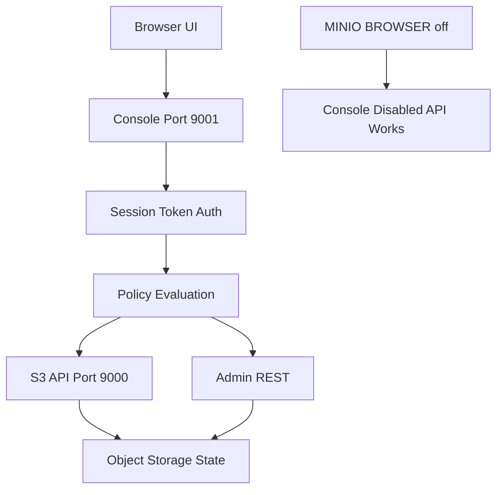

# The MinIO Console and the Browser UI: What the Web Interface Can and Cannot Do

## English

MinIO ships with a browser-based administrative console that listens on a separate port from the S3 API (by default the API is on 9000 and the console on 9001 in recent container images, though you can override both with flags like --address and --console-address). The console is a convenience layer, not a second protocol: every button in it ultimately calls the same S3 and admin REST endpoints that mc and SDKs use. When you log in, the console authenticates you with a root credential or an IAM user and then issues short-lived session tokens, so the browser is not permanently holding your long-lived secret key. That design detail matters because it means the UI inherits exactly the same policy evaluation as any other client — if a policy denies s3:PutObject on a bucket, the upload button will fail with the same AccessDenied error an SDK would see.

The console is genuinely useful for exploration: browsing buckets, inspecting object metadata, generating a presigned share link, watching server metrics, and creating users and policies without memorising JSON. But it is deliberately not a full management tool. Anything repetitive or scriptable — bulk policy changes, lifecycle tuning across dozens of buckets, CI provisioning — belongs in mc or the Admin API, because the console has no batch mode and no idempotent declarative configuration. Treating the console as the source of truth for infrastructure is a common beginner mistake: the state lives in the server, and the console merely renders it.

A subtle but important behaviour is that the console can be disabled entirely with an environment variable (MINIO_BROWSER=off), which many production operators do to shrink the attack surface. If the console is off, the API keeps working normally — proof that the two are independent listeners, not one monolithic app. Conversely, you can expose the console behind a reverse proxy at a sub-path, which requires setting the correct public URL so that generated links and redirects point somewhere the browser can actually reach. Misconfigured proxies producing a blank page or a redirect loop are almost always this problem, not a MinIO bug.

Security-wise, the console deserves the same scrutiny as any admin panel. Root credentials should never be used for day-to-day browsing; create an IAM user with an admin policy attached and log in as that. Session tokens expire, so an idle tab will eventually need re-authentication — that is a feature. And because the console can generate presigned URLs, anyone with console access can mint temporary public links to private objects; audit who has console reachability at the network layer, not just at the IAM layer.

Finally, remember the console is a client, and clients can be replaced. If you prefer a generic S3 browser (many desktop tools exist), or you are automating everything, you may never open the MinIO console at all. Its value is in the first hour of learning a new deployment and in quick spot checks, not in being part of your architecture.

## 中文

MinIO 內建一個以瀏覽器為基礎的管理主控臺（console），它監聽的埠與 S3 API 不同（近期容器映像中，API 預設在 9000、主控臺在 9001，兩者都可用 --address 與 --console-address 旗標覆寫）。主控臺只是一層便利包裝，並非第二種協定：它上面每一個按鈕，最終呼叫的都是 mc 與各 SDK 所用的同一批 S3 與 admin REST 端點。當你登入時，主控臺會用 root 憑證或某個 IAM 使用者來驗證你，然後發出短命的 session token，因此瀏覽器不會長期握有你的長效 secret key。這個設計細節很重要，因為它意味著 UI 繼承了與任何其他客戶端完全相同的策略評估——若某條策略拒絕了某個 bucket 上的 s3:PutObject，上傳按鈕就會失敗，並回傳與 SDK 所見相同的 AccessDenied 錯誤。

主控臺在探索時確實好用：瀏覽 bucket、檢視物件中介資料、產生 presigned 分享連結、觀察伺服器指標，以及不必背誦 JSON 就能建立使用者與策略。但它刻意不是完整的管理工具。任何重複性或可指令碼化的工作——大量策略變更、跨數十個 bucket 調校生命週期、在 CI 中做佈建——都應該交給 mc 或 Admin API，因為主控臺沒有批次模式，也沒有冪等的宣告式設定。把主控臺當成基礎設施的真實來源，是常見的新手錯誤：狀態存在伺服器裡，主控臺只是把它呈現出來。

一個細微但重要的行為是：主控臺可以用環境變數完全停用（MINIO_BROWSER=off），許多生產環境的操作者都會這麼做以縮小攻擊面。主控臺關掉之後，API 仍照常運作——這證明兩者是各自獨立的監聽器，而不是一個 monolithic 應用。反過來說，你也可以把主控臺放在反向代理之後、掛在某個子路徑上，但這需要設定正確的公開 URL，否則產生的連結與重導向會指向瀏覽器實際到不了的地方。設定錯誤的代理造成空白頁或重導向迴圈，幾乎都是這個問題，而不是 MinIO 的 bug。

在安全方面，主控臺值得和任何管理面板一樣被嚴格檢視。root 憑證絕不該用於日常瀏覽；請建立一個繫結 admin 策略的 IAM 使用者，並以該身分登入。session token 會過期，所以閒置的分頁最終需要重新驗證——這是特性，不是缺陷。而且因為主控臺能產生 presigned URL，任何能存取主控臺的人都能為私有物件鑄造臨時公開連結；因此要在網路層稽核誰能連到主控臺，而不只是在 IAM 層。

最後要記得，主控臺是一個客戶端，而客戶端是可以替換的。如果你偏好通用的 S3 瀏覽器（市面上有許多桌面工具），或者你一切都自動化，你可能根本不會開啟 MinIO 主控臺。它的價值在於學習一個新部署的頭一小時，以及快速抽查，而不在於成為你架構的一部分。

## Key Takeaway

The MinIO console is just another S3/admin API client rendered in a browser, so it inherits the same policies and should never be your source of truth or your root-credential habit.

## Related Concepts
- The MinIO Server Process: Ports, Configuration, and the Admin API
- Identity and Access Management: Users, Groups, Policies, and Service Accounts

## Diagram

