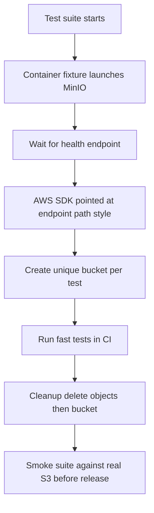

# Testing Against MinIO: Fixtures, Cleanup, and Why It Is Not Quite AWS

## English

MinIO has become the default local stand-in for S3 in test suites because it starts in seconds, needs no cloud account, and speaks the S3 API faithfully enough for most code paths. The typical pattern is a container fixture: a test harness (Testcontainers in Java, pytest fixtures in Python, a docker-compose service in Node projects) launches a MinIO container, waits for its health endpoint to answer, then hands the test suite an endpoint URL plus an access key and secret key. A common trick is to point the AWS SDK at that endpoint and force path-style addressing (in boto3, the config option s3={'addressing_style': 'path'}), because MinIO serves buckets as path components rather than as virtual-host subdomains unless you have wildcard DNS configured.

The biggest source of false confidence is the gap between MinIO and real AWS S3. They agree on the core verbs — PutObject, GetObject, ListObjectsV2, multipart upload — but differ in edge behaviour. AWS has broader regional coverage, additional storage classes, request-payer semantics, and a much larger set of managed features such as Object Lambda and certain replication modes (note that S3 has been strongly consistent for all operations, including LIST, since December 2020, so consistency itself is not a differentiator). MinIO implements a pragmatic subset. So a suite that passes against MinIO proves your code is structurally correct, but it does not prove it will pass against AWS. The mature approach is a two-tier test strategy: fast, cheap, always-run tests against MinIO in CI, plus a smaller smoke suite against a real S3 bucket before release.

Isolation is the other recurring pain. Each test that creates a bucket must clean it up, and deleting a non-empty bucket fails — you must delete objects first, or use a bucket lifecycle rule with expiration, or rely on mc rb --force. A robust fixture creates a uniquely named bucket per test (often a UUID suffix) and tears it down in a finally block, so a crashed test does not poison the next run. If tests share a bucket, parallel execution will produce flaky failures that look like application bugs but are actually namespace collisions.

Credentials in tests deserve care too. Hard-coding minioadmin/minioadmin is acceptable for a throwaway container on localhost, but the moment the fixture can reach a shared environment, that default becomes a liability. Pass credentials through environment variables, and never commit a .env file containing anything that touches a non-local deployment. Also pin the container image tag — the latest tag drifts, and a behaviour change in a new MinIO release can turn a green pipeline red for reasons unrelated to your code.

Finally, think about what you are actually testing. If the goal is your application logic, MinIO is ideal. If the goal is S3-specific behaviour — signature quirks, region redirects, unusual error codes — only real S3 will do. Knowing which question each environment answers is what separates a trustworthy test suite from one that merely looks green.

## 中文

MinIO 已成為測試套件中 S3 的預設本機替身，因為它幾秒內就能啟動、不需要雲端帳號，而且對大多數程式路徑而言，講 S3 API 講得夠忠實。典型模式是容器 fixture：測試框架（Java 的 Testcontainers、Python 的 pytest fixture、Node 專案裡的 docker-compose 服務）啟動一個 MinIO 容器，等它的健康端點回應，然後把端點 URL 加上 access key 與 secret key 交給測試套件。一個常見技巧是把 AWS SDK 指向該端點並強制使用 path-style 定址（在 boto3 中是設定選項 s3={'addressing_style': 'path'}），因為除非你設定了萬用字元 DNS，MinIO 會把 bucket 當成路徑元件來服務，而不是虛擬主機子網域。

假信心的最大來源，是 MinIO 與真實 AWS S3 之間的落差。兩者在核心動詞上一致——PutObject、GetObject、ListObjectsV2、分段上傳——但邊緣行為不同。AWS 有更廣的區域覆蓋、額外的儲存類別、request-payer 語意，以及大得多的受管功能集合，例如 Object Lambda 與某些複寫模式（注意 S3 自 2020 年 12 月起對所有操作包括 LIST 都是強一致，所以一致性本身並不是差異點）。MinIO 實作的是一套務實的子集。所以一套對 MinIO 通過的測試，證明你的程式在結構上正確，但不證明它能對 AWS 通過。成熟的做法是兩層測試策略：在 CI 中對 MinIO 跑快速、便宜、每次都跑的測試，外加在發佈前對真實 S3 bucket 跑一套較小的煙霧測試。

隔離是另一個反覆出現的痛點。每個建立 bucket 的測試都必須清理它，而刪除非空 bucket 會失敗——你必須先刪物件，或使用帶到期規則的 bucket 生命週期規則，或依賴 mc rb --force。穩健的 fixture 會為每個測試建立唯一命名的 bucket（常用 UUID 後綴），並在 finally 區塊中拆除，這樣某個測試崩潰也不會毒害下一輪執行。如果測試共用一個 bucket，平行執行會產生看起來像應用程式 bug、實際上是命名空間碰撞的間歇性失敗。

測試中的憑證也值得小心。對 localhost 上用完即丟的容器而言，硬編碼 minioadmin/minioadmin 可以接受，但一旦該 fixture 能觸及共用環境，這個預設值就變成負債。請透過環境變數傳遞憑證，並且絕不提交任何含有會碰到非本機部署之內容的 .env 檔。同時要釘住容器映像的 tag——latest 標籤會漂移，新版本 MinIO 的行為變更可能讓原本綠燈的管線變紅，而原因與你的程式無關。

最後，想想你真正在測什麼。如果目標是你的應用邏輯，MinIO 很理想。如果目標是 S3 特有的行為——簽章怪癖、區域重導向、不尋常的錯誤碼——那就只有真實 S3 才行。知道每個環境能回答哪個問題，正是可信賴的測試套件與只是看起來綠燈的測試套件之間的差別。

## Key Takeaway

MinIO is an excellent fast CI fixture for S3-shaped code, but its subset behaviour means you still need a small smoke suite against real S3 to catch the gaps.

## Related Concepts
- Running MinIO Locally: Docker, Testcontainers, and CI Fixtures
- The S3 API Is Not One API: Subresources, Query Parameters, and the Signature Dance

## Diagram

