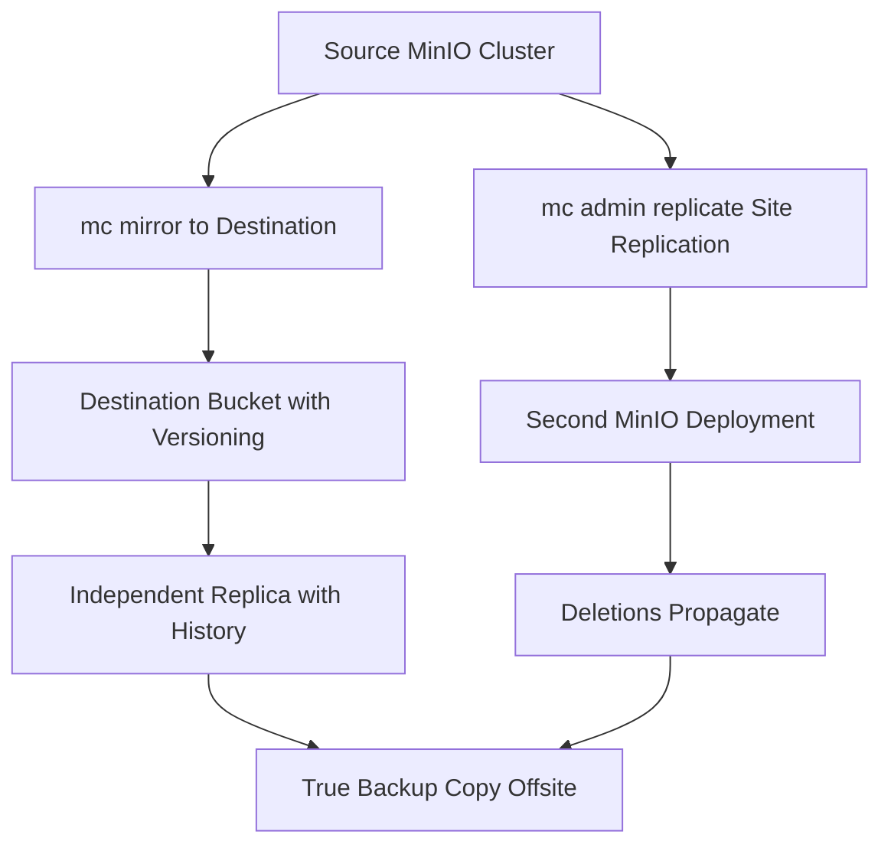

# Backing Up and Restoring MinIO: Snapshots, Mirroring, and What mc admin Can and Cannot Save You From

## English

A common misconception is that erasure coding is a backup. It is not. Erasure coding protects against drive and node failure inside a cluster; it does nothing against an operator running mc rm --recursive on the wrong bucket, a ransomware process with valid credentials, or a bug that corrupts objects through the API. A backup must survive the loss of the whole cluster and the loss of the credentials that write to it. That distinction shapes every real MinIO backup strategy.

The most portable approach is object-level mirroring with mc mirror. You point it at a source alias and a destination alias (another MinIO cluster, an S3 bucket, or even a local directory) and it copies objects, preserving metadata and optionally deleting extras with --remove. Run it on a schedule, or continuously with --watch, and you get a replica that is independent of the source's erasure sets. The caveat is that mirroring is not a point-in-time snapshot: if an object is overwritten or deleted at the source between runs, the mirror follows. To get history, you need versioning enabled on the destination bucket, so that overwrites create new versions and deletes become delete markers rather than data loss. Versioning plus mirroring is the closest thing MinIO has to incremental backup.

For whole-cluster disaster recovery, Site Replication (configured via mc admin replicate) keeps buckets, IAM policies, and objects synchronised between independent MinIO deployments. It is powerful but it is replication, not backup: a deletion propagates. Treat it as high availability across sites, and still keep a separate, versioned, ideally offline copy for true recovery. The 3-2-1 rule — three copies, two media, one offsite — still applies; MinIO just changes the mechanics of how you make those copies.

Restoring is where plans usually break. Restoring millions of small objects with mc mirror is slow because each object is a separate PUT with its own signature and metadata write; throughput is dominated by request rate, not bandwidth. Test your restore time before you need it. Also verify that IAM configuration travels with your data: users, groups, policies, and service accounts live in the server's configuration, not in the buckets, so a bucket-only restore leaves you with data nobody can access. Export the IAM metadata with mc admin cluster iam export, which produces an ALIAS-iam-info.zip archive that mc admin cluster iam import can restore elsewhere, and include mc admin config export for the server's own configuration. Note that mc admin config export deliberately does not cover users, policies, or bucket metadata — those live in the IAM backend, which is why the separate IAM export is required. Because the export skips any item it cannot read and then finishes, always open the resulting zip after an export to confirm it is valid rather than assuming success.

Finally, protect the backup itself. The destination credentials should be write-only where possible, stored separately from the source credentials, and the destination should have Object Lock enabled if you are defending against ransomware. A backup that an attacker with the same stolen key can delete is not a backup — it is a second copy of the same mistake.

## 中文

一個常見的誤解，是把糾刪碼當成備份。它不是。糾刪碼防的是叢集內的硬碟與節點故障；它對操作者在錯誤的 bucket 上執行 mc rm --recursive、對持有有效憑證的勒索軟體程式、或對透過 API 損壞物件的 bug，完全無能為力。備份必須能在整個叢集消失、以及能寫入該叢集的憑證也消失之後仍然存在。這個區別塑造了每一套真正的 MinIO 備份策略。

最具可攜性的做法，是用 mc mirror 做物件層級的映象。你把它指向來源別名與目的別名（另一個 MinIO 叢集、一個 S3 bucket，甚至一個本機目錄），它就會複製物件、保留中介資料，並可選擇用 --remove 刪除多出來的專案。你可以排程執行，或用 --watch 持續執行，於是得到一份獨立於來源糾刪集之外的副本。要注意的是，映象不是時間點快照：若來源的某個物件在兩次執行之間被覆寫或刪除，映象會跟著變。要保留歷史，你需要在目的 bucket 上啟用版本控制，這樣覆寫會產生新版本、刪除會變成刪除標記，而不是資料遺失。版本控制加映象，是 MinIO 最接近增量備份的東西。

若要做整個叢集的災難復原，Site Replication（透過 mc admin replicate 設定）會讓獨立的 MinIO 部署之間同步 bucket、IAM 策略與物件。它很強大，但它是複寫，不是備份：刪除會傳播。請把它視為跨站高可用，並且仍要為真正的復原保留一份獨立、有版本控制、最好離線的副本。3-2-1 原則——三份副本、兩種媒體、一份異地——依然適用；MinIO 改變的只是你製作這些副本的機制。

復原才是計畫通常崩潰的地方。用 mc mirror 復原數百萬個小物件很慢，因為每個物件都是一次獨立的 PUT，各有自己的簽章與中介資料寫入；吞吐量受請求速率支配，而非頻寬。在你真正需要之前，先測試復原時間。同時要確認 IAM 設定會跟著你的資料一起走：使用者、群組、策略與服務帳戶住在伺服器設定裡，不在 bucket 裡，所以只復原 bucket 會讓你得到一份沒人存取得了的資料。請用 mc admin cluster iam export 匯出 IAM 中介資料，它會產生一個 ALIAS-iam-info.zip 壓縮檔，可以交由 mc admin cluster iam import 還原到另一個站點；伺服器本身的設定則另外用 mc admin config export 匯出。要留意 mc admin config export 刻意不涵蓋使用者、策略與 bucket 中介資料——那些住在 IAM 後端，所以必須有獨立的 IAM 匯出。又因為匯出時讀不到的項目會被略過而整個流程仍會完成，所以每次匯出後都應該開啟那個 zip 確認它有效，而不是假設一定成功。

最後，保護備份本身。目的端的憑證應盡可能只具寫入權，並與來源憑證分開存放；若你要防勒索軟體，目的端應啟用 Object Lock。一份攻擊者用同一把竊得的金鑰就能刪掉的備份，不是備份——那只是同一個錯誤的第二份副本。

## Key Takeaway

Erasure coding is availability, not backup; a real MinIO backup needs mirroring plus destination versioning, separately stored credentials, and a restore time you have actually measured.

## Related Concepts
- Erasure Coding: How MinIO Achieves Data Durability
- Object Lock and Immutability: WORM Storage for Ransomware and Compliance

## Diagram

