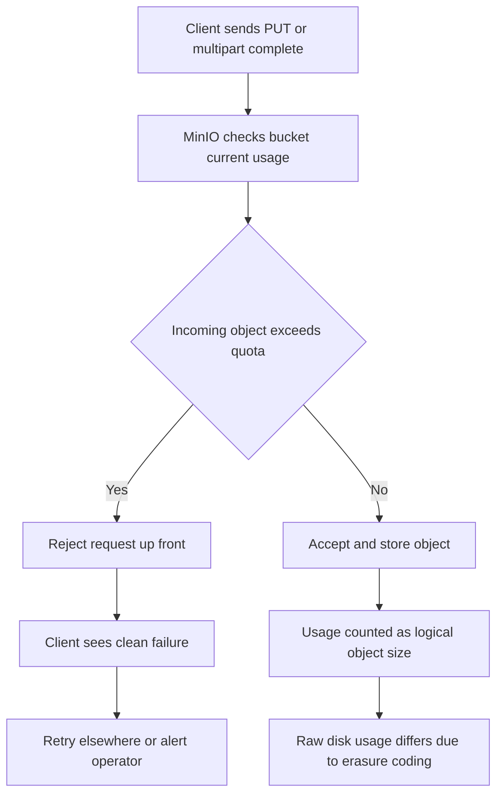

# Quota Enforcement and Bucket Limits: What Happens When Storage Runs Out

## English

MinIO lets you cap a bucket's total size with `mc quota set`, and the way it enforces that cap teaches you something fundamental about object stores. Unlike a POSIX filesystem where a quota failure surfaces as ENOSPC in the middle of a write, MinIO checks the bucket's current usage before accepting a PUT or a multipart upload's completion. If the incoming object would push usage past the limit, the request is rejected up front with an error rather than silently filling the disk. This design means the client sees a clean failure and can retry elsewhere or alert an operator, instead of discovering a half-written object later.

The interesting subtlety is that quota accounting happens against the logical object size, not the physical bytes on disk after erasure coding. A bucket with a 1 TiB quota and a 4+4 erasure set can hold 1 TiB of object data even though the cluster consumes roughly twice that in raw capacity. So a quota is a governance tool, not a capacity-planning tool: it protects one team's bucket from being eaten by another team's runaway job, but it will not stop the cluster itself from filling up. Those are two different failure modes and you need both a quota strategy and a capacity strategy.

Quotas also interact with multipart uploads in a way that surprises people. When you upload a large file in parts, the parts sit in a staging area until you call CompleteMultipartUpload. Depending on how the implementation accounts for in-flight uploads, an incomplete multipart upload may or may not count against the quota while it is being assembled. This is exactly why lifecycle rules that abort incomplete multipart uploads after N days matter so much in production: abandoned uploads are invisible in a normal object listing but they still occupy disk, and they can quietly erode the headroom you thought you had.

Beyond hard quotas, there is the question of what happens when the underlying drives genuinely fill up. MinIO's erasure coding needs free space to write new shards and to heal damaged ones; a cluster that is 99% full cannot heal effectively because healing requires writing reconstructed shards. Operators therefore typically set a soft threshold — often around 70-80% raw usage — and treat crossing it as an incident. The quota system is the first line of defence, but the second line is monitoring free space per drive and alerting before healing becomes impossible.

For an undergraduate building a project, the practical lesson is: enforce limits at the layer closest to the producer. If your application generates logs or user uploads into MinIO, set a bucket quota and a lifecycle rule together. The quota stops a single bucket from monopolising the cluster; the lifecycle rule stops time from doing the same thing slowly. Neither one alone is sufficient, and understanding why is the difference between a system that degrades gracefully and one that falls over on a Friday night.

## 中文

MinIO 可以用 `mc quota set` 為 bucket 設定總容量上限，而它的執行方式正好揭示了對象存儲一個很根本的道理。POSIX 檔案系統的 quota 失敗通常是在寫入途中冒出 ENOSPC；MinIO 卻不一樣，它在接受 PUT 或完成 multipart upload 之前，會先檢查 bucket 目前的用量。如果新對象會令用量超出上限，請求會即時被拒絕並回傳錯誤，而不是靜靜地把磁碟塞滿。這種設計讓客戶端看到一個乾淨的失敗，可以重試或通知維運人員，而不是事後才發現寫了半個對象。

有趣的地方在於，quota 計算的是對象的邏輯大小，而不是糾刪碼之後磁碟上的實體位元組。一個 1 TiB quota 的 bucket，配上 4+4 的 erasure set，可以裝下 1 TiB 的對象資料，但叢集的原始容量其實消耗了接近兩倍。所以 quota 是治理工具，不是容量規劃工具：它保護某個團隊的 bucket 不會被另一個團隊的失控任務吃光，但它不會阻止叢集本身被填滿。這是兩種不同的故障模式，你需要同時有 quota 策略和容量策略。

Quota 跟 multipart upload 的互動也常令人意外。當你分段上傳一個大檔案，各個 part 會停留在暫存區，直到你呼叫 CompleteMultipartUpload 為止。視乎實作如何計算進行中的上傳，未完成的 multipart upload 可能計入、也可能不計入 quota。這正是為何「N 天後中止未完成 multipart upload」的生命週期規則在生產環境如此重要：被遺棄的上傳在普通對象列表裡看不到，但照樣佔用磁碟，還會悄悄侵蝕你以為存在的餘裕。

除了硬性 quota，還有底層硬碟真的滿了會怎樣的問題。MinIO 的糾刪碼需要空閒空間去寫新的 shard 和修復受損的 shard；一個 99% 滿的叢集無法有效 heal，因為 heal 本身就要寫入重建出來的 shard。所以維運人員通常會設一個軟性門檻——很多時候是原始用量 70-80%——一旦跨過就當作事故處理。Quota 系統是第一道防線，第二道防線則是監控每顆硬碟的剩餘空間，在 heal 變得不可能之前就發出警報。

對一個做專案的大學生來說，實用的教訓是：在離生產者最近的那一層設限。如果你的應用會把日誌或使用者上傳寫進 MinIO，就把 bucket quota 和生命週期規則一起設好。Quota 阻止單一 bucket 壟斷叢集；生命週期規則阻止時間用更慢的方式做同一件事。兩者缺一不可，而明白這個道理，就是系統優雅降級與週五晚上爆掉之間的差別。

## Key Takeaway

Bucket quotas are governance limits measured in logical object bytes, not a substitute for capacity planning, and they only work well when paired with lifecycle rules that clean up abandoned multipart uploads.

## Related Concepts
- Multipart Upload and Lifecycle Policies
- Capacity Planning and the Cost of Durability: Choosing Parity and Drive Counts

## Diagram

