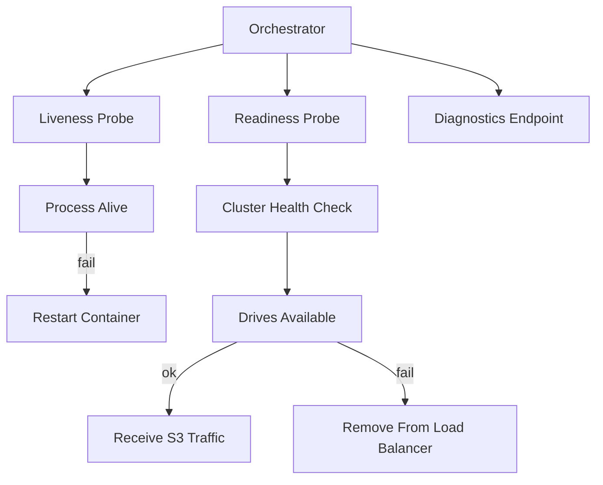

# The Health Check Endpoints: Liveness, Readiness, and Cluster Diagnostics

## English

MinIO exposes a small family of HTTP endpoints that tell you whether the server is alive, whether it is ready to serve traffic, and whether the cluster is healthy. These are not part of the S3 API — they live under the health namespace and are meant for orchestrators and monitoring systems rather than applications. Knowing them changes how you deploy MinIO, because a container that answers on its S3 port is not necessarily a container that should receive traffic.

The classic distinction is liveness versus readiness. A liveness probe asks 'is this process still running and not deadlocked?' If it fails repeatedly, the orchestrator kills and restarts the container. A readiness probe asks 'should this instance receive requests right now?' If it fails, the instance is removed from the load balancer but not restarted. MinIO provides endpoints suited to each: a lightweight liveness check that returns quickly as long as the process is up, and a cluster health check that actually inspects drive availability and reports whether the node can serve reads and writes. Wiring the wrong one into the wrong probe is a common cause of restart loops during a partial outage.

There is also a diagnostics endpoint intended for humans and support tooling. It returns a structured report about the node: version, uptime, drive states, and error conditions. In a distributed deployment this is how you answer the question 'which node is the odd one out?' without SSH-ing into every machine. The report is deliberately verbose and should not be polled at high frequency, but it is invaluable during an incident when you need to know whether a drive is offline, healing, or simply slow.

A subtle operational point: readiness should reflect the ability to serve S3 traffic, not merely the ability to accept a TCP connection. A node whose drives are all offline can still accept connections and return errors, and if your load balancer keeps sending it traffic, clients see 5xx responses that look like application bugs. By pointing readiness at the cluster health endpoint, you let the orchestrator drain traffic away from a degraded node automatically, which is exactly the behaviour you want during a drive failure or a rolling upgrade.

For someone learning about distributed systems, MinIO's health endpoints are a compact case study in the difference between 'process up' and 'service healthy'. The same pattern appears in Kubernetes, in database clusters, and in any system with partial failure. The habit worth building is: for every service you deploy, decide explicitly what liveness means, what readiness means, and what a human should look at when either one goes red — and make sure those three answers are backed by three different checks.

## 中文

MinIO 提供了一小組 HTTP endpoint，用來告訴你伺服器是否存活、是否準備好接收流量、以及叢集是否健康。這些 endpoint 不屬於 S3 API——它們位於 health 命名空間之下，對象是編排器和監控系統，而不是應用程式。認識它們會改變你部署 MinIO 的方式，因為一個能在 S3 port 上回應的容器，不代表它應該接收流量。

經典的分野是 liveness 與 readiness。Liveness probe 問的是「這個行程還在跑、沒有死鎖嗎？」如果連續失敗，編排器會殺掉並重啟容器。Readiness probe 問的是「這個實例現在應該接收請求嗎？」失敗的話，實例會從負載平衡器移除，但不會被重啟。MinIO 為兩者各自提供了合適的 endpoint：一個只要行程還在就快速回應的輕量 liveness 檢查，和一個真正檢視硬碟可用性、回報節點能否服務讀寫的叢集健康檢查。把錯的那個接到錯的 probe，是局部故障期間出現重啟迴圈的常見原因。

另外還有一個給人和支援工具用的診斷 endpoint。它回傳節點的結構化報告：版本、運行時間、硬碟狀態、錯誤情況。在分散式部署裡，這就是你回答「哪一個節點與眾不同」的方法，不必逐台 SSH 進去。這份報告刻意寫得很囉唆，不應該高頻輪詢，但在事故期間，當你需要知道某顆硬碟是離線、正在 heal、還是單純很慢，它是無價的。

一個微妙的維運重點：readiness 應該反映「能否服務 S3 流量」，而不是「能否接受 TCP 連線」。一個所有硬碟都離線的節點仍然可以接受連線然後回傳錯誤；如果負載平衡器繼續送流量給它，客戶端就會看到看似應用程式 bug 的 5xx 回應。把 readiness 指向叢集健康 endpoint，你就能讓編排器自動把流量從降級的節點抽走——這正是硬碟故障或滾動升級期間你想要的行為。

對正在學分散式系統的人來說，MinIO 的健康 endpoint 是一個精簡的案例研究，說明「行程活著」和「服務健康」的分別。同樣的模式出現在 Kubernetes、資料庫叢集，以及任何會局部故障的系統裡。值得養成的習慣是：對每個你部署的服務，明確決定 liveness 代表什麼、readiness 代表什麼、以及當任何一個變紅時人應該看什麼——並確保這三個答案背後有三個不同的檢查。

## Key Takeaway

Liveness and readiness answer different questions, and pointing readiness at MinIO's cluster health endpoint lets an orchestrator drain traffic from a degraded node instead of sending it errors.

## Related Concepts
- Metrics, Audit Logs, and Health Endpoints: Operating MinIO Observably
- Running MinIO in Kubernetes: StatefulSets, PVCs, and the Operator

## Diagram

