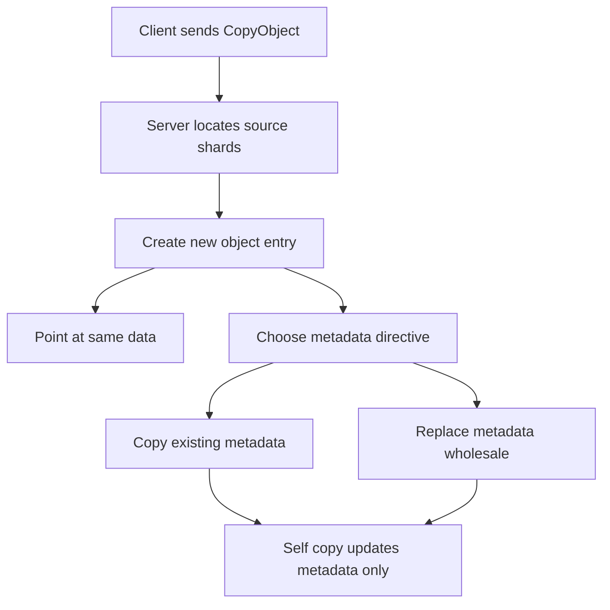

# Metadata-Only Copy and Server-Side Copy: Moving Objects Without Moving Bytes

## English

When you copy an object inside MinIO — from one key to another, or from one bucket to another on the same cluster — you are usually not moving bytes across the network. The S3 CopyObject operation tells the server 'take the data you already have and give it a new name', and the server performs a server-side copy. In a distributed cluster this is a meaningful optimisation: the shards already live on drives somewhere, and the copy can be recorded as a new object entry pointing at the same underlying data, so no client ever downloads and re-uploads gigabytes.

The catch is metadata. Every object in MinIO carries user metadata (arbitrary key-value pairs you set at upload time) and system metadata (content type, ETag, checksums, storage class, and so on). A copy operation lets you replace the metadata wholesale by supplying a new set of headers, but it does not merge old and new. If you copy an object to change its content type and forget to re-specify a custom header, that header is gone. This is why the S3 documentation talks about 'metadata directive' — you are choosing whether to copy the existing metadata or replace it, and there is no partial update.

There is a second, more subtle form: the metadata-only update, sometimes called a self-copy. You copy an object onto itself with a replacement metadata directive. Because source and destination are the same key, the data does not move, but the metadata entry is rewritten. This is the standard trick for changing an object's storage class, content type, or cache headers after the fact, because object stores have no 'update in place' operation — objects are immutable once written, and any change is conceptually a new version.

Server-side copy also interacts with versioning and encryption. On a versioned bucket, a copy produces a new version rather than overwriting the old one, so a careless self-copy loop can multiply your storage. On an encrypted bucket, the copy is re-encrypted under the destination's key configuration, which matters if you are rotating keys. And copies across clusters are a different animal entirely: that is replication or `mc mirror`, which does move bytes over the network and has its own bandwidth and consistency characteristics.

For a student, the mental model to internalise is that object stores separate 'the bytes' from 'the name and metadata pointing at them'. Most operations you think of as file operations — rename, move, chmod — are really metadata operations or copy-then-delete sequences. Understanding which one you are paying for is the difference between a migration that takes minutes and one that saturates your network for hours.

## 中文

當你在 MinIO 內部複製一個對象——由一個 key 複製到另一個 key，或在同一個叢集內由一個 bucket 複製到另一個 bucket——你通常不是在網路上搬運位元組。S3 的 CopyObject 操作等於告訴伺服器「把你已經有的資料換個新名字」，伺服器會進行 server-side copy。在分散式叢集裡這是個有意義的優化：shard 本來就躺在某處的硬碟上，複製可以記錄成一筆新的對象條目指向同一份底層資料，客戶端完全不需要下載再上傳幾 GB。

陷阱在於 metadata。MinIO 裡每個對象都帶著使用者 metadata（上傳時你設定的任意 key-value）和系統 metadata（content type、ETag、checksum、storage class 等等）。複製操作讓你可以提供一組全新的 header 來整批取代 metadata，但它不會把新舊合併。如果你複製一個對象只想改 content type，卻忘了重新指定某個自訂 header，那個 header 就消失了。這就是為何 S3 文件會談到「metadata directive」——你是在選擇複製現有 metadata 還是整批取代，並沒有局部更新這回事。

還有第二種更微妙的形式：純 metadata 更新，有時叫 self-copy。你把一個對象複製到它自己身上，並使用取代 metadata 的 directive。因為來源和目的地的 key 相同，資料不會移動，但 metadata 條目會被重寫。這是事後更改對象的 storage class、content type 或 cache header 的標準技巧，因為對象存儲沒有「就地更新」這回事——對象一旦寫入就不可變，任何改動在概念上都是一個新版本。

Server-side copy 也會跟版本控制和加密互動。在開啟版本控制的 bucket 上，複製會產生新版本而不是覆蓋舊版本，所以一個粗心的 self-copy 迴圈會讓你的儲存量倍增。在加密的 bucket 上，複製會用目的地的金鑰設定重新加密，這在你輪換金鑰時很重要。至於跨叢集的複製完全是另一回事：那是 replication 或 `mc mirror`，真的會在網路上搬位元組，有自己的頻寬和一致性特性。

對學生來說，要內化的心智模型是：對象存儲把「位元組」和「指向它們的名字與 metadata」分開。你以為是檔案操作的大部分動作——改名、移動、chmod——其實都是 metadata 操作，或者複製後刪除的序列。搞清你付出的是哪一種代價，就是幾分鐘完成的遷移與癱瘓網路好幾小時之間的差別。

## Key Takeaway

CopyObject and self-copy let you rename objects or rewrite metadata without moving data, but metadata replacement is wholesale, so any header you forget to re-specify is lost.

## Related Concepts
- MinIO Stores Data as Objects with Metadata
- Bucket Replication and Versioning

## Diagram

