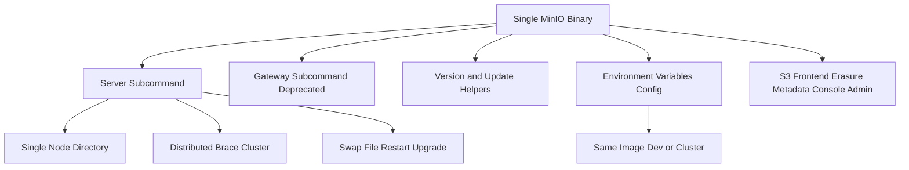

# The MinIO Binary: One Executable, Many Roles

## English

MinIO ships as a single statically linked Go binary. There is no separate web server, no database daemon, no package ecosystem to install — you download one file, make it executable, and run it. That single binary contains the S3 front end, the erasure-coding engine, the metadata layer, the console UI, and the admin API all at once. This is a deliberate design choice: fewer moving parts means fewer version-skew bugs, simpler container images, and a deployment you can describe in one line.

The binary is driven by subcommands. Running it with no arguments only prints the CLI help and exits; `minio server /data` is the command that starts the server, serving a single directory, while `minio server http://host{1...4}/data` expands brace notation into a four-node distributed cluster. Other subcommands include `minio gateway` (historically, a translation layer in front of other storage backends — now deprecated and removed in recent releases) and version/update helpers. The same artifact is therefore both the server you deploy and the tool you use to inspect it.

Configuration follows a similar philosophy. Rather than a sprawling config file, MinIO reads environment variables — `MINIO_ROOT_USER`, `MINIO_ROOT_PASSWORD`, `MINIO_VOLUMES`, and dozens of `MINIO_*` tuning knobs. In container orchestration you supply these as env vars or a mounted env file. Because configuration is external to the binary, the same image can be a single-node dev server or one member of a large cluster purely by changing its environment.

This matters operationally in ways that are easy to underestimate. Upgrades become a matter of swapping a file and restarting; there is no schema migration step to run by hand, and no dependency tree to audit for CVEs beyond the Go runtime and standard library. Rollback is equally blunt: keep the previous binary, restart. The trade-off is that you get fewer knobs than a general-purpose system — MinIO deliberately refuses to be a Swiss Army knife, which is precisely why it is easy to reason about.

A practical consequence: because everything is one process, resource limits apply to the whole system. If you cap the container's memory, you are capping the S3 handler, the healing routines, and the console together. Sizing exercises should account for the process as a unit rather than pretending it has separable services.

## 中文

MinIO 以單一靜態連結的 Go 二進位檔形式發佈。它沒有獨立嘅網頁伺服器、冇資料庫守護進程、亦冇一大堆要安裝嘅套件生態——你下載一個檔案、賦予執行權限、然後執行它。呢個單一二進位檔一次過包含 S3 前端、糾刪碼引擎、元數據層、主控台 UI 同管理 API。呢個係刻意嘅設計取捨：零件越少，版本錯配嘅 bug 就越少，容器映像越簡單，部署亦可以用一句話講清楚。

呢個二進位檔由子命令驅動。唔帶參數執行只會印出 CLI 說明然後結束；真正啟動伺服器嘅係 `minio server /data` 呢條命令，服務單一目錄，而 `minio server http://host{1...4}/data` 就會將大括號記法展開成四節點嘅分散式叢集。其他子命令包括 `minio gateway`（歷史上係一個放在其他儲存後端前面嘅轉譯層——現已棄用並在近期版本移除）以及版本／更新輔助命令。所以同一個 artifact 既係你部署嘅伺服器，亦係你用來檢查它嘅工具。

配置哲學亦類似。MinIO 唔用一個龐大嘅配置檔，而係讀取環境變數——`MINIO_ROOT_USER`、`MINIO_ROOT_PASSWORD`、`MINIO_VOLUMES`，以及幾十個 `MINIO_*` 調校參數。在容器編排裡面，你透過環境變數或者掛載嘅 env 檔提供呢啲值。因為配置外置於二進位檔，同一個映像只要改變環境就可以係單節點開發伺服器，亦可以係大型叢集嘅其中一員。

呢點在運維上嘅重要性好容易被低估。升級就係換一個檔案然後重啟；冇需要人手執行嘅 schema 遷移步驟，除咗 Go runtime 同標準庫之外亦冇依賴樹要審核 CVE。回滾同樣直接：保留上一個二進位檔，重啟即可。代價係你得到嘅可調參數比通用系統少——MinIO 刻意拒絕做萬能刀，而正因為咁它先容易理解。

一個實際後果：因為所有嘢都係同一個進程，資源限制就適用於整個系統。如果你限制容器嘅記憶體，你同時限制咗 S3 處理器、修復常式同主控台。容量規劃應該將進程視為一個整體，而唔係假裝它有可分離嘅服務。

## Key Takeaway

MinIO's entire server is one statically linked binary configured by environment variables, which makes deployment and upgrades trivial but means resource limits apply to the whole process at once.

## Related Concepts
- Environment-variable configuration
- Container image design

## Diagram

