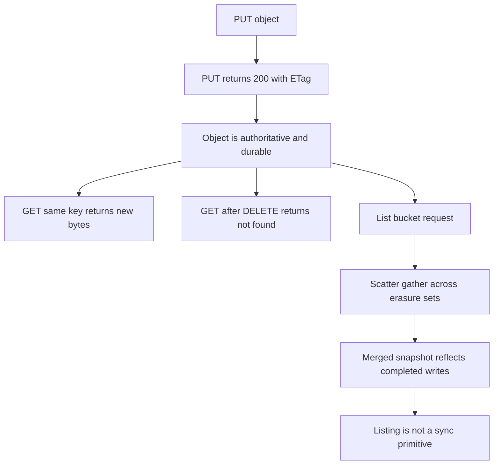

# The Consistency Model: Read-After-Write and the Limits of Listing

## English

Object stores are not file systems, and the sharpest place that shows up is consistency. MinIO provides strong read-after-write consistency for individual objects: once a PUT returns success, a subsequent GET for that same key will return the new bytes and metadata. It also provides read-after-delete consistency — after a successful DELETE, a GET returns not-found. This is a stronger guarantee than the eventual consistency that early S3 offered for overwrites and for LIST results (deletes and creates were always strongly consistent there), and since December 2020 S3 itself has offered strong consistency for all operations. It is what lets applications treat MinIO like a normal key-value store for single-key operations.

Consistency is defined per object, and MinIO extends it to listings: a LIST issued after a successful PUT always shows the new key. If you write `a.txt` and then list the bucket, `a.txt` is guaranteed to be there. Internally, listing in a distributed object store is a scatter-gather operation: the server fans out to the erasure sets that hold the bucket's namespace, collects their local listings, merges and sorts them, and returns a page. The scatter-gather is an implementation detail rather than a consistency guarantee — because writes are strictly ordered, the merged page reflects every completed write. A listing is therefore a consistent snapshot of the bucket's namespace as of the request, not a stale approximation of it.

Because of this, the classic "write then list to confirm" pattern is not a trap in MinIO — a LIST after a successful PUT reliably confirms the key is visible. The PUT response remains the authoritative and cheapest signal (if it returned 200 with an ETag, the object exists), and listing is best reserved for discovery and inventory. What a listing still is not is a synchronization primitive between concurrent writers: the merged page reflects the writes that had completed when the request was served, so two writers racing on the same key still need conditional writes to arbitrate.

Pagination compounds the issue. ListObjectsV2 returns at most 1000 keys per page and uses a continuation token; the token encodes where the previous page ended in the sorted key space. If objects are created or deleted between pages, the merged result can skip or duplicate keys at page boundaries. Applications that need a stable inventory should either snapshot the bucket (via versioning or replication to a quiet target) or tolerate boundary anomalies, rather than assuming a full listing is a consistent point-in-time view.

Finally, conditional writes close part of the gap. MinIO supports S3 conditional headers such as `If-None-Match: *` on PUT, which makes an upload succeed only if the key does not already exist. That gives you atomic create-if-absent semantics without a separate lock service — the object store itself becomes the arbiter, and two racing writers cannot both win.

## 中文

對象存儲唔係檔案系統，而呢個差異最 sharp 嘅地方就係一致性。MinIO 對個別對象提供強烈嘅寫後讀一致性：一旦 PUT 返回成功，之後對同一個 key 嘅 GET 就會返回新嘅位元組同元數據。它亦提供刪除後讀一致性——成功 DELETE 之後，GET 會返回 not-found。呢個係比早期 S3 對覆寫同 LIST 結果所提供嘅最終一致性更強嘅保證（喺嗰邊，刪除同建立一直都係強烈一致），而自 2020 年 12 月起，S3 本身對所有操作都提供強烈一致性。亦係令應用程式可以將 MinIO 當成普通 key-value store 來處理單 key 操作嘅原因。

一致性係按對象定義，而 MinIO 將呢個保證延伸到列表：在成功 PUT 之後發出嘅 LIST，一定會見到新嘅 key。如果你寫入 `a.txt` 然後列出 bucket，`a.txt` 保證會喺列表裡面。內部運作上，分散式對象存儲嘅列表係一個 scatter-gather 操作：伺服器向持有該 bucket 命名空間嘅糾刪集分發請求，收集它們各自嘅本地列表，合併同排序，然後返回一頁。呢個 scatter-gather 只係實作細節，唔係一致性保證——因為寫入係嚴格排序嘅，合併後嘅一頁會反映所有已完成嘅寫入。所以列表係反映請求時刻 bucket 命名空間嘅一致快照，而唔係一個過時嘅近似值。

正因為如此，「寫入然後列表確認」嘅經典模式喺 MinIO 唔係陷阱——成功 PUT 之後嘅 LIST 可以可靠咁確認個 key 已經可見。PUT 回應依然係最權威亦最平嘅訊號（如果它返回 200 同 ETag，對象就存在），而列表最好留給探索同盤點。列表仍然唔係並發寫入者之間嘅同步原語：合併後嗰一頁反映服務該次請求時已完成嘅寫入，所以兩個競爭寫入者仍然需要條件寫入來仲裁。

分頁會令問題更複雜。ListObjectsV2 每頁最多返回 1000 個 key，並使用 continuation token；token 編碼咗上一頁在已排序 key 空間中結束嘅位置。如果頁與頁之間有對象被建立或刪除，合併結果可能在頁邊界跳過或者重複 key。需要穩定盤點嘅應用程式應該要麼快照 bucket（透過版本控制或者複製到一個安靜嘅目標），要麼容忍邊界異常，而唔係假設完整列表係一致嘅時間點視圖。

最後，條件寫入填補咗部分空隙。MinIO 支援 S3 條件式標頭，例如 PUT 上嘅 `If-None-Match: *`，令上傳只有在 key 未存在時才成功。咁就給你原子嘅 create-if-absent 語義，唔需要額外嘅鎖服務——對象存儲本身成為仲裁者，兩個競爭嘅寫入者唔可能同時贏。

## Key Takeaway

MinIO gives strong read-after-write, read-after-delete and list-after-write consistency, so a successful PUT is immediately visible in listings; pagination and concurrent modification, not staleness, are the listing caveats.

## Related Concepts
- Conditional writes with If-None-Match
- ListObjectsV2 pagination

## Diagram

