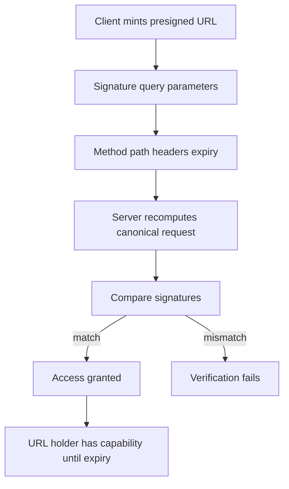

# Presigned URLs in Practice: Expiry, Method Binding, and Leakage Risks

## English

A presigned URL is a normal S3 URL with a signature appended as query parameters: the access key ID, the credential scope (date and region), the signed headers, the expiry, and the signature itself. The server recomputes the canonical request from those parameters and the request as received, then compares. If you change anything the signature covers — the HTTP method, the path, a signed header, or the expiry timestamp — verification fails. That is why a presigned URL for GET cannot be reused as a PUT: the verb is part of what was signed.

Expiry is expressed in seconds and is capped. AWS S3 caps presigned URLs at seven days when signed with long-term credentials; MinIO likewise enforces a maximum. The practical implication is that presigned URLs are for short-lived handoffs — a browser downloading a report, a mobile client uploading a photo — not for embedding in a document that lives for months. If you need durable access, you mint a new URL at request time from a service that holds the credentials.

The security model is that possession of the URL equals possession of the capability. The signature proves the URL was minted by someone holding the secret key, but it does not identify who is using it. Anyone who obtains the URL — from browser history, a proxy log, a screenshot, a Referer header — can use it until it expires. Mitigations include keeping expiry short, scoping the policy behind the signing credential to the minimum prefix, and remembering that TLS protects the URL in transit but not in logs.

A common operational mistake is generating presigned URLs with root credentials. The URL then carries the full authority of the root account for its lifetime. The correct pattern is a dedicated service account or a user with a narrow policy limited to the specific bucket and prefix, so a leaked URL can only touch what that policy allows. Rotating the underlying credentials invalidates outstanding URLs, which is a useful incident-response lever.

Finally, note the interaction with headers. If you sign specific headers (for example, a content type or a checksum header), the client must send exactly those headers or the signature breaks. Many SDKs default to signing only the host header, which keeps URLs simple; but if you add a header to the signing step for integrity, you must document it for whoever consumes the URL. Debugging signature mismatches almost always means diffing the canonical request: method, path, query string ordering, and signed header list.

## 中文

預簽 URL 係一個普通嘅 S3 URL，只係將簽名以查詢參數形式附加：access key ID、憑證範圍（日期同區域）、已簽署標頭、到期時間，以及簽名本身。伺服器會根據呢啲參數同收到嘅請求重新計算標準請求，然後比較。如果你改變咗簽名覆蓋嘅任何東西——HTTP 方法、路徑、已簽署標頭，或者到期時間戳——驗證就會失敗。呢個就係為何用於 GET 嘅預簽 URL 唔可以重用為 PUT：動詞本身就係被簽署嘅一部分。

到期時間以秒為單位表達，並且有上限。AWS S3 用長期憑證簽署時將預簽 URL 上限設為七日；MinIO 同樣執行最大值。實際含義係預簽 URL 用於短暫交接——瀏覽器下載報告、流動客戶端上傳相片——而唔係嵌入在會存在幾個月嘅文件裡面。如果你需要持久存取，就應該在請求時由持有憑證嘅服務重新簽發一個新 URL。

安全模型係：擁有 URL 就等於擁有該能力。簽名證明 URL 係由持有密鑰嘅人簽發，但唔會識別邊個在使用它。任何取得 URL 嘅人——從瀏覽器歷史、代理日誌、截圖、Referer 標頭——都可以在到期前使用它。緩解措施包括保持到期時間短、將簽署憑證背後嘅策略限定到最小前綴，以及記住 TLS 保護 URL 在傳輸中但唔保護它在日誌中。

一個常見嘅運維錯誤係用 root 憑證生成預簽 URL。咁樣 URL 在其有效期內就帶有 root 帳戶嘅全部權限。正確模式係用專用服務帳戶或者一個只限於特定 bucket 同前綴嘅窄策略使用者，咁即使 URL 洩漏都只可以觸及該策略允許嘅範圍。輪換底層憑證會令未到期嘅 URL 失效，呢個係有用嘅事故應變手段。

最後，注意同標頭嘅互動。如果你簽署特定標頭（例如 content type 或者校驗和標頭），客戶端必須準確發送嗰啲標頭，否則簽名就會斷。好多 SDK 預設只簽署 host 標頭，令 URL 保持簡單；但如果你為完整性在簽署步驟加入標頭，就必須向使用該 URL 嘅人記錄清楚。除錯簽名不匹配幾乎總係意味住要對比標準請求：方法、路徑、查詢字串排序，以及已簽署標頭清單。

## Key Takeaway

A presigned URL is a capability bound to a specific method, path, headers, and expiry, so keep lifetimes short and mint them from a narrowly scoped service account rather than root credentials.

## Related Concepts
- Canonical request signing
- Least-privilege service accounts

## Diagram

