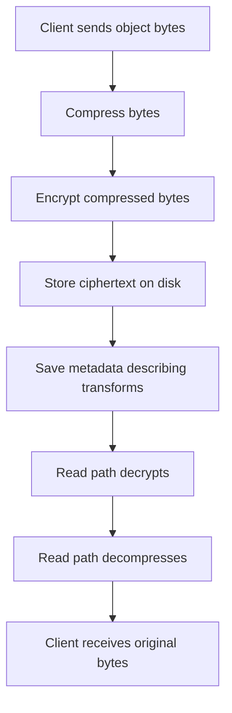

# Compression, Encryption, and the Order of Operations on the Write Path

## English

When an object is written to MinIO, several transformations can happen before bytes ever touch a disk: encryption (SSE-S3, SSE-KMS, or SSE-C), and — depending on how the client or gateway is configured — compression. The order matters enormously, and the general rule is that compression must happen before encryption, because ciphertext is statistically random and therefore incompressible. If you encrypted first and compressed second, you would spend CPU time and gain nothing. This is the same reason you zip a file before you put it in an encrypted archive, not after.

On the read path the transformations unwind in reverse: the server (or client, for SSE-C) decrypts, and any compression layer decompresses. MinIO stores metadata alongside each object describing which transforms were applied, so a reader knows exactly what to undo. This is why the object's stored size on disk can differ from the Content-Length the client sent — a subtlety that trips people up when they compare `mc stat` output with what their application uploaded.

Range requests are where this gets genuinely tricky. If a client asks for bytes 1000–2000 of an object, and the object is compressed, those logical byte offsets do not map to physical offsets in the stored stream. A correct implementation must either decompress from the start of the stream up to the requested range (expensive) or store the object in independently compressed blocks with an index. This is one reason object stores often treat compression as a client-side concern rather than a server-side default.

Encryption keys add another layer. With SSE-KMS, the object is encrypted with a data key, and that data key is itself wrapped by a master key held in an external KMS. The wrapped data key lives in the object's metadata. Losing the KMS means losing every object encrypted under it, even though the ciphertext bytes are perfectly intact on disk — a good reminder that in object storage, durability of bytes and durability of meaning are two separate problems.

Practically, when you design a pipeline, decide early where each transform lives. Compress at the producer if your data is compressible (logs, JSON, CSV), encrypt at the server if you want centralised key management, and avoid stacking transforms you cannot reason about. The write path is a small pipeline, and like any pipeline, the order of stages determines whether the output is useful or just expensive noise.

## 中文

當一個對象寫入 MinIO 時，在位元組真正落到磁碟之前，可能會經過幾層轉換：加密（SSE-S3、SSE-KMS 或 SSE-C），以及——視客戶端或閘道配置而定——壓縮。次序極為重要，一般原則是壓縮必須在加密之前，因為密文在統計上是隨機的，因此不可壓縮。若你先加密再壓縮，你會耗費 CPU 時間而毫無所得。這與你先壓縮檔案再放進加密壓縮包、而非相反的道理一樣。

在讀取路徑上，這些轉換會反向展開：伺服器（或 SSE-C 情況下的客戶端）解密，任何壓縮層則解壓。MinIO 會在每個對象旁存儲描述已套用哪些轉換的元數據，讓讀取方清楚知道要還原什麼。這就是為何對象在磁碟上的儲存大小可能與客戶端送出的 Content-Length 不同——這個細節常常令人困惑，尤其當他們把 `mc stat` 的輸出與應用程式上傳的內容作比較時。

範圍請求（Range request）才是真正棘手之處。若客戶端要求對象的第 1000–2000 位元組，而該對象已被壓縮，那些邏輯位元組偏移並不會對應到儲存串流中的實體偏移。正確的實作必須要麼從串流開頭解壓到所請求的範圍（代價高昂），要麼把對象分成獨立壓縮的區塊並建立索引。這正是對象存儲往往把壓縮視為客戶端責任、而非伺服器預設行為的原因之一。

加密金鑰再加上另一層。使用 SSE-KMS 時，對象以資料金鑰加密，而該資料金鑰本身由外部 KMS 持有的主金鑰包裹。被包裹的資料金鑰存於對象的元數據中。失去 KMS 就等於失去在它之下加密的每一個對象，即使密文位元組在磁碟上完好無損——這正好提醒我們：在對象存儲中，位元組的耐用性與意義的耐用性是兩個不同的問題。

實務上，當你設計管線時，要及早決定每個轉換的位置。若資料可壓縮（日誌、JSON、CSV），在生產端壓縮；若想要集中式金鑰管理，在伺服器端加密；並避免堆疊你無法理解的轉換。寫入路徑是一條小型管線，而像任何管線一樣，各階段的次序決定輸出是有用還是昂貴的噪音。

## Key Takeaway

Compression must precede encryption on the write path, and range requests over compressed objects force you to think about logical versus physical byte offsets.

## Related Concepts
- Client-Side Encryption and SSE-KMS
- The Data Path: How a PUT Request Becomes Bytes on Disk

## Diagram

