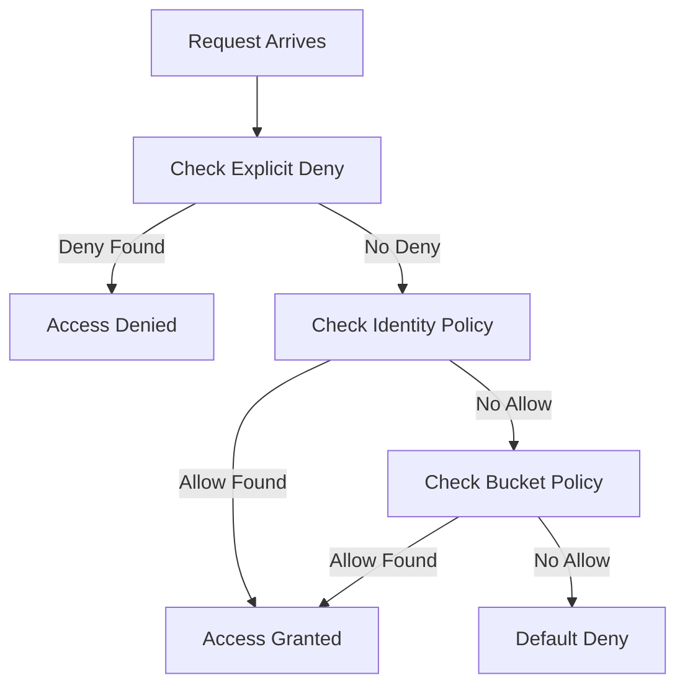

# Bucket Policies vs. IAM Policies: Where an Access Decision Is Actually Made

## English

MinIO inherits from S3 a model where access can be granted in more than one place, and understanding which place wins is the difference between a secure deployment and a confusing one. There are two broad categories: identity-based policies (attached to a user, group, or service account) and resource-based policies (attached to a bucket, describing who may do what to it). A request is evaluated against both, and the effective answer is the union of what either allows — with explicit denies acting as a hard veto.

The mental model that helps most is a courtroom. Identity policies are like a person's credentials: what this principal is generally allowed to do. Bucket policies are like the rules posted on a specific door: who may enter this room, regardless of their general credentials. A person with no credentials can still be let in by the door's own rule (this is how you grant anonymous read access to a public bucket). Conversely, a person with broad credentials can be stopped by an explicit deny on the door.

The evaluation order is usually described as: explicit deny anywhere beats everything; otherwise, an explicit allow from either an identity policy or a resource policy grants access; otherwise the request is denied by default. That last clause is the important one — object stores are deny-by-default, so an empty policy set means no access at all, not full access. Beginners often assume the opposite and are surprised when a freshly created user can do nothing until a policy is attached.

A concrete example: you have a shared bucket called `uploads` that a public web application writes to via presigned URLs, and an internal analytics team reads from. The bucket policy might grant `s3:PutObject` to anonymous principals scoped to a prefix like `incoming/`, while the analytics team's identity policy grants `s3:GetObject` on the whole bucket. Neither policy alone would be sufficient for both use cases; together they describe the actual system.

A practical warning: bucket policies are easy to leave behind. When you tear down a test environment and recreate it, the identity policies may be reapplied from your infrastructure-as-code, but a bucket policy set by hand in the console can be forgotten — or worse, a permissive one can survive into production. Treat bucket policies as first-class configuration, version them, and audit them with the same rigour as IAM. The question 'who can read this bucket?' should have exactly one answer, and it should be written down.

## 中文

MinIO 承襲 S3 的模型：存取權可以在多於一個地方授予，而理解哪個地方最終生效，正是安全部署與混亂部署之間的分野。大致有兩類：以身分為基礎的策略（綁定到使用者、群組或服務帳戶），以及以資源為基礎的策略（綁定到 bucket，描述誰可以對它做什麼）。請求會同時對兩者評估，而最終答案就是任一方允許的聯集——其中顯式拒絕則作為硬性否決。

最有幫助的心智模型是法庭。身分策略就像一個人的資歷：這個主體一般而言被允許做什麼。Bucket 策略則像貼在某扇門上的規則：無論一般資歷如何，誰可以進入這個房間。一個沒有資歷的人仍可被門本身的規則放行（這就是授予匿名讀取公開 bucket 的方式）。反過來，一個資歷很廣的人也可被門上的顯式拒絕擋下。

評估次序通常如此描述：任何地方的顯式拒絕壓倒一切；否則，來自身分策略或資源策略的顯式允許即授予存取；再否則，請求預設被拒絕。最後一句最為關鍵——對象存儲是預設拒絕的，所以空的策略集意味著完全沒有存取權，而非完全存取權。初學者常假設相反，並在新建使用者未綁定策略前什麼都做不了時感到意外。

一個具體例子：你有一個名為 `uploads` 的共享 bucket，公開網頁應用透過預簽名 URL 寫入，而內部分析團隊從中讀取。Bucket 策略可能授予匿名主體對 `incoming/` 這類前綴的 `s3:PutObject`，而分析團隊的身分策略則授予對整個 bucket 的 `s3:GetObject`。單獨任一策略都不足以涵蓋兩個用途；合起來才描述出實際系統。

一個實務警告：bucket 策略很容易被遺留。當你拆除並重建測試環境時，身分策略可能由基礎設施即程式碼重新套用，但在主控台手動設定的 bucket 策略卻可能被遺忘——更糟的是，一個寬鬆的策略可能殘留到生產環境。請把 bucket 策略視為一等配置，納入版本控制，並以與 IAM 同等的嚴謹度審核。『誰可以讀取這個 bucket？』這個問題應該只有一個答案，而且應該被寫下來。

## Key Takeaway

Access is the union of identity-based and resource-based allows, minus any explicit deny, and object stores default to deny — so an empty policy means no access, not full access.

## Related Concepts
- Identity and Access Management: Users, Groups, Policies, and Service Accounts
- Buckets Are the Top-Level Namespace in MinIO

## Diagram

