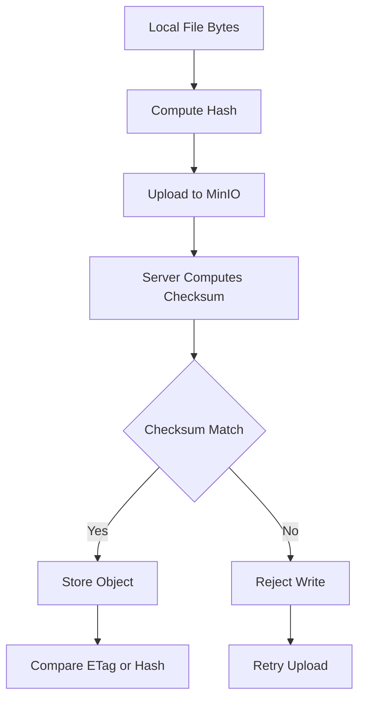

# Content-Addressable Thinking: Why ETags, Checksums, and Hashes Matter More Than Filenames

## English

In a file system, identity is the path: `/home/alice/report.pdf` is the file. In object storage, the key is just a label, and the real identity of the content is its hash. This shift — from path-based to content-based thinking — is one of the most useful mental upgrades you can make when working with MinIO, because it unlocks deduplication, integrity verification, and idempotent uploads.

Every object in S3-compatible storage carries an ETag, which is an opaque identifier for a specific version of the object's bytes. For a simple single-part upload, the ETag is typically the MD5 hex digest of the content, which makes it a weak but convenient integrity check: upload a file, compare your locally computed MD5 with the returned ETag, and you have a cheap end-to-end verification. For multipart uploads the ETag is computed differently — it is derived from the MD5s of the individual parts plus the part count — so it is no longer a plain MD5 of the whole object. Code that assumes ETag equals MD5 will silently break on large files, and this is one of the most common interoperability bugs.

Modern S3 APIs support explicit checksums beyond MD5: CRC32, CRC32C, SHA-1, and SHA-256, sent as headers or as part of a checksum algorithm parameter. These are stronger and more flexible, and they let you verify integrity without relying on the ETag's ambiguous semantics. When you upload with a checksum, the server can reject the write if the computed checksum does not match, catching corruption in transit before it becomes corruption at rest.

Content addressing also enables idempotency. If your pipeline computes a SHA-256 of a payload before uploading, you can use that hash as the object key, or store it as metadata, and then a retry of the same logical upload becomes a no-op instead of a duplicate. This is how many data lakes avoid the 'same file uploaded five times because the first four requests timed out' problem. The key is not 'report.pdf' but 'the bytes whose hash is 3f9a...'; the former is a name, the latter is an identity.

Finally, content addressing makes caching and deduplication tractable. A CDN or a local cache can key on the hash rather than the URL, so two different URLs serving identical bytes share one cache entry. A deduplicating layer can store each unique block once regardless of how many objects reference it. None of this works if you think in filenames; all of it works if you think in hashes. The mental shift is small, but it changes what you can build.

## 中文

在檔案系統中，身分就是路徑：`/home/alice/report.pdf` 就是那個檔案。在對象存儲中，鍵只是標籤，內容的真正身分是它的雜湊值。這種從路徑導向轉向內容導向的思維，是使用 MinIO 時最有用的心智升級之一，因為它開啟了去重、完整性驗證與冪等上傳。

S3 相容存儲中的每個對象都帶有 ETag，它是對象位元組某個特定版本的不透明識別碼。對於簡單的單段上傳，ETag 通常是內容的 MD5 十六進位摘要，這使它成為一個弱但方便的一致性檢查：上傳檔案、把你本地計算的 MD5 與回傳的 ETag 比較，就得到一個便宜的端到端驗證。對於分段上傳，ETag 的計算方式不同——它由各分段的 MD5 加上分段數推導而來——所以它不再是整個對象的單純 MD5。假設 ETag 等於 MD5 的程式碼會在大檔案上悄悄出錯，這是最常見的互通性錯誤之一。

現代 S3 API 支援 MD5 以外的顯式校驗和：CRC32、CRC32C、SHA-1 與 SHA-256，以標頭或校驗和演算法參數送出。它們更強也更靈活，讓你毋須依賴 ETag 的模糊語義就能驗證完整性。當你帶著校驗和上傳時，若計算出的校驗和不符，伺服器可拒絕該寫入，在傳輸中的損壞變成靜止時的損壞之前就攔下它。

內容定址也促成冪等性。若你的管線在上傳前計算酬載的 SHA-256，你可以把該雜湊用作對象鍵，或存為元數據，那麼同一邏輯上傳的重試就變成空操作而非重複。這就是許多資料湖避免『同一個檔案被上傳五次，因為前四次請求逾時』問題的方式。鍵不是『report.pdf』，而是『雜湊為 3f9a... 的那些位元組』；前者是名字，後者是身分。

最後，內容定址讓快取與去重變得可行。CDN 或本地快取可以用雜湊而非 URL 作為鍵，於是兩個提供相同位元組的不同 URL 共用一個快取條目。去重層可以每個唯一區塊只存一次，無論有多少對象引用它。若你以檔名思考，這些都行不通；若你以雜湊思考，全都行得通。這個心智轉變很小，但它改變了你能建造什麼。

## Key Takeaway

Treat the hash, not the key, as the true identity of an object — that is what makes integrity checks, idempotent uploads, and deduplication possible.

## Related Concepts
- MinIO Stores Data as Objects with Metadata
- Multipart Upload and Lifecycle Policies

## Diagram

