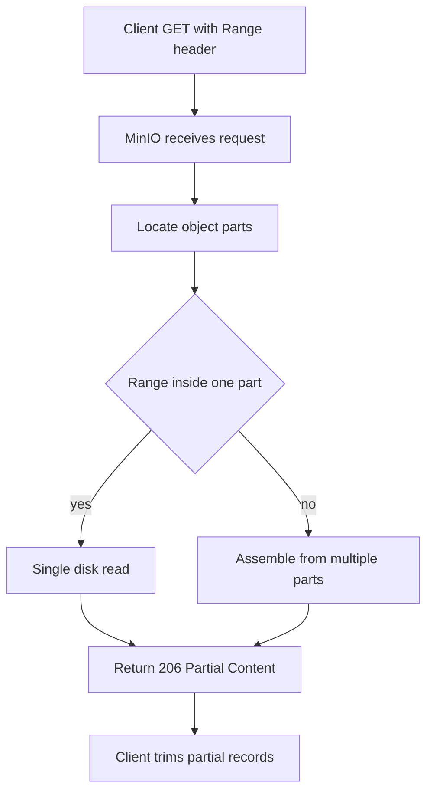

# Range Requests and Partial Reads: Getting One Slice of a Huge Object

## English

Object storage is often described as "write once, read whole", but in practice a video player does not download a 4 GB film before showing the first frame, and a log analyser does not fetch a 900 MB archive to look at the last thousand lines. The S3 API solves this with the HTTP Range header: a GET request may carry `Range: bytes=0-1023` and the server responds with status 206 Partial Content plus a `Content-Range: bytes 0-1023/4294967296` header telling you which slice you got and how big the whole object is. MinIO supports this natively, and because objects are stored in fixed-size parts underneath, a range that falls inside a single part can be served from one disk read instead of assembling the whole object. This is the same mechanism that makes `curl -r` and resumable downloads work.

The subtlety is that ranges are byte offsets, not record boundaries. If you ask for bytes 500000-600000 of a JSON file you will almost certainly get half a record at each end, and it is your job to discard the incomplete fragments. This is why line-oriented tools that read from object storage often read a slightly overlapping range and trim. For formats with an index, like Parquet or ORC, the client first fetches the footer at the end of the file (another range request), learns where each column chunk lives, and then fetches only the chunks it needs. That pattern — small metadata read, then targeted data reads — is how analytics engines avoid scanning terabytes.

Range requests also interact with multipart uploads. A multipart object is composed of parts of varying sizes, and the ETag of such an object is not a plain MD5 of the content; it is a hash-of-hashes with a `-N` suffix, where N is the part count. So you cannot verify a ranged read by comparing against a simple checksum — you either verify per-part or trust the transport. Also note that a range request on an encrypted object still works, because decryption happens server-side after the bytes are located, but the offsets you request are offsets in the plaintext, not the ciphertext.

A practical caution: servers are allowed to ignore a Range header and return the whole object with status 200. Well-behaved clients must check the status code rather than assuming 206. And if you issue many small ranged reads against the same object, each one is a separate HTTP request with its own signature and latency; batching or using a single connection with keep-alive matters more than you might expect. For large sequential reads, plain GET is usually faster than a thousand tiny ranges.

Finally, ranges matter for correctness in one more place: `mc cat` and similar tools stream an object; if the connection drops mid-stream, a resumable client can restart from the last received byte offset rather than from zero. That is the difference between a 10-minute retry and a 10-second one when your object is large and your network is flaky.

## 中文

物件儲存常被形容為「寫一次、整份讀取」，但實際上，影片播放器不會先下載完整套 4 GB 的電影才顯示第一格畫面，日誌分析工具也不會為了看最後一千行而下載整份 900 MB 的壓縮檔。S3 API 用 HTTP 的 Range 標頭解決這個問題：一個 GET 請求可以帶上 `Range: bytes=0-1023`，伺服器便回傳 206 Partial Content 狀態碼，並附上 `Content-Range: bytes 0-1023/4294967296` 標頭，告訴你拿到的是哪一段、整個物件又有多大。MinIO 原生支援這個機制，而且因為物件底層是以固定大小的 part 儲存，若請求的範圍剛好落在同一個 part 之內，就可以只讀一次磁碟便回傳，不必把整個物件組裝起來。`curl -r` 和可續傳的下載之所以行得通，靠的正是同一套機制。

微妙之處在於，range 是位元組偏移量，不是記錄邊界。如果你要求 JSON 檔的第 500000 至 600000 位元組，頭尾幾乎肯定會各切到半條記錄，丟棄這些不完整的碎片是你的責任。這正是為何從物件儲存讀取的行導向工具，往往會多讀一點重疊範圍再修剪。對於有索引的格式，例如 Parquet 或 ORC，客戶端會先抓取檔案末尾的 footer（又是另一個 range 請求），得知每個 column chunk 的位置，然後只抓真正需要的 chunk。這種「先讀少量中繼資料、再針對性讀取資料」的模式，就是分析引擎得以避免掃描整 TB 資料的原因。

Range 請求亦與分段上傳互相影響。分段上傳的物件由大小不一的 part 組成，這類物件的 ETag 並不是內容的單純 MD5，而是「雜湊的雜湊」再加上 `-N` 後綴，N 代表 part 的數量。因此你不能用簡單的 checksum 去驗證一次 range 讀取——你要麼逐 part 驗證，要麼信任傳輸過程。另外要注意，對加密物件發出 range 請求仍然可行，因為解密是在伺服器端定位位元組之後才進行，但你要求的偏移量是明文中的偏移量，不是密文中的偏移量。

實務上的告誡：伺服器有權忽略 Range 標頭，直接回傳整個物件並附上 200 狀態碼。行為良好的客戶端必須檢查狀態碼，而不是假設一定是 206。此外，若你對同一物件發出大量細小的 range 讀取，每一個都是獨立的 HTTP 請求，各自帶有簽章與延遲；批次處理或使用 keep-alive 的單一連線，影響比你想像中更大。對於大型的順序讀取，一次完整的 GET 通常比一千次細小 range 更快。

最後，range 在另一處關乎正確性：`mc cat` 之類的工具會串流物件；若連線中途斷掉，可續傳的客戶端可以從最後收到的位元組偏移量重新開始，而不是從零開始。當物件很大、網路又不穩時，這就是十分鐘重試與十秒重試之間的差別。

## Key Takeaway

Range requests let clients fetch slices of an object instead of the whole thing, but the offsets are raw bytes, servers may ignore them, and multipart ETags cannot be verified with a simple checksum.

## Related Concepts
- HTTP Range header
- Multipart upload part boundaries

## Diagram

