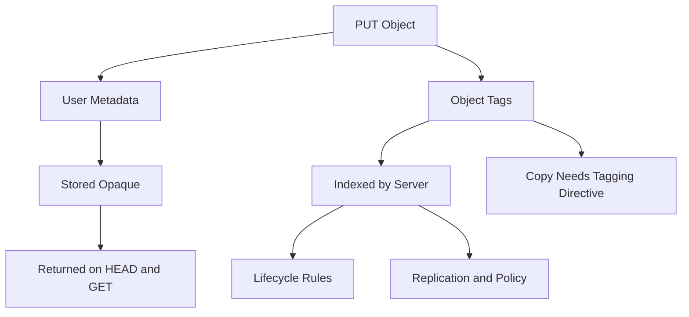

# Object Tags, Metadata, and the Two Very Different Places Data About Data Lives

## English

Every object in MinIO carries two kinds of descriptive data, and confusing them causes real bugs. The first is user metadata: arbitrary key-value pairs you attach at PUT time via headers prefixed with `x-amz-meta-`, such as `x-amz-meta-project: apollo`. These are stored with the object and returned on HEAD and GET. The second is object tags: a separate, smaller set of up to ten key-value pairs set through the `x-amz-tagging` header or the tagging subresource, e.g. `x-amz-tagging: team=research&stage=raw`. They look similar but behave very differently, and the difference matters for automation.

The key distinction is that tags are queryable by the server and by lifecycle rules, while user metadata is not. Lifecycle rules can say "expire objects whose tag `stage` equals `temp` after seven days" — a tag-based filter — but they cannot filter on a custom `x-amz-meta-` header. Similarly, replication rules and some policy conditions can key off tags. Metadata, by contrast, is essentially opaque payload: the server stores it and gives it back, but does not index it or reason about it. If you want the system to act on a property automatically, it belongs in tags; if you just want to remember something for the application, metadata is the cheaper, more flexible place.

There are practical limits worth knowing. User metadata is sent as HTTP headers, so it is size-constrained and must be header-safe — no raw newlines, and non-ASCII values need encoding. Tags are also bounded (the S3 model allows up to ten per object, with limited key and value lengths), and tag keys have their own character rules. Both travel with the object on copy operations only if you ask: a server-side copy does not automatically carry tags unless you set the tagging directive, and metadata handling on copy has its own flag. Getting this wrong silently drops your labels.

A second trap is mutability. Object metadata is set at write time; you cannot edit a single metadata key on an existing object. Changing it means copying the object onto itself with new metadata — a metadata-only copy that rewrites headers without moving the data bytes. Tags are different: there is a dedicated tagging subresource (a PUT to the object's `?tagging` endpoint) that updates tags in place, cheaply, without any copy. So a pipeline that wants to mark an object as "processed" should use tags, not metadata; a pipeline that wants to record the originating job ID at upload time should use metadata.

Finally, think about where these live in a listing. A LIST operation returns key, size, last-modified, ETag and storage class, but not user metadata and not tags — fetching either requires a HEAD or a separate tag GET per object. If you design a system that lists a million objects and then HEADs each one to read a label, you have built a million round trips. Store the fields you need to filter on in the key naming scheme or in tags with lifecycle rules, and keep per-object metadata for the details you only need when you actually open the object.

## 中文

MinIO 中的每個物件都帶有兩種描述性資料，把它們混為一談會導致真實的程式錯誤。第一種是使用者中繼資料（user metadata）：你在 PUT 時透過 `x-amz-meta-` 前綴的標頭附加的任意鍵值對，例如 `x-amz-meta-project: apollo`。這些資料與物件一起儲存，並在 HEAD 與 GET 時回傳。第二種是物件標籤（object tags）：另一組較小的鍵值對，最多十個，透過 `x-amz-tagging` 標頭或 tagging 子資源設定，例如 `x-amz-tagging: team=research&stage=raw`。兩者看似相似，行為卻大相逕庭，而這個差別對自動化至關重要。

關鍵分別在於：標籤可以被伺服器查詢、可以被生命週期規則使用，而使用者中繼資料不行。生命週期規則可以說「把標籤 `stage` 等於 `temp` 的物件在七天後過期」——這是標籤篩選——但它無法用自訂的 `x-amz-meta-` 標頭來篩選。同樣地，複製規則和某些策略條件也可以依據標籤運作。相反，中繼資料本質上是不透明的酬載：伺服器把它存起來、再還給你，但不會為它建立索引，也不會對它推理。若你想讓系統自動對某項屬性採取行動，它應該放在標籤裡；若你只是想替應用程式記住某些東西，中繼資料是更便宜、更靈活的選擇。

有些實務限制值得知道。使用者中繼資料是以 HTTP 標頭傳送，因此有大小限制，而且必須是標頭安全的——不能有原始換行字元，非 ASCII 值需要編碼。標籤同樣有上限（S3 模型允許每個物件最多十個，鍵與值的長度也有限制），而標籤鍵有自己的字元規則。兩者在複製操作中都不會自動跟隨物件，除非你明確要求：伺服器端複製不會自動帶上標籤，除非你設定 tagging 指令，而中繼資料在複製時的處理也有自己的旗標。弄錯這點，你的標記就會無聲無息地消失。

第二個陷阱是可變性。物件中繼資料在寫入時設定；你無法就地編輯現有物件的單一中繼資料鍵。要更改就得把物件複製到自己身上並附上新中繼資料——這是一次只改寫標頭、不搬動資料位元組的中繼資料專用複製。標籤則不同：有一個專屬的 tagging 子資源（對物件的 `?tagging` 端點發出 PUT），可以就地、便宜地更新標籤，完全不需要複製。因此，想把物件標記為「已處理」的管線應該用標籤，而不是中繼資料；想在上傳時記錄來源工作 ID 的管線則應該用中繼資料。

最後，想想這些資料在列表中的位置。LIST 操作回傳鍵名、大小、最後修改時間、ETag 與儲存類別，但不回傳使用者中繼資料，也不回傳標籤——要取得兩者，都得對每個物件做一次 HEAD 或另發一次標籤 GET。若你設計的系統列出百萬個物件、再逐一 HEAD 去讀某個標籤，你就造出了百萬次往返。把你需要篩選的欄位放進鍵名命名規則，或放進可配合生命週期規則的標籤裡；把每個物件的中繼資料留給真正打開物件時才需要的細節。

## Key Takeaway

Tags are server-queryable and drive lifecycle and replication rules, while user metadata is opaque payload set at write time — and neither appears in a LIST response, so do not design filters that require a HEAD per object.

## Related Concepts
- Lifecycle rule filters
- HEAD object request

## Diagram

