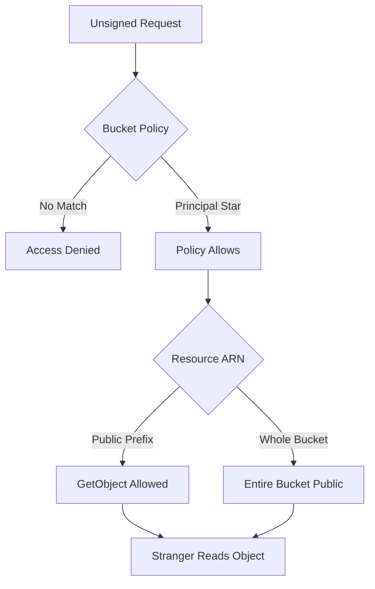

# Anonymous Access and Public Buckets: The Policy That Says Yes to Strangers

## English

By default, every request to MinIO must be signed with credentials, and an unsigned request is rejected. But there is a deliberate exception: a bucket policy can grant permissions to the special principal `*`, which means "anyone, signed or not". This is how you serve a static website, host public software downloads, or let a browser fetch an image with a plain `` tag. The mechanism is not a separate feature — it is the same bucket policy engine, with a wildcard principal and typically a condition limiting the action to `s3:GetObject` on a key prefix. Understanding it means understanding that "public" is a policy decision, not a server-wide switch.

The canonical shape is a policy allowing `s3:GetObject` on an ARN like `arn:aws:s3:::my-bucket/public/*` for principal `*`. Note three things. First, the resource ARN names the bucket and a key pattern; the pattern is what confines public reads to one folder. Second, `s3:ListBucket` is a separate permission on the bucket ARN (not the object ARN) — granting it lets strangers enumerate your keys, which you usually do not want even if reads are public. Third, the policy is attached to the bucket, so it applies to every object matching the pattern, including ones you add later. That is convenient and dangerous in equal measure.

The classic mistake is a wildcard that is wider than intended. A policy on `arn:aws:s3:::my-bucket/*` with `s3:GetObject` makes the entire bucket world-readable, including the folder where your application writes user uploads, database dumps, or logs. Because object keys are flat and there is no real directory, a prefix is a naming convention, not a security boundary enforced by the filesystem — the policy is the only boundary. Test by making an unsigned request with a tool that does not send credentials, and confirm that a path outside your intended prefix returns AccessDenied rather than the object.

A related trap is that public read plus guessable keys equals data leakage. Object keys are often derived from timestamps, user IDs, or sequential job numbers; if an attacker can enumerate or guess them, public read on a prefix exposes everything under it. MinIO's listing behaviour and ETag semantics do not help here — the defence is unguessable keys, a narrow prefix, and not granting list permission. Also remember that public read is separate from public write: granting `s3:PutObject` to `*` turns your bucket into an open drop box, which is occasionally intentional (an upload endpoint) and almost always a mistake otherwise.

Finally, distinguish anonymous access from presigned URLs. A presigned URL is a time-limited, signed grant to a specific object for a specific method; it works without any policy change and expires. An anonymous policy is permanent until you change it and applies to a whole pattern. Use presigned URLs for one-off sharing, and anonymous policies only for genuinely public content that you are content to have crawled, mirrored, and cached by the entire internet.

## 中文

預設情況下，發往 MinIO 的每個請求都必須以憑證簽署，未簽署的請求會被拒絕。但有一個刻意的例外：bucket 策略可以授予特殊主體 `*` 權限，意思是「任何人，無論是否簽署」。這就是你提供靜態網站、託管公開軟體下載，或讓瀏覽器用單純的 `` 標籤抓取圖片的方式。這個機制不是獨立功能——它用的是同一套 bucket 策略引擎，只是主體用了萬用字元，通常再加上條件，把動作限制為某個鍵名前綴上的 `s3:GetObject`。理解它，就等於理解「公開」是一項策略決定，而不是伺服器層級的開關。

典型的形態是一條策略，對主體 `*` 允許 `arn:aws:s3:::my-bucket/public/*` 這類 ARN 上的 `s3:GetObject`。注意三件事。第一，資源 ARN 同時指名 bucket 與鍵名樣式；正是這個樣式把公開讀取限制在單一資料夾。第二，`s3:ListBucket` 是 bucket ARN（而非物件 ARN）上的另一項權限——授予它會讓陌生人列舉你的鍵名，即使讀取是公開的，這通常也不是你想要的。第三，策略附掛在 bucket 上，因此適用於所有符合樣式的物件，包括你日後才加入的。這既方便又同樣危險。

經典的錯誤是萬用字元比預期更寬。對 `arn:aws:s3:::my-bucket/*` 授予 `s3:GetObject` 會讓整個 bucket 全世界可讀，包括應用程式寫入使用者上傳檔、資料庫傾印或日誌的資料夾。因為物件鍵名是平坦的、沒有真正的目錄，前綴只是命名慣例，不是檔案系統強制執行的安全邊界——策略才是唯一的邊界。測試方法是：用一個不帶憑證的工具發出未簽署請求，確認落在預期前綴之外的路徑回傳 AccessDenied，而不是回傳物件。

相關的陷阱是：公開讀取加上可猜測的鍵名，等於資料外洩。物件鍵名往往由時間戳、使用者 ID 或連續的工作編號衍生；若攻擊者能列舉或猜出鍵名，前綴上的公開讀取就會把底下的一切暴露出來。MinIO 的列舉行為與 ETag 語意在此幫不上忙——防禦之道是不可猜測的鍵名、狹窄的前綴，以及不授予列舉權限。另外要記得，公開讀取與公開寫入是兩回事：對 `*` 授予 `s3:PutObject` 會把你的 bucket 變成開放的投遞箱，偶爾這是刻意的（一個上傳端點），其他情況下幾乎總是錯誤。

最後，把匿名存取與預簽章 URL 區分開來。預簽章 URL 是對特定物件、特定方法、有時間限制的簽署授權；它無須任何策略變更就能運作，而且會過期。匿名策略則在你改變它之前永久有效，並適用於整個樣式。一次性分享用預簽章 URL；匿名策略只留給真正公開、而你樂意讓整個網際網路去爬取、鏡像與快取的內容。

## Key Takeaway

Public access in MinIO is just a bucket policy with principal `*`, so the prefix in the resource ARN is the only boundary — keep it narrow, never grant list permission casually, and prefer presigned URLs for one-off sharing.

## Related Concepts
- Bucket policy principal
- Presigned URL expiry

## Diagram

