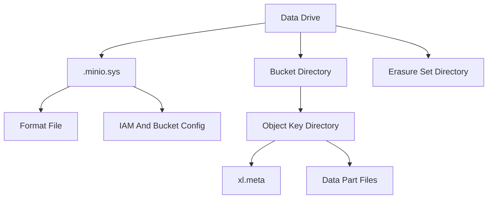

# MinIO's On-Disk Layout: Walking Through a Drive by Hand

## English

When you look at a MinIO data drive in a file manager, you do not see a folder tree that mirrors your bucket names. Instead you see a small set of hidden directories whose names start with a dot, plus one directory per erasure set. The most important of these is the metadata directory, conventionally `.minio.sys`, which holds internal bookkeeping: bucket configuration, IAM data, the format file that records the drive's UUID and erasure-set assignment, and the per-object metadata that MinIO consults before it can serve a read. The actual object payloads live under a directory whose name is derived from the bucket name, and inside that, one directory per object key. For an object called `photos/2024/cat.jpg`, MinIO creates a directory path that encodes the key, and within it stores the data part files plus a `xl.meta` metadata file.

The `xl.meta` file is the heart of the layout. It is a compact binary structure that describes, for a single object: the erasure-coding scheme used, the list of data and parity shards, the checksums for each shard, the object's size, its ETag, its user metadata (the `x-amz-meta-*` headers), its tags, and version information if versioning is on. Because MinIO uses erasure coding, a single logical object is split into N shards spread across N drives, and each drive holds one shard plus its own copy of `xl.meta`. That redundancy in metadata is deliberate: any single drive can be lost and the cluster can still reconstruct both the shard and the metadata it needs to interpret it.

Why does this matter to you as an operator or developer? First, it explains why you cannot simply `cp` a file into a bucket directory and expect MinIO to see it. Object stores are not file systems; the catalogue and the payload must agree, and MinIO only trusts what it wrote itself. Second, it explains why backing up a MinIO deployment by copying raw drive contents is fragile: you would need a consistent snapshot across all drives in an erasure set at the same instant, or the shards and metadata could disagree. Third, it explains the `.minio.sys` directory's sensitivity — corrupting it can make an otherwise healthy set of payload files unreadable, because MinIO no longer knows how to interpret them.

A useful mental model: think of each drive as a shelf of sealed envelopes. The envelope labelled with the object key contains one puzzle piece (the shard) and a printed instruction card (the `xl.meta`) that says which puzzle it belongs to and how the pieces fit. The `.minio.sys` directory is the librarian's index that tells the server which shelves to visit for a given object. Lose one shelf and the librarian can still route around it; lose the index and the shelves become anonymous paper.

In practice, you rarely touch these files directly. But knowing they exist helps you interpret error messages like 「erasure set not found」 or 「xl.meta corrupt」, and it makes you skeptical of any advice that says 「just mount the drive and copy the files out」. The correct path for extraction is always through the S3 API or `mc`, never the file system.

## 中文

當你在檔案管理員裡打開一個 MinIO 資料磁碟，你不會見到一個與 bucket 名稱一一對應的資料夾樹。你見到的是一小撮以點開頭的隱藏目錄，加上每個 erasure set 一個目錄。其中最重要的是元數據目錄，慣例上叫 `.minio.sys`，裡面放著內部簿記：bucket 設定、IAM 資料、記錄磁碟 UUID 與 erasure-set 歸屬的 format 檔，以及 MinIO 在提供讀取之前必須查閱的每物件元數據。真正的物件內容放在一個由 bucket 名稱衍生出來的目錄下，再往裡是每個 object key 一個目錄。對於一個叫 `photos/2024/cat.jpg` 的物件，MinIO 會建立一條編碼了該 key 的目錄路徑，裡面放著資料分片檔以及一個 `xl.meta` 元數據檔。

`xl.meta` 檔是整個佈局的靈魂。它是一個緊湊的二進位結構，描述單一物件的：所用的糾刪碼方案、資料分片與校驗分片清單、每個分片的校驗和、物件大小、ETag、使用者元數據（即 `x-amz-meta-*` 標頭）、標籤，以及若開啟了版本控制時的版本資訊。因為 MinIO 用糾刪碼，一個邏輯物件會被切成 N 個分片散佈在 N 塊磁碟上，每塊磁碟持有其中一個分片，外加它自己的一份 `xl.meta`。元數據的這種冗餘是刻意的：任何單塊磁碟丟失，叢集仍然可以重建它需要的分片與元數據。

這對身為操作者或開發者的你有何意義？第一，它解釋了為何你不能直接把檔案 `cp` 進 bucket 目錄就期望 MinIO 看得見。物件存儲不是檔案系統；目錄與內容必須一致，而 MinIO 只信任它自己寫的東西。第二，它解釋了為何靠複製原始磁碟內容來備份 MinIO 部署是很脆弱的：你需要在同一瞬間對同一個 erasure set 的所有磁碟做一致性快照，否則分片與元數據可能對不上。第三，它解釋了 `.minio.sys` 目錄的敏感度——破壞它會令一組本來健康的內容檔變得不可讀，因為 MinIO 不再知道如何解讀它們。

一個有用的心智模型：把每塊磁碟想像成一個放滿密封信封的架子。標著 object key 的信封裡裝著一塊拼圖（分片）和一張印刷的說明卡（`xl.meta`），說明這塊拼圖屬於哪幅圖、各塊如何拼合。`.minio.sys` 目錄就是圖書館員的索引，告訴伺服器某個物件要去哪些架子找。丟了一個架子，圖書館員仍可繞路；丟了索引，架子就變成無名廢紙。

實務上你很少直接碰這些檔案。但知道它們存在，有助你解讀像「erasure set not found」或「xl.meta corrupt」這類錯誤訊息，也讓你對任何「只要掛載磁碟把檔案複製出來就好」的建議保持懷疑。正確的提取路徑永遠是透過 S3 API 或 `mc`，絕不是檔案系統。

## Key Takeaway

MinIO's on-disk layout is a catalogue plus sharded payloads, not a mirror of your bucket tree — always extract data through the API, never by copying raw drives.

## Related Concepts
- Erasure Coding
- The .minio.sys metadata layer

## Diagram

