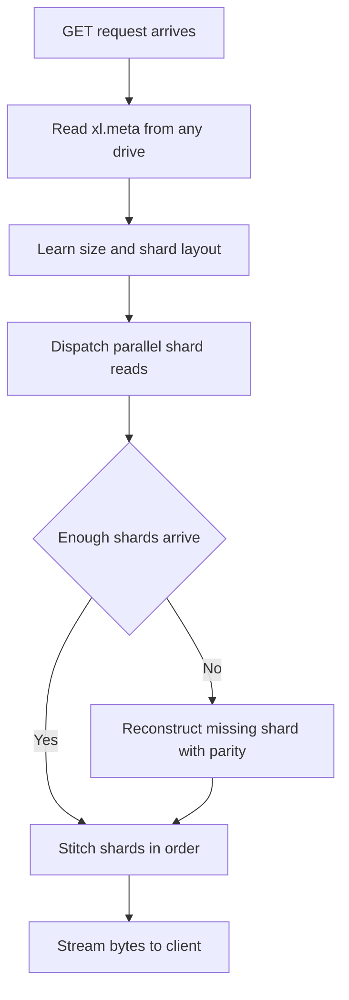

# Read Path Under Failure: How MinIO Reconstructs an Object From Surviving Shards

## English

A GET request against MinIO looks trivial from the client side: send the key, receive the bytes. Underneath, the server is performing a small orchestration. It first reads the object's `xl.meta` from one of the drives in the erasure set — any drive will do, since the metadata is replicated — to learn the object's size, the erasure-coding parameters, and the shard layout. Then it dispatches read requests for the data shards to the drives that hold them, in parallel. If every drive answers, the server simply stitches the shards back together in order and streams the bytes to the client, verifying checksums along the way.

The interesting case is when a drive is slow, offline, or returns a corrupted shard. MinIO does not fail the read immediately. Instead it waits for enough shards to arrive to satisfy the erasure-coding threshold — if the object was written with, say, 8 data shards and 4 parity shards, the server needs any 8 of the 12 to reconstruct the object. If one data shard is missing, the server can use the parity shards to mathematically recover the missing data shard. This is the entire point of erasure coding: reads degrade gracefully. A single failed drive turns a normal read into a slightly more expensive read, not an error.

What does 「more expensive」 mean concretely? Reconstruction is a matrix operation over Galois field arithmetic — the server must solve a small linear system to recover the missing shard. It costs CPU and memory, and it must wait for the parity shards to arrive before it can begin reconstruction, which adds latency. MinIO pipelines this: it can start streaming the shards it has already received while awaiting the rest, so the client sees a steady byte stream rather than a stall. But if many drives are down simultaneously — approaching the parity count — reads will slow down noticeably, and if more than the parity count fail, the object becomes unreadable and the server returns an error.

Healing is the server's response to this degraded state. When MinIO detects that a drive is back online or that a shard's checksum does not match, it schedules a repair job that reads the surviving shards, reconstructs the missing one, and writes it back to the recovered drive. This happens in the background and is driven by the scanner, which periodically walks the erasure set looking for discrepancies. Until healing completes, reads of that object continue to pay the reconstruction cost. This is why operators watch the healing queue: a large backlog means the cluster is running in a degraded, slower mode.

A useful analogy: imagine a book whose pages are torn into twelve strips and distributed to twelve librarians, with instructions that any eight strips suffice to reconstruct the whole book. A normal read asks all twelve for their strips and assembles them. A read where one librarian is on holiday asks the remaining eleven, notices one is missing, and uses the mathematical relationship encoded in the four spare strips to regenerate the missing one. The book still comes out intact; it just took longer and used more brainpower. That is the read path under failure, and it is the reason MinIO can survive drive loss without downtime.

## 中文

從客戶端角度看，對 MinIO 發一個 GET 請求好像很簡單：送出 key，收到位元組。但在底層，伺服器正在進行一場小型編排。它首先從 erasure set 中某塊磁碟讀取物件的 `xl.meta`——任何一塊都可以，因為元數據是複製的——以得知物件大小、糾刪碼參數與分片佈局。然後它向持有資料分片的磁碟並行派發讀取請求。如果每塊磁碟都回應，伺服器就簡單地把分片按序縫合，一邊校驗校驗和，一邊把位元組串流給客戶端。

有趣的情況是某塊磁碟變慢、離線，或回傳了損壞的分片。MinIO 不會立刻令讀取失敗。相反，它會等到足夠的分片到達以滿足糾刪碼門檻——如果物件是以例如 8 個資料分片加 4 個校驗分片寫入，伺服器只需要 12 個中的任意 8 個就能重建物件。若缺了一個資料分片，伺服器可以用校驗分片以數學方式還原它。這正是糾刪碼的全部意義：讀取會優雅降級。一塊磁碟故障只是把一次普通讀取變成一次稍貴的讀取，而不是錯誤。

「稍貴」具體是什麼意思？重建是伽羅瓦域算術上的一次矩陣運算——伺服器要解一個小型線性方程組來還原缺失的分片。它耗 CPU 與記憶體，而且必須等校驗分片到達才能開始重建，這會增加延遲。MinIO 會把這個流程管線化：它可以一邊串流已收到的分片，一邊等待其餘的，讓客戶端見到穩定的位元組流而不是卡頓。但如果同時有多塊磁碟離線——接近校驗分片數——讀取會明顯變慢；若故障數超過校驗分片數，物件就變得不可讀，伺服器會回傳錯誤。

修復（healing）是伺服器對這種降級狀態的回應。當 MinIO 偵測到某塊磁碟重新上線，或某個分片的校驗和不符，它會排程一個修復任務，讀取存活的分片、重建缺失的那一塊，並寫回已復原的磁碟。這在背景進行，由掃描器驅動，掃描器會定期走訪 erasure set 尋找不一致。在修復完成之前，該物件的讀取會繼續付出重建成本。這就是為何操作者要盯住修復佇列：積壓很大意味著叢集正以降級、較慢的模式運行。

一個有用的類比：想像一本書被撕成十二條紙條分給十二位圖書館員，並附有指示說任意八條就足以還原整本書。正常讀取會向十二人索取紙條並組裝。若有一位圖書館員放假，讀取就向餘下十一人索取，發現少了一條，並用四條備用紙條中編碼的數學關係重新生成缺失的那條。書仍然完整出爐；只是花了更長時間、用了更多腦力。這就是故障下的讀取路徑，也是 MinIO 能在不中斷服務的情況下承受磁碟丟失的原因。

## Key Takeaway

A MinIO GET is a parallel shard fetch that tolerates missing drives up to the parity count, at the cost of extra CPU and latency until healing restores the shard.

## Related Concepts
- Erasure Coding
- Bitrot detection and healing

## Diagram

