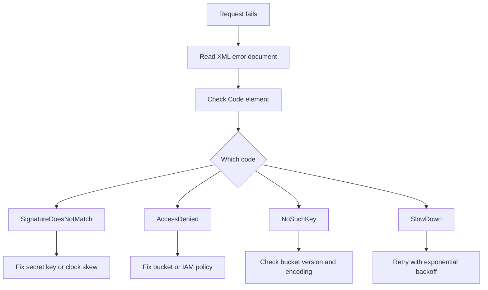

# Debugging Slow or Failing Requests: Reading MinIO's Error Responses and Logs

## English

When a request to MinIO fails, the server responds with an XML error document, not a JSON blob, because the S3 protocol specifies XML. The document has a small, stable shape: a `<Code>` element with a symbolic name like `NoSuchKey`, `AccessDenied`, `SignatureDoesNotMatch`, `InvalidBucketName`, or `SlowDown`; a `<Message>` with a human-readable description; a `<Resource>` naming the bucket and key; and a `<RequestId>` and `<HostId>` that you can quote when asking for help. Learning to read these codes is the fastest way to debug an S3 client, because the code tells you which layer rejected the request — authentication, authorization, routing, or storage.

A few codes are worth memorising because they map to very different fixes. `SignatureDoesNotMatch` almost always means the client and server disagree about the secret key or about the exact bytes of the canonical request — a common cause is a proxy or SDK silently re-encoding a header, or a clock skew so large that the signature's timestamp falls outside the allowed window. `AccessDenied` means the signature was valid but the policy evaluation said no; the fix is in the bucket policy or IAM policy, not in the credentials. `NoSuchKey` means the object genuinely is not there — check whether you are hitting the right bucket, whether versioning has hidden an older version, or whether the client is URL-encoding the key differently from how it was written. `SlowDown` is MinIO's backpressure signal, telling a client to retry with exponential backoff rather than hammering the server.

The server logs are the second tool. MinIO emits structured logs to standard output, and in a container deployment you read them with `docker logs` or `kubectl logs`. Look for the request ID from the error response — it appears in the log line for that request, letting you correlate the client's view with the server's. The log line typically includes the API operation (e.g. `GetObject`), the bucket and object, the HTTP status, the duration, and often the bytes transferred. A pattern of long durations on `GetObject` for the same erasure set points at a slow or failing drive; a burst of `AccessDenied` from one client points at a misconfigured policy or an expired credential.

For deeper investigation, `mc admin trace` streams live request traces showing each API call, its parameters, and its latency, and `mc admin info` shows per-drive health and the healing queue. `mc admin heal` can be used to inspect or trigger repair on a specific bucket or prefix. These are the commands that turn 「it's slow」 into 「drive 7 in erasure set 3 has a failing shard and is being healed」. They are read-only diagnostics by default, which makes them safe to run in production, though `trace` can be noisy on a busy cluster.

A practical debugging habit: reproduce the failure with the simplest possible client — `mc` or a short script using the AWS SDK — before blaming the application. If `mc cp` works but your app fails, the bug is in the app's signing, encoding, or retry logic. If `mc` also fails with the same code, the problem is server-side or configuration-side, and the error code tells you which. This divide-and-conquer approach saves hours, because S3's error surface is wide and the codes are the map.

## 中文

當對 MinIO 的請求失敗，伺服器回傳的是一份 XML 錯誤文件，而不是 JSON，因為 S3 協定規定用 XML。這份文件形狀小而穩定：一個 `<Code>` 元素帶有像 `NoSuchKey`、`AccessDenied`、`SignatureDoesNotMatch`、`InvalidBucketName` 或 `SlowDown` 這類符號名稱；一個 `<Message>` 帶人類可讀的描述；一個 `<Resource>` 指出 bucket 與 key；以及 `<RequestId>` 與 `<HostId>`，方便你求助時引用。學會讀這些代碼是除錯 S3 客戶端最快的方法，因為代碼告訴你請求是在哪一層被拒——認證、授權、路由，還是儲存。

有幾個代碼值得記住，因為它們對應非常不同的修法。`SignatureDoesNotMatch` 幾乎總是意味著客戶端與伺服器對 secret key 或對正規化請求的確切位元組有分歧——常見原因是代理或 SDK 悄悄重新編碼了某個標頭，或時鐘偏差大到簽章的時間戳落在允許窗口之外。`AccessDenied` 表示簽章有效但策略評估說不；修法在 bucket policy 或 IAM policy，不在憑證。`NoSuchKey` 表示物件真的不在——檢查是否打錯 bucket、版本控制是否藏起了舊版本，或客戶端對 key 的 URL 編碼與寫入時不同。`SlowDown` 是 MinIO 的背壓訊號，叫客戶端以指數退避重試，而不是猛打伺服器。

伺服器日誌是第二件工具。MinIO 把結構化日誌輸出到標準輸出，在容器部署中你用 `docker logs` 或 `kubectl logs` 讀取。找錯誤回應中的 request ID——它會出現在該請求的日誌行裡，讓你把客戶端的視角與伺服器的對上。日誌行通常包含 API 操作（例如 `GetObject`）、bucket 與 object、HTTP 狀態、耗時，往往還有傳輸位元組數。同一 erasure set 上 `GetObject` 耗時偏長，指向某塊慢或故障的磁碟；單一客戶端湧出大量 `AccessDenied`，指向設定錯誤的策略或過期的憑證。

要更深調查，`mc admin trace` 會串流即時請求追蹤，顯示每個 API 呼叫、其參數與延遲；`mc admin info` 顯示每塊磁碟的健康與修復佇列；`mc admin heal` 可用來檢視或對特定 bucket 或前綴觸發修復。這些指令把「很慢」變成「erasure set 3 的第 7 塊磁碟有故障分片，正在修復」。它們預設是唯讀診斷，因此可安全在生產環境執行，不過 `trace` 在繁忙叢集上會很吵。

一個實用的除錯習慣：先用最簡單的客戶端重現失敗——`mc` 或一段短腳本配 AWS SDK——再怪應用程式。如果 `mc cp` 成功而你的應用失敗，bug 在應用的簽章、編碼或重試邏輯。如果 `mc` 也以相同代碼失敗，問題在伺服器端或設定端，而錯誤代碼告訴你是哪一邊。這種分而治之的方法省下數小時，因為 S3 的錯誤面很寬，而代碼就是地圖。

## Key Takeaway

S3 error codes are a map of which layer rejected a request — read them, correlate the request ID with server logs, and reproduce with the simplest client before blaming your app.

## Related Concepts
- The S3 API is not one API
- The mc admin toolchain

## Diagram

