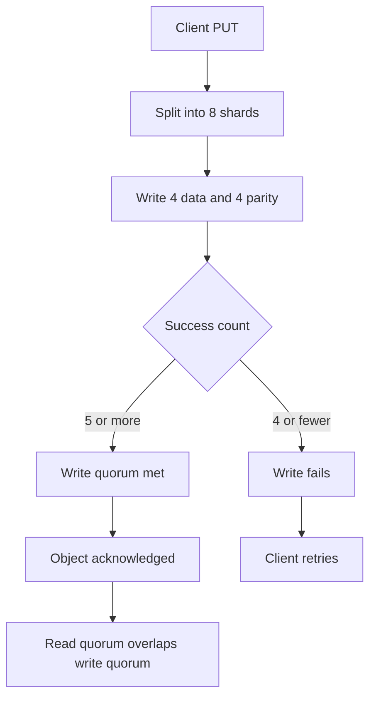

# The Write Quorum: How Many Shards Must Agree Before an Object Exists

## English

Erasure coding splits an object into data shards and parity shards, but splitting is the easy part. The interesting question is: how many of those shards must be successfully written before MinIO tells the client the upload succeeded? This is the write quorum. In an erasure set of N drives with parity level P, an object is written as N shards, of which P may be lost and the object still reconstructable. The write quorum is K, the number of data shards — so MinIO needs K successful shard writes to confirm the object. There is one special case: when the parity is exactly half the erasure set size, the write quorum becomes K+1. Concretely, with 4 data shards and 4 parity shards (8 total, EC:4), the parity is exactly half, so MinIO needs at least 5 successful shard writes to confirm the object. If only 4 succeed, the request fails even though the data is technically still recoverable — because that K+1 requirement exists precisely to prevent a split-brain scenario where a network partition isolates exactly half the drives and the same object gets written twice, once to each "half" of the erasure set.

Why not simply the bare minimum for reconstruction? Because of something called read quorum. When a client later reads the object, MinIO must decide which shards are authoritative, and the read quorum is also K. If two clients could write to different halves of the erasure set, two conflicting versions could each hold enough shards to look valid. Keeping reads and writes at the same K threshold — and bumping writes to K+1 when parity is half the set — ensures that a read quorum and a write quorum must overlap in at least one drive, so a reader always sees the most recent acknowledged write. This is the same arithmetic reasoning that underpins quorum systems like Paxos and Raft, applied at the level of disk shards rather than network nodes.

The practical consequence is that a MinIO cluster can tolerate drive failures and still serve reads, but writes may start failing earlier than you expect. With EC:4 on 8 drives, you can lose 4 drives and still reconstruct existing objects, but you can only lose 3 drives and still accept new writes. That last drive of headroom is the price of consistency. This is why capacity and durability planning must consider not just how much data you can survive losing, but how many drives must be online for the cluster to remain writable.

There is also a subtlety about partial writes. If a PUT fails to reach write quorum, MinIO does not leave a half-object visible to readers. The shards that did land are marked as incomplete in the internal metadata (the .minio.sys layer), and a background healing process cleans them up. Clients see a clean error, not a corrupt object. This is one of the reasons object stores can get away with weaker per-drive guarantees: the quorum layer turns a messy set of partial disk writes into an all-or-nothing outcome at the API boundary.

When you are debugging intermittent 503 or 500 errors during heavy writes, the first thing to check is how many drives in each erasure set are offline or slow. A drive that is merely slow — not failed — can still cause a write to miss quorum if its shard write times out. This is why monitoring per-drive latency matters as much as monitoring drive health. The quorum is not just about counting drives; it is about counting drives that responded in time.

## 中文

糾刪碼會將物件拆成資料分片和校驗分片，但拆分只是最簡單的一步。真正有趣的問題是：在 MinIO 告訴客戶端上傳成功之前，究竟需要多少個分片寫入成功？這就是寫入法定人數（write quorum）。在一個由 N 個磁碟組成、校驗級別為 P 的糾刪集（erasure set）中，物件會被寫成 N 個分片，其中最多可以丟失 P 個而仍能重建。寫入法定人數就是 K，也就是資料分片的數目——所以 MinIO 需要 K 個分片寫入成功才能確認物件。但有一個特例：當校驗數正好等於糾刪集大小的一半時，寫入法定人數會變成 K+1。具體來說，4 個資料分片加 4 個校驗分片（共 8 個，EC:4）時，校驗數正好是一半，所以 MinIO 需要至少 5 個分片寫入成功才能確認物件。如果只有 4 個成功，請求就會失敗——即使資料在技術上仍可恢復——因為這個 K+1 的要求正是為了防止 split-brain 情境：網絡分割令剛好一半的磁碟被隔離，導致同一個物件被寫入兩次，一次寫在糾刪集的「一半」那邊。

為什麼不用重建的最低要求就好？這與讀取法定人數（read quorum）有關。當客戶端稍後讀取物件時，MinIO 必須決定哪些分片是權威的，而讀取法定人數同樣是 K。如果不同客戶端可以寫入糾刪集的不同半數，兩個衝突的版本可能各自持有足夠分片而看似有效。讀取與寫入都維持在 K 這個門檻（校驗數為一半時寫入提高到 K+1），確保任何讀取法定集合與任何寫入法定集合至少重疊一個磁碟——因此讀者總能看到最新已確認的寫入。這與 Paxos、Raft 等法定人數系統的算術推理相同，只是應用在磁碟分片而非網路節點上。

實際後果是：MinIO 叢集可以容忍磁碟故障並繼續提供讀取，但寫入可能比你想像中更早開始失敗。8 個磁碟上使用 EC:4 時，你可以丟失 4 個磁碟並仍能重建現有物件，但只能丟失 3 個磁碟並仍能接受新寫入。最後那一個磁碟的餘量就是一致性的代價。這就是為什麼容量和耐用性規劃不僅要考慮能承受丟失多少資料，還要考慮叢集要保持可寫需要多少磁碟線上。

還有一個關於部分寫入的微妙之處。如果 PUT 未能達到寫入法定人數，MinIO 不會留下一個半成品物件讓讀者看到。已落盤的分片會在內部後設資料（.minio.sys 層）中標記為不完整，後臺修復過程會清理它們。客戶端看到的是乾淨的錯誤，而不是損壞的物件。這是物件儲存能夠以較弱的單磁碟保證執行的原因之一：法定人數層將一組混亂的部分磁碟寫入轉化為 API 邊界上的全有或全無結果。

當你在大量寫入期間除錯間歇性的 503 或 500 錯誤時，首先要檢查每個糾刪集中有多少磁碟離線或緩慢。一個僅僅緩慢——而非故障——的磁碟，如果其分片寫入超時，仍可能導致寫入無法達到法定人數。這就是為什麼監控每磁碟延遲與監控磁碟健康同樣重要。法定人數不僅僅是計算磁碟數量，而是計算及時響應的磁碟數量。

## Key Takeaway

MinIO's write quorum is K data shards — or K+1 when parity is exactly half the erasure set — so durability headroom and writability headroom are different numbers that must both be planned for.

## Related Concepts
- Read quorum and reconstruction threshold
- Per-drive latency and timeout behaviour

## Diagram

