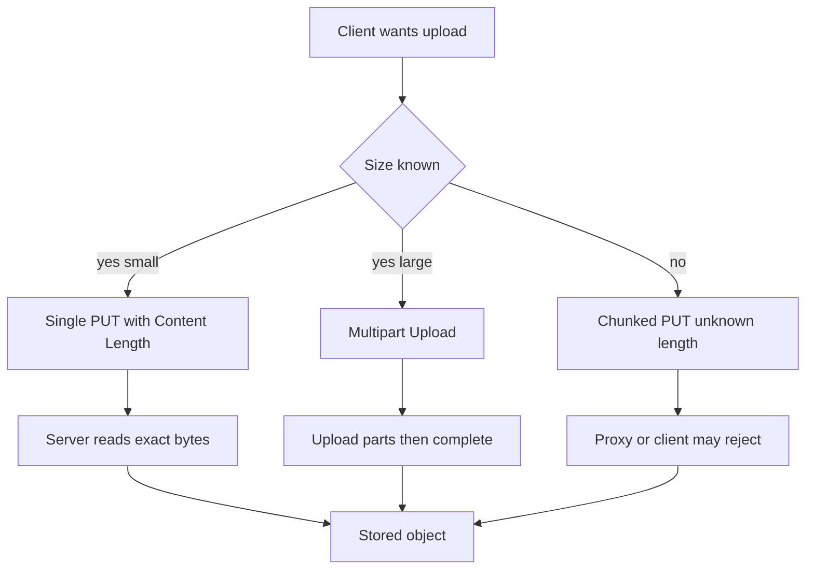

# Streaming Uploads and the Chunked PUT: Why Content-Length Matters

## English

A naive mental model of uploading a file to object storage is: send the bytes, get a 200 OK. In reality, the S3 protocol has a specific contract around how the server knows when a PUT is finished. The simplest form is a single PUT with a Content-Length header: the client declares the exact byte count up front, and the server reads exactly that many bytes. If the connection drops mid-stream, the server knows the upload is incomplete because it received fewer bytes than promised. This is why single PUT requests are capped at 5 GiB by the S3 specification — a limit MinIO honours — and why many clients will refuse to send a stream of unknown length.

For anything larger, or for streams where the total length is not known in advance, the answer is multipart upload. The client splits the object into parts (each typically 5 MiB to 5 GiB, with the last part allowed to be smaller), uploads each part with its own part number, and then sends a final CompleteMultipartUpload request listing the parts and their ETags. The server stitches the parts together logically without ever needing the whole object in memory or on a single disk. This is the mechanism that makes it possible to upload a 5 TiB object from a laptop with 8 GB of RAM.

But there is a third mode that trips people up: chunked transfer encoding with an unknown Content-Length. HTTP/1.1 allows a client to send a body in chunks, each prefixed with its size, ending with a zero-length chunk. Some S3 clients and proxies use this for streaming uploads. Historically, S3 required a Content-Length for PUT, and many S3-compatible servers rejected chunked uploads outright. MinIO does accept chunked PUTs in many configurations, but the behaviour can vary with the client library and any proxy in between. If you see mysterious 411 Length Required errors or truncated uploads, the culprit is often a proxy stripping or refusing to forward chunked bodies.

This matters in practice because streaming pipelines — logs shipped from a sidecar, backups piped from tar, data exported from a database — frequently produce streams of unknown length. The robust pattern is to buffer into a multipart upload: read the stream in fixed-size chunks, upload each chunk as a part as soon as it fills, and complete the upload at the end. This keeps memory bounded, avoids the Content-Length problem entirely, and gives you resumability for free, since parts already uploaded can be reused if the connection dies. It is more code than a single PUT, but it is the pattern that survives real networks.

A related gotcha is the ETag of a multipart object. For a single PUT, the ETag is typically the MD5 of the content (in quotes). For a multipart upload, the ETag is a hash of the part hashes with a dash and the part count appended, something like "abc123-7". Code that compares ETags to detect changes must not assume the ETag is an MD5 — and must not assume two objects with the same content have the same ETag if they were uploaded differently. If you need content identity, compute your own checksum and store it as object metadata, rather than relying on the ETag.

## 中文

對上傳檔案到物件儲存的樸素心智模型是：傳送位元組，收到 200 OK。實際上，S3 協議對伺服器如何知道 PUT 已完成有特定的約定。最簡單的形式是帶 Content-Length 頭的單次 PUT：客戶端事先宣告確切的位元組數，伺服器正好讀取那麼多位元組。如果連線中途斷開，伺服器知道上傳不完整，因為收到的位元組少於承諾的數量。這就是為什麼 S3 規範將單次 PUT 請求限制在 5 GiB——MinIO 遵守此限制——也是為什麼許多客戶端會拒絕傳送長度未知的流。

對於更大的物件，或總長度事先未知的流，答案是分段上傳（multipart upload）。客戶端將物件分成多個部分（每個通常 5 MiB 到 5 GiB，最後一部分可以更小），用各自的部分編號上傳每個部分，然後傳送最終的 CompleteMultipartUpload 請求，列出各部分及其 ETag。伺服器在邏輯上將各部分拼接在一起，無需將整個物件放入記憶體或單個磁碟。這就是為什麼可以從一臺 8 GB 記憶體的筆記本上傳 5 TiB 物件的機制。

但還有第三種模式會讓人栽跟頭：Content-Length 未知的分塊傳輸編碼（chunked transfer encoding）。HTTP/1.1 允許客戶端以分塊方式傳送正文，每塊字首其大小，以零長度塊結束。一些 S3 客戶端和代理使用這種方式進行流式上傳。歷史上，S3 要求 PUT 帶 Content-Length，許多 S3 相容伺服器直接拒絕分塊上傳。MinIO 在許多配置下確實接受分塊 PUT，但行為可能因客戶端庫和中間代理而異。如果你看到神秘的 411 Length Required 錯誤或上傳被截斷，罪魁禍首往往是代理剝離或拒絕轉發分塊正文。

這在實踐中很重要，因為流式管道——從 sidecar 傳送的日誌、從 tar 管道傳來的備份、從資料庫匯出的資料——經常產生長度未知的流。穩健的模式是緩衝到分段上傳中：以固定大小的塊讀取流，每當塊填滿就作為一個部分上傳，最後完成上傳。這使記憶體保持有界，完全避免了 Content-Length 問題，並免費獲得可恢復性，因為已上傳的部分可以在連線斷開時重用。這比單次 PUT 需要更多程式碼，但它是在真實網路中存活的模式。

一個相關的陷阱是分段物件的 ETag。對於單次 PUT，ETag 通常是內容的 MD5（帶引號）。對於分段上傳，ETag 是部分雜湊的雜湊，附加一個破折號和部分數量，類似 "abc123-7"。比較 ETag 以檢測變化的程式碼不能假設 ETag 是 MD5——也不能假設兩個內容相同的物件如果上傳方式不同就有相同的 ETag。如果你需要內容標識，請計算自己的校驗和並將其儲存為物件後設資料，而不是依賴 ETag。

## Key Takeaway

Single PUTs need a known Content-Length and are capped at 5 GiB; multipart upload is the correct pattern for large or unknown-length streams, and multipart ETags are not MD5s.

## Related Concepts
- Multipart upload lifecycle
- HTTP chunked transfer encoding

## Diagram

