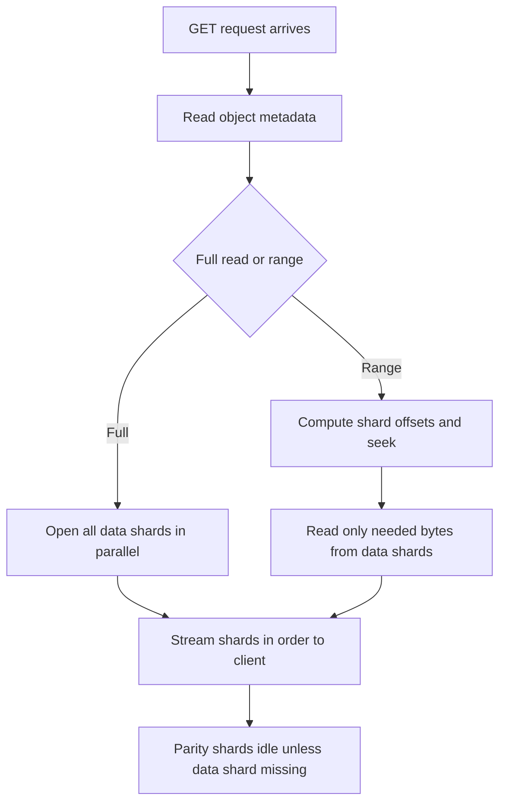

# The Read Path When Everything Is Fine: Range Reads, Shard Selection, and Streaming

## English

Most explanations of erasure coding focus on the dramatic case: a drive has failed, and the server reconstructs lost shards from parity. But the more common read path is the boring one — all drives healthy, a client asks for bytes, and the server returns them. Understanding this path explains why object storage can serve huge files with modest memory, and why range requests are so powerful.

When a GET arrives, MinIO consults the metadata for the object to learn its size, its erasure layout (data and parity shard counts), and which drives hold which shards. For a full read, it opens the data shards in parallel and streams them to the client in order. It does not need to read parity shards at all when every data shard is available — parity is only fetched when a data shard is missing or unreadable. This is a key efficiency: in the healthy case, the read cost is proportional to the object size, not to the object size times the erasure overhead. The parity shards sit idle, consuming disk space but not read bandwidth.

Now consider a range request: the client sends a Range header asking for bytes 1,000,000 to 1,999,999 of a 10 GiB object. MinIO does not read the whole object and slice it. It computes which shard offsets correspond to the requested byte range, seeks to those offsets on each data shard, and reads only the needed bytes. Because the erasure coding is applied in fixed-size blocks, a range that crosses block boundaries may touch several shards, but the total bytes read from disk is still proportional to the requested range, not the object size. This is what makes it practical to read a single record out of a multi-gigabyte Parquet file or to resume a download after a dropped connection.

Streaming is the other half of the story. MinIO does not buffer the whole object in memory before responding. It writes bytes to the HTTP response as it reads them from disk, using a bounded buffer. Backpressure from a slow client naturally slows the disk reads, which prevents a fast disk from overwhelming a slow network. The consequence for operators is that a single slow client can hold a connection and some memory for a long time, which is why connection limits and timeouts matter. It also means that a client that disconnects mid-read causes the server to abort the disk reads promptly rather than finishing the transfer into the void.

There is a subtle interaction with healing. If a drive is being healed, reads may briefly be served from parity reconstruction even though the drive is technically online. This is normal and self-correcting, but it shows up as elevated CPU usage and slightly higher latency during heal operations. If you see read latency spike without an obvious client-side cause, check whether a heal is in progress. The healthy read path is cheap; the reconstructing read path is correct but noticeably more expensive, and knowing which one you are on is half of performance debugging.

## 中文

大多數關於糾刪碼的解釋都集中在戲劇性的情況：一個磁碟故障了，服務器從校驗分片重建丟失的分片。但更常見的讀取路徑是無聊的那一種——所有磁碟健康，客戶端請求字節，服務器返回它們。理解這條路徑能解釋為什麼對象存儲能以適度的內存服務巨大的文件，以及為什麼範圍請求如此強大。

當 GET 到達時，MinIO 查詢對象的元數據以了解其大小、糾刪佈局（數據和校驗分片數量）以及哪些磁碟持有哪些分片。對於完整讀取，它並行打開數據分片並按順序流式傳輸給客戶端。當每個數據分片都可用時，它根本不需要讀取校驗分片——只有當數據分片缺失或無法讀取時才會獲取校驗。這是一個關鍵的效率：在健康情況下，讀取成本與對象大小成正比，而不是與對象大小乘以糾刪開銷成正比。校驗分片閒置著，消耗磁碟空間但不消耗讀取帶寬。

現在考慮一個範圍請求：客戶端發送 Range 頭，請求一個 10 GiB 對象的第 1,000,000 到 1,999,999 字節。MinIO 不會讀取整個對象再切片。它計算請求的字節範圍對應哪些分片偏移，在每個數據分片上定位到那些偏移，只讀取所需字節。由於糾刪碼應用於固定大小的塊，跨越塊邊界的範圍可能觸及多個分片，但從磁碟讀取的總字節數仍與請求範圍成正比，而非對象大小。這就是為什麼從多 GB 的 Parquet 文件中讀取單條記錄，或在連接斷開後恢復下載，在實踐中是可行的。

流式傳輸是故事的另一半。MinIO 不會在響應前將整個對象緩衝在內存中。它在從磁碟讀取字節時將其寫入 HTTP 響應，使用有界緩衝區。來自慢客戶端的背壓自然會減慢磁碟讀取，防止快速磁碟淹沒慢速網絡。對運維人員的後果是，單個慢客戶端可能長時間佔用連接和一些內存，這就是為什麼連接限制和超時很重要。這也意味著在讀取中途斷開的客戶端會促使服務器及時中止磁碟讀取，而不是將傳輸完成到虛空之中。

與修復有一個微妙的交互。如果一個磁碟正在被修復，即使該磁碟在技術上在線，讀取也可能短暫地由校驗重建提供服務。這是正常的且會自我修正，但它會表現為修復操作期間 CPU 使用率升高和延遲略微增加。如果你看到讀取延遲飆升而沒有明顯的客戶端原因，請檢查是否有修復正在進行。健康的讀取路徑是廉價的；重建的讀取路徑是正確的但明顯更昂貴，知道你在哪一條路徑上是性能調試的一半。

## Key Takeaway

On the healthy read path MinIO reads only data shards and only the bytes a range request asks for, streaming with bounded memory — parity is fetched only when a data shard is unavailable.

## Related Concepts
- Range requests and partial reads
- Backpressure and connection timeouts

## Diagram

