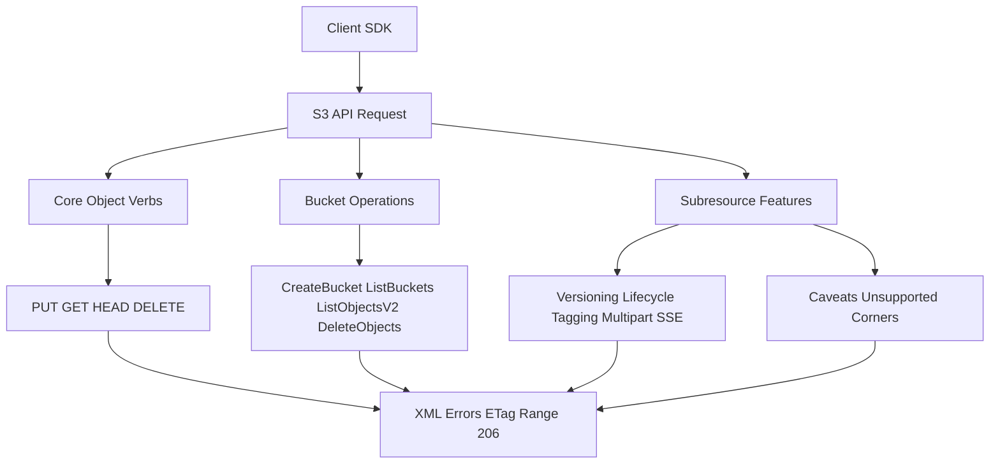

# The S3 API Surface MinIO Actually Implements (and the Corners It Does Not)

## English

MinIO advertises itself as S3-compatible, but compatibility is a spectrum, not a boolean. The core object verbs — PUT, GET, HEAD, DELETE on /bucket/key — plus bucket-level operations like CreateBucket, ListBuckets, ListObjectsV2, and DeleteObjects (the multi-object batch delete) form the foundation almost every client library relies on. MinIO implements these thoroughly, including the awkward parts: the XML error body with a Code and Message, the ETag header on PUT, and the 206 Partial Content response for range GETs. When you point an AWS SDK at MinIO, it is these operations that make the SDK 'just work' without special-casing.

Above that core sits a long tail of subresources and features, and this is where compatibility becomes a matter of degree. Some features are fully supported: bucket versioning, lifecycle configuration, object tagging, multipart upload, and server-side encryption with KMS. Others are implemented with caveats — for example, some S3 features assume AWS-specific backends (like certain storage-class transitions to Glacier) that have no direct meaning on a MinIO cluster, so they may be accepted syntactically but have no effect, or be rejected outright. The practical lesson is that 'S3-compatible' means the common 90% works identically, while the remaining 10% requires checking the documentation rather than assuming.

A concrete example is the difference between ListObjects (the original V1 API) and ListObjectsV2. V2 adds a continuation-token mechanism and a start-after parameter that make pagination cleaner, and most modern SDKs default to it. If a tool you depend on still calls V1 with marker-based pagination, you want to confirm both endpoints behave consistently, especially around delimiter and prefix semantics, since these determine how 'folders' appear in a flat namespace. Similarly, the multi-object DeleteObjects call returns a per-key result list, and clients must parse partial failures rather than assuming all-or-nothing.

Another subtle area is request signing and headers. MinIO supports Signature Version 4, the current AWS signing scheme, and expects the canonical request to be built correctly, including the x-amz-content-sha256 header. If you write a hand-rolled client and get a SignatureDoesNotMatch error, the cause is almost always a mismatch in how headers were canonicalized (whitespace, header ordering, or which headers were signed). Because MinIO validates signatures strictly, it is an excellent test target for client code — if it works against MinIO, the signing logic is usually correct.

So the mental model is a layered one: a rock-solid core that behaves like S3, a broad middle of features MinIO implements faithfully, and a thin edge of AWS-specific behaviour that either degrades gracefully or fails loudly. When building against MinIO, design for the core, test the middle explicitly, and treat the edge as something to verify per feature rather than assume. That discipline is what separates a system that works in a demo from one that survives a migration to or from real AWS S3.

## 中文

MinIO 自稱「S3 相容」，但相容性其實是一個光譜，而不是一個布林值。核心的對象動詞 — 對 /bucket/key 的 PUT、GET、HEAD、DELETE — 再加上 bucket 層級的操作，例如 CreateBucket、ListBuckets、ListObjectsV2 和 DeleteObjects（多對象批次刪除），構成了幾乎所有客戶端函式庫都依賴的基礎。MinIO 把這些實作得很徹底，包括那些彆扭的部分：帶有 Code 和 Message 的 XML 錯誤主體、PUT 回應中的 ETag 標頭，以及範圍 GET 回傳的 206 Partial Content。當你把 AWS SDK 指向 MinIO 時，正是這些操作讓 SDK「直接可用」，無需特別處理。

在這個核心之上，還有一條長尾的子資源與功能，而這正是相容性變成程度問題的地方。有些功能被完整支援：bucket 版本控制、生命週期組態、對象標籤、分段上傳，以及搭配 KMS 的伺服器端加密。其他功能則附帶但書 — 例如某些 S3 功能假設了 AWS 專屬的後端（像是轉換到 Glacier 的某些儲存類別），在 MinIO 叢集上沒有直接意義，因此可能在語法上被接受卻毫無效果，或被直接拒絕。實際的教訓是：「S3 相容」意味著常見的九成行為完全一致，而剩下那一成需要查閱文件，而不是想當然爾。

一個具體例子是 ListObjects（原始的 V1 API）與 ListObjectsV2 的差異。V2 加入了延續權杖機制和 start-after 參數，讓分頁更乾淨，而大多數現代 SDK 預設使用它。如果你依賴的工具仍以 marker 為基礎的分頁呼叫 V1，你會想確認兩個端點行為一致，尤其是在 delimiter 與 prefix 的語意上，因為這些決定了「資料夾」在扁平命名空間中如何呈現。同樣地，多對象的 DeleteObjects 呼叫會回傳逐鍵的結果清單，客戶端必須解析部分失敗，而不是假設全有或全無。

另一個微妙的領域是請求簽章與標頭。MinIO 支援 Signature Version 4，也就是現行的 AWS 簽章方案，並期望正規化請求被正確建構，包括 x-amz-content-sha256 標頭。如果你手寫客戶端並得到 SignatureDoesNotMatch 錯誤，原因幾乎總是標頭正規化的方式不一致（空白、標頭排序，或哪些標頭被簽署）。因為 MinIO 嚴格驗證簽章，它是測試客戶端程式碼的絕佳目標 — 如果它能對 MinIO 運作，簽章邏輯通常就是正確的。

因此心智模型是分層的：一個如磐石般穩固、行為與 S3 一致的核心；一個 MinIO 忠實實作的寬廣中間層；以及一小片 AWS 專屬行為的邊緣地帶，它要麼優雅降級，要麼大聲失敗。針對 MinIO 建構時，要為核心而設計、明確測試中間層，並把邊緣視為需要逐項驗證而非假設的東西。這份紀律，正是區分「在示範中能跑」與「能在遷移到或遷離真實 AWS S3 後存活」的系統的關鍵。

## Key Takeaway

S3 compatibility is layered: trust the core verbs, test the middle features explicitly, and verify AWS-specific edge cases rather than assuming they behave identically.

## Related Concepts
- Signature Version 4 signing
- ListObjectsV2 pagination semantics

## Diagram

