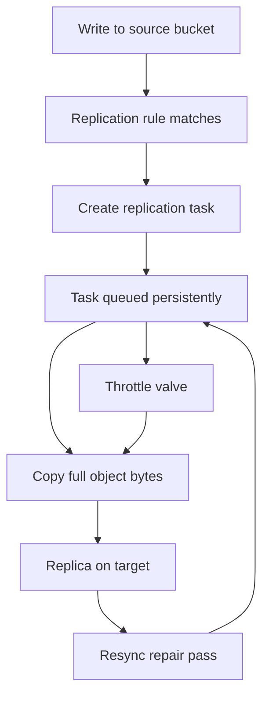

# Replication Bandwidth, Resync, and the Operational Reality of Bucket Replication

## English

Bucket replication sounds simple: objects written to one bucket appear in another. But the mechanism behind it is a queue, and queues need care. When you configure replication, MinIO records a replication configuration on the source bucket, and each write that matches the rule creates a replication task. Those tasks are tracked persistently, so that if the target is briefly unreachable — a network blip, a target restart — MinIO can retry rather than silently dropping the object. This is why replication is described as asynchronous: the PUT to the source returns success once the source write is durable, not once the replica exists. Your application sees a fast write; the replica arrives later.

The most common operational surprise is bandwidth. Replication copies the full object bytes across the link, and for a cluster ingesting large media files or database backups, that can saturate a WAN link quickly. MinIO exposes bandwidth throttling controls so you can cap replication throughput, trading replication lag for headroom on the shared network. The right mental model is a pipe with a valve: if you open it fully, replication keeps up but steals bandwidth from foreground traffic; if you close it partly, foreground stays healthy but the replica falls behind. Monitoring replication lag — how far behind the target is — is the signal that tells you which way to turn the valve.

Another subtlety is what happens when replication falls badly out of sync, for example after the target has been offline for days. MinIO provides a resync mechanism that re-scans the source bucket and re-queues objects that should exist on the target but do not, or whose versions differ. This is not the same as initial replication; it is a repair pass. Knowing that resync exists changes how you plan outages: you do not need to panic about a target being down for a maintenance window, but you do need to run resync afterward and watch it complete, because until it does, the target is not a faithful copy.

Versioning interacts with replication in ways that trip people up. If the source bucket has versioning enabled (which replication generally requires, since it needs to track object versions), then deletes and overwrites become version events too. A delete marker on the source may or may not be replicated depending on configuration, and a delete-marker replication policy decides whether deletions propagate. Getting this wrong means a target that accumulates objects the source has deleted, or one that loses objects the source still has. The safe approach is to decide explicitly what deletion semantics you want and test them with a small bucket before trusting them with production data.

Finally, replication is not backup. A replica that receives every write also receives every bad write, including an accidental mass delete or a ransomware encryption pass. Replication protects against site loss and read locality; it does not protect against logical corruption. The healthy pattern is replication for availability plus a separate, versioned, immutable or offsite copy for recovery — often using object lock on the backup target. Treating replication as your only safety net is the operational equivalent of wearing one seatbelt in two different cars.

## 中文

Bucket 複製聽起來很簡單：寫入一個 bucket 的對象會出現在另一個 bucket。但它背後的機制是一個佇列，而佇列需要小心照料。當你設定複製時，MinIO 會在來源 bucket 上記錄一份複製組態，而每一筆符合規則的寫入都會建立一個複製任務。這些任務被持久地追蹤，因此如果目標短暫無法連線 — 網路瞬間中斷、目標重啟 — MinIO 可以重試，而不是默默丟掉對象。這就是為什麼複製被描述為非同步：對來源的 PUT 在來源寫入持久化後就回傳成功，而不是在副本存在之後。你的應用程式看到的是快速寫入；副本稍後才到。

最常見的營運意外是頻寬。複製會把完整的對象位元組跨越連結複製過去，而對於正在接收大型媒體檔案或資料庫備份的叢集，這可能很快塞爆一條廣域網路連結。MinIO 提供頻寬節流控制，讓你能限制複製吞吐量，用複製延遲換取共享網路上的餘裕。正確的心智模型是一根帶閥門的管子：全開，複製跟得上，但會搶走前景流量的頻寬；半開，前景保持健康，但副本會落後。監控複製延遲 — 目標落後多少 — 就是告訴你該往哪個方向轉閥門的訊號。

另一個微妙之處是：當複製嚴重脫節時會發生什麼，例如目標已離線數日之後。MinIO 提供重同步機制，會重新掃描來源 bucket，並把應該存在於目標卻不存在、或版本不同的對象重新排入佇列。這與初始複製不同；它是一趟修復。知道重同步存在，會改變你規劃停機的方式：你不必為目標在維護窗口期間離線而驚慌，但事後必須執行重同步並看著它完成，因為在它完成之前，目標並不是忠實的副本。

版本控制與複製的互動方式常讓人栽跟頭。如果來源 bucket 啟用了版本控制（複製通常要求如此，因為它需要追蹤對象版本），那麼刪除與覆寫也變成版本事件。來源上的刪除標記是否被複製取決於組態，而刪除標記複製策略決定刪除是否傳播。弄錯這點，意味著目標會累積來源已刪除的對象，或者丟失來源仍持有的對象。安全的做法是明確決定你要的刪除語意，並在小型 bucket 上測試，再放心用在生產資料上。

最後，複製不是備份。接收每一筆寫入的副本，也會接收每一筆壞寫入，包括意外的大量刪除或勒索軟體加密。複製防範的是站點損失與讀取就近性；它不防範邏輯性損壞。健康的模式是：以複製換取可用性，再加上另一份獨立、具版本、不可變或異地的副本用於復原 — 通常是在備份目標上使用對象鎖定。把複製當成唯一的安全網，在營運上等同於在兩輛不同的車上各繫一條安全帶。

## Key Takeaway

Replication is an asynchronous queue with bandwidth and versioning consequences, and it complements but never replaces a separate immutable backup.

## Related Concepts
- Replication resync
- Delete marker replication

## Diagram

